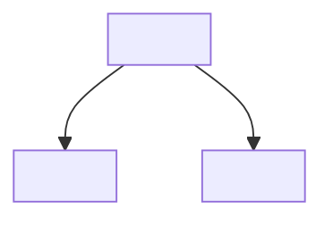

# UI Spec: `<ComponentOrViewName>`

> **File:** `app/qml/<views|components>/<Name>.qml`
> **Pack:** `<00..07-...md>`
> **Legacy Reference:** `<src/Classes/...lua or port-plan/reference/...>`
> **Status:** `Draft | Reviewed | Test-Covered`

---

## 1. Purpose & Parity Notes
- **Role:** 1-2 sentences on what the user accomplishes with this view/component.
- **Intentional Deviations from Legacy PoB:** List any approved UX changes (e.g., Import tab guided flow), or write `None (1:1 functional parity)`.

---

## 2. Lightweight Wireframe & Layout Box Model

### Default Window (`1100x720`)
```text
+-------------------------------------------------------------------+
| [Header / Toolbar Row]                                            |
+---------------------------------+---------------------------------+
| Left Column / Panel             | Right Column / Panel            |
|  [Control 1]  [Dropdown v]      |  [List / Detail Area]           |
+---------------------------------+---------------------------------+
| [Status / Footer Strip]                                           |
+-------------------------------------------------------------------+
```

### Responsive / Overflow Rules
- **Minimum safe width/height:** `<e.g., 960x640>`
- **Horizontal scroll policy:** `<Forbidden | Allowed only in table X>`
- **Text truncation policy:** `<Wrap | ElideRight + hover tooltip showing full text>`

### Component Hierarchy


---

## 3. Interactive States & Controls

| Control (`objectName`) | Type | Default State | Interactive Behavior | Edge States (Disabled / Empty / Loading / Error / Long Text) |
| :--- | :--- | :--- | :--- | :--- |
| `pob.<scope>.<name>` | `DropDownControl` | Enabled / `<value>` | Opens popup, filters on type, commits on click/Enter | Disabled when `<cond>` with tooltip `<reason>`; elides long text |

---

## 4. Data & Bridge Contract
- **Reads (`LuaEngine` / C++ Models):** `<e.g., luaEngine.invoke("pob_...", []) -> { items: QVariantList }>`
- **Writes / Mutations:** `<e.g., luaEngine.invoke("pob_set...", [...])>`
- **Signals Observed:** `<e.g., buildDataChanged, itemsChanged>`
- **Qt6 Bridge Safety:** Every list returned from Lua MUST be normalized via `QmlBridge.toArray()` (never raw `Array.isArray()`).

---

## 5. Testable Acceptance Criteria (`Qt6::QuickTest`)

- **AC-01 (Initial Render & Zero Warnings):** Given `<precondition>`, when `<view/component>` loads, then `0` QML warnings are emitted and all visible controls have `width > 0 && height > 0`.
- **AC-02 (No Text Overflow / Clipping):** At `960x640`, `1100x720`, and `1600x900`, no visible text has `paintedWidth > width + 1` without `elide` + hover tooltip fallback.
- **AC-03 (Primary User Flow):** Given `<state>`, when user `<clicks/types/selects>`, then `<UI state + Lua/stat outcome>`.
- **AC-04 (Keyboard & Focus):** Tab order, `Enter` confirm, `Esc` cancel, and view shortcuts work as specified.
- **AC-05 (Empty / Error / Disabled States):** `<exact expected UI state and user-facing reason>`.

---

## 6. Bug Audit Findings (Current Implementation vs Spec)

| Severity | File & Line | Symptom / Defect | Root Cause | Expected Behavior |
| :--- | :--- | :--- | :--- | :--- |
| `High / Med / Low` | `<file:line>` | `<what breaks for the user>` | `<exact QML/bridge bug>` | `<correct behavior per AC-XX>` |
