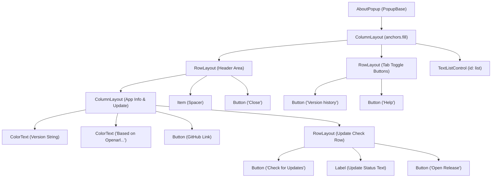

# UI Spec: AboutPopup
**File:** `app/qml/components/AboutPopup.qml`  **Pack:** `00-shell-and-theme.md`  **Legacy Reference:** `src/Modules/Main.lua:1356-1460` (`main:OpenAboutPopup`)  **Status:** Test-Covered

--------------------------------------------------------------------------------

## 1. Purpose & Parity Notes
*   **Role:** Information and utility dialog displaying the Path of Building Community version, attribution, GitHub repository link, update status / manual update checker, and dual-tabbed display for Version History (`changelog.txt`) and Help Documentation (`help.txt`).
*   **Intentional Deviations from Legacy PoB:** None (1:1 functional parity). Includes support for deep-linking directly into a specific Help section when summoned via context-sensitive help triggers (F1 key).

--------------------------------------------------------------------------------

## 2. Lightweight Wireframe & Layout Box Model
# Default Modal Layout (810x628)
```text
+-----------------------------------------------------------------------------------+
|  About                                                                        [X] |
+-----------------------------------------------------------------------------------+
|  Path of Building Community Fork v2.48.0                                [ Close ] |
|  Based on Openarl's Path of Building                                              |
|  [ GitHub: github.com/PathOfBuildingCommunity/PathOfBuilding                    ] |
|  [ Check for Updates ]  ^2Update available: 2.49.0  [ Open Release ]              |
|                                                                                   |
|  [ Version history (Locked) ]  [ Help ]                                           |
|  +------------------------------------------------------------------------------+ |
|  | 2.48.0 (2024-03-15):                                                         | |
|  |   - Added Necropolis league passive tree changes.                            | |
|  |   - Fixed calculation bug for Archmage Support mana scaling.                 | |
|  |                                                                              | |
|  | 2.47.1 (2024-02-10):                                                         | |
|  |   - Updated gem data and added transfigured gem mechanics.                   | |
|  +------------------------------------------------------------------------------+ |
+-----------------------------------------------------------------------------------+
```

# Responsive / Overflow Rules
*   **Minimum safe dimensions:** 810x600 px (Clamped to fit within 960x640 host window).
*   **Horizontal scroll policy:** Forbidden. Text in `TextListControl` wraps or truncates at defined column bounds.
*   **Text truncation policy:** Changelog and Help entries render in multi-line flow; GitHub and update URLs are fixed width.

# Component Hierarchy


--------------------------------------------------------------------------------

## 3. Interactive States & Controls
| Control (objectName) | Type | Default State | Interactive Behavior | Edge States (Disabled / Empty / Loading / Error / Long Text) |
| ------ | ------ | ------ | ------ | ------ |
| `pob.about.githubBtn` | `Button` | Enabled | Opens GitHub URL in system external web browser | Accessible focus ring; fixed width 440 px |
| `pob.about.checkUpdateBtn` | `Button` | Enabled | Invokes `luaEngine.invoke("pob_checkForUpdates", [{ force: true }])` | Disabled when `updateState.checking == true` |
| `pob.about.statusLabel` | `Label` | Empty / Initial status | Reflects update check progress: Checking, Up to date, Available, Error | Red (`^1`) on error; Green (`^2`) when new version found |
| `pob.about.openReleaseBtn` | `Button` | Hidden (`visible: false`) | Opens download release page in browser | Visible only when `updateState.status === "available"` |
| `pob.about.closeBtn` | `Button` | Enabled | Closes dialog via `accept()` | Default accept action on Enter key |
| `pob.about.historyTab` | `Button` | Locked (`showHelp == false`) | Switches list content to `changelog.txt` model | Locked style indicates active tab selection |
| `pob.about.helpTab` | `Button` | Unlocked | Switches list content to `help.txt` model | Locked style indicates active tab selection |
| `pob.about.list` | `TextListControl` | Displaying Version History | Scrolls through formatted changelog or help sections | Smooth scroll; preserves scroll target on tab switch |

# State Matrix & Binding Hazards
*   *Scroll Timing Hazard:* `openAtSection(tabNameLower)` invokes `list.setScrollOffset(target)` via `Qt.callLater`. If the popup height has not yet finished geometry layout, the target offset can be clamped prematurely. Ensure layout completion before applying scroll offsets.
*   *Stale Update Connection:* `Connections` targeting `luaEngine` for `onUpdateChanged` must safely handle null engine states during teardown.

--------------------------------------------------------------------------------

## 4. Data & Bridge Contract
*   **Reads (LuaEngine / C++ Models):**
    *   `luaEngine.invoke("pob_getUpdateState")` -> `{ checking: bool, status: string, latestVersion: string, releaseUrl: string, error: string }`
    *   `root.content` (pre-parsed in shell): `{ versionNumber: string, changeList: QVariantList, changeVersionHeights: QVariantList, helpList: QVariantList, helpSections: QVariantList, helpSectionHeights: QVariantList }`
*   **Writes / Mutations:**
    *   `luaEngine.invoke("pob_checkForUpdates", [{ force: true }])`
    *   `luaEngine.openURL(url)` / `Qt.openUrlExternally(url)`
*   **Signals Observed:**
    *   `luaEngine.onUpdateChanged` -> triggers `refreshUpdateState()`
*   **Qt6 Bridge Safety:** Pre-parsed text arrays passed to `TextListControl.list` must be validated via `QmlBridge.toArray()` to guard against raw QVariantMap wrapping.

--------------------------------------------------------------------------------

## 5. Testable Acceptance Criteria (Qt6::QuickTest)
*   **AC-01 (Initial Render & Zero Warnings):** Opening `AboutPopup` loads without QML console errors, displaying the correct Community version string.
*   **AC-02 (No Text Overflow / Clipping):** Modal contents fit within 810x628 px envelope without vertical clipping of action buttons.
*   **AC-03 (Primary User Flow):** Clicking `Help` switches the active view to help documentation, locking the Help tab button and displaying help text.
*   **AC-04 (Deep Link Section Navigation):** Calling `openAtSection("skills")` opens the dialog, selects the Help tab, and scrolls `TextListControl` to the Skills heading.
*   **AC-05 (Empty / Error / Disabled States):** When `updateState.status === "error"`, error description is rendered in red (`^1`) and `Open Release` button remains hidden.

--------------------------------------------------------------------------------

## 6. Bug Audit Findings (Current Implementation vs Spec)
| Severity | File & Line | Symptom / Defect | Root Cause | Expected Behavior |
| ------ | ------ | ------ | ------ | ------ |
| Med | `app/qml/components/AboutPopup.qml:4950` | Height 628 px overflows minimum safe host height (640 px window - 32 px title/taskbar) | Fixed height set to 628 px | Constrain height to `Math.min(600, parent.height - 30)` |
| Low | `app/qml/components/AboutPopup.qml:4960` | `setScrollOffset` called before `TextListControl` geometry stabilizes | Single `Qt.callLater` executes before layout pass | Defer scroll until view completes initial layout |
| Low | `app/qml/components/AboutPopup.qml:5070` | TextListControl columns hardcoded at x=1, x=135 | Fixed pixel offsets overlap on high-DPI font scaling | Calculate second column offset dynamically from font metrics |
