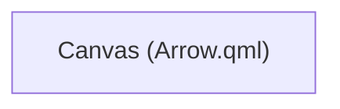

# UI Spec: Arrow
**File:** `app/qml/components/Arrow.qml`  **Pack:** `01-core-components.md`  **Legacy Reference:** `src/Modules/Main.lua:1438` (`main:DrawArrow`)  **Status:** Test-Covered

--------------------------------------------------------------------------------

## 1. Purpose & Parity Notes
*   **Role:** Directional vector triangle glyph used as the expansion indicator in `DropDownControl`, step buttons in `ScrollBar`, chevrons in `PathControl`, and detented slider split knobs.
*   **Intentional Deviations from Legacy PoB:**
    *   *Canvas Vector Rendering:* Legacy PoB issues immediate-mode `DrawImageQuad` calls using normalized coordinate math. Arrow encapsulates drawing inside an HTML5-style Qt Quick `Canvas` element, repainting whenever `direction`, `glyphColor`, or dimensions change.

--------------------------------------------------------------------------------

## 2. Lightweight Wireframe & Layout Box Model
# Component Box Model & Layout
```text
+-------------------------------------------------------------------------------+
| Arrow (Canvas primitive)                                                      |
| property string direction: "down" ("up", "down", "left", "right")             |
| property color glyphColor: theme.text                                         |
| width / height: matches parent allocation (e.g. 9x5px in dropdowns)           |
+-------------------------------------------------------------------------------+
```

# ASCII Anatomy & Wireframe
```text
Directional Orientations:
1. Down (Default):          2. Up:
   (x1, y1)  (x2, y1)           (xMid, y1)
      +----------+                  /\
       \        /                  /  \
        \      /                  /    \
         \    /                  /      \
          \  /                  +--------+
           \/               (x1, y2)  (x2, y2)
        (xMid, y2)

3. Left:                    4. Right:
          (x2, y1)          (x1, y1)
             /|             |\
            / |             | \
   (x1,yMid)< |             | >(x2,yMid)
            \ |             | /
             \|             |/
          (x2, y2)          (x1, y2)
```

# Responsive / Overflow Rules
*   **Minimum safe width/height:** 4x4px; typical sizes range from 9x5px (dropdowns) to 12x12px (scrollbars).
*   **Aspect Ratio Policy:** Fills the full assigned bounding box with an isosceles triangle; apex points toward `direction`.

# Component Hierarchy


--------------------------------------------------------------------------------

## 3. Interactive States & Controls
| Control (objectName) | Type | Default State | Interactive Behavior | Edge States (Disabled / Empty / Loading / Error / Long Text) |
| ------ | ------ | ------ | ------ | ------ |
| `pob.arrow.root` | Canvas | `direction: "down"` | Repaints vector path on geometry or color change | Mutes glyph color when host control is disabled. |

# State Matrix & Binding Hazards
*   *Canvas Repaint Latch:* Qt Quick `Canvas` does not repaint automatically on property changes unless explicitly notified. Property change observers (`onDirectionChanged`, `onGlyphColorChanged`, `onWidthChanged`, `onHeightChanged`) must invoke `requestPaint()` to ensure dynamic updates (e.g. dropdown opening) reflect immediately.
*   *Zero Dimension Check:* Drawing on a canvas with width or height `<= 0` can emit graphics context warnings; `onPaint` must guard against zero dimensions.

--------------------------------------------------------------------------------

## 4. Data & Bridge Contract
*   **Reads (Properties):**
    *   `direction: string` -> `"up"`, `"down"`, `"left"`, `"right"`
    *   `glyphColor: color` -> fill color (defaults to `theme.text`)
*   **Writes / Mutations:** None (presentation component).
*   **Signals Observed:** None.
*   **Qt6 Bridge Safety:** Invalid direction strings gracefully fall back to `"down"`.

--------------------------------------------------------------------------------

## 5. Testable Acceptance Criteria (Qt6::QuickTest)
*   **AC-01 (Initial Render & Zero Warnings):** Given `direction: "down"`, when `Arrow.qml` mounts, 0 QML warnings are logged and canvas requests paint.
*   **AC-02 (Directional Vertex Mapping):** When `direction` is changed to `"up"`, `onPaint` constructs a path with apex at `(width / 2, 0)`.
*   **AC-03 (Color Synchronization):** When `glyphColor` is updated to `theme.muted`, canvas repaints with the new fill style.

--------------------------------------------------------------------------------

## 6. Bug Audit Findings (Current Implementation vs Spec)
| Severity | File & Line | Symptom / Defect | Root Cause | Expected Behavior |
| ------ | ------ | ------ | ------ | ------ |
| Low | `app/qml/components/Arrow.qml:55` | Arrow glyph appears fuzzy or distorted on fractional devicePixelRatio displays. | Canvas rendering at non-integral pixel bounds. | Snap canvas bounds to integer coordinates inside delegate layouts. |
