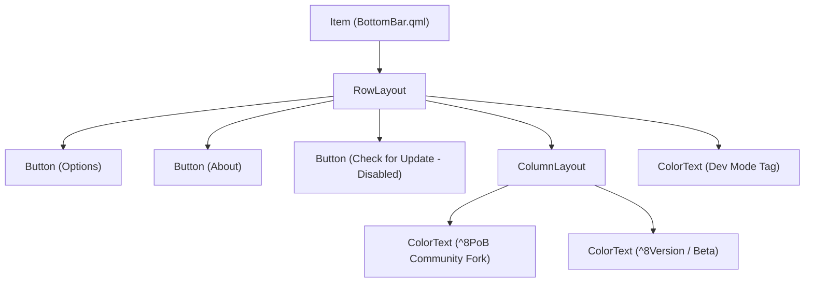

# UI Spec: BottomBar
**File:** `app/qml/components/BottomBar.qml`  **Pack:** `00-shell-and-theme.md`  **Legacy Reference:** `src/Modules/Main.lua:205-240` (`main:Init` `anchorMain`)  **Status:** Test-Covered

--------------------------------------------------------------------------------

## 1. Purpose & Parity Notes
*   **Role:** The persistent bottom status and utility strip of the application window. Houses access to global dialogs (Options, About / Version History), displays application build versioning, branch metadata, dev mode status tags, and contains the update checker trigger.
*   **Intentional Deviations from Legacy PoB:**
    *   *Dialog hosting:* BottomBar does not construct or manage `OptionsDialog` or `AboutPopup` directly. It fires `optionsRequested()` and `aboutRequested(section)` signals, allowing `main.qml` to coordinate modal focus and window overlay hierarchy.
    *   *Update checking:* The "Check for Update" button is rendered in an inert, disabled state with a descriptive tooltip explaining that update checking is deferred to Phase 10/14 network integration.
    *   *Dev Mode rendering:* Renders dev mode as a standalone `ColorText` element (`^1Dev Mode`) gated on `aboutContent.devMode`.

--------------------------------------------------------------------------------

## 2. Lightweight Wireframe & Layout Box Model
# Component Box Model & Layout
```text
+-----------------------------------------------------------------------------------------------------------------------+
| BottomBar (implicitHeight: 24px)                                                                                      |
| RowLayout (anchors.left: parent.left, anchors.bottom: parent.bottom, margins: 4px, spacing: 4px)                      |
| +----------------+----------------+--------------------------+-------------------------------------+----------------+ |
| | [Options]      | [About]        | [Check for Update]       | PoB Community Fork                  | ^1Dev Mode     | |
| | 68x20px        | 68x20px        | 140x20px (Disabled)      | Version: 2.48.0 (Dev)               | (visible if    | |
| | Button         | Button         | Button                   | ColumnLayout (2x ColorText ^8)      | devMode==true) | |
| +----------------+----------------+--------------------------+-------------------------------------+----------------+ |
+-----------------------------------------------------------------------------------------------------------------------+
```

# ASCII Anatomy & Wireframe
```text
+--------------------------------------------------------------------------------------------------------+
| [ Options ]  [ About ]  [ Check for Update ]  PoB Community Fork                 ^1Dev Mode            |
|                                               Version: 2.48.0                                          |
+--------------------------------------------------------------------------------------------------------+
     (1)          (2)             (3)                     (4)                          (5)

Annotations:
(1) Options Button: 68x20px, emits optionsRequested() on click.
(2) About Button: 68x20px, emits aboutRequested("") on click.
(3) Check for Update Button: 140x20px, controlEnabled: false, hover displays implementation tooltip.
(4) Version Metadata Block: Two lines of theme.fontSizeSm ColorText (^8 color code).
    Top: "PoB Community Fork"
    Bottom: "Version: <num>", "Beta: <num>", or appends " (Dev)".
(5) Dev Mode Tag: Visible only when devMode is true; colored theme.danger (^1).
```

# Responsive / Overflow Rules
*   **Minimum safe width/height:** 600x24px. Fits comfortably within the minimum application width (960px).
*   **Horizontal scroll policy:** Forbidden. Anchored to the left and bottom of its parent container.
*   **Text truncation policy:** Font sizes use `theme.fontSizeSm` (10-11px). No wrapping; strings are deterministic based on build metadata.

# Component Hierarchy


--------------------------------------------------------------------------------

## 3. Interactive States & Controls
| Control (objectName) | Type | Default State | Interactive Behavior | Edge States (Disabled / Empty / Loading / Error / Long Text) |
| ------ | ------ | ------ | ------ | ------ |
| `pob.bottombar.options` | Button | Enabled / "Options" | On click, emits `optionsRequested()` | Standard button hover/pressed animations. |
| `pob.bottombar.about` | Button | Enabled / "About" | On click, emits `aboutRequested("")` | Standard button hover/pressed animations. |
| `pob.bottombar.update` | Button | Disabled / "Check for Update" | Click has no effect; shows informative tooltip on hover | `controlEnabled: false`; cursor defaults to standard pointer. |
| `pob.bottombar.fork` | ColorText | "^8PoB Community Fork" | Static label | Formatted with `theme.fontSizeSm`. |
| `pob.bottombar.version` | ColorText | Dynamic Version | Static label | Displays "Beta: <ver>", "Version: <ver>", or appends " (Dev)". |
| `pob.bottombar.devMode` | ColorText | Hidden (`devMode == false`) | Static warning label | Visible when `devMode == true`; text is `^1Dev Mode` with `theme.danger`. |

# State Matrix & Binding Hazards
*   *Static Payload Fetching:* `luaEngine.getAboutContent()` fetches static session metadata (changelogs, help text, version number, branch name, dev mode flag). It is evaluated once as a read-only property to prevent continuous C++/Lua bridge polling.
*   *Popup Coupling Hazard:* BottomBar must never instantiate `OptionsDialog` or `AboutPopup` internally. Stacking modals inside a 24px item disrupts QML z-indexing and bounds clipping. All modal triggers must bubble up via signals.

--------------------------------------------------------------------------------

## 4. Data & Bridge Contract
*   **Reads (LuaEngine / C++ Models):**
    *   `luaEngine.getAboutContent()` -> `{ versionNumber: string, versionBranch: string, devMode: bool, changelog: string, help: string }`
*   **Writes / Mutations:** None (BottomBar is purely read/dispatch).
*   **Signals Observed:** None.
*   **Qt6 Bridge Safety:** Safe fallback when `aboutContent` is null or undefined: `versionNumber` and `versionBranch` default to empty strings, `devMode` defaults to `false`.

--------------------------------------------------------------------------------

## 5. Testable Acceptance Criteria (Qt6::QuickTest)
*   **AC-01 (Initial Render & Zero Warnings):** When `BottomBar.qml` mounts, 0 QML warnings are emitted, `implicitHeight` is exactly 24px, and all buttons render with valid bounding boxes.
*   **AC-02 (Options & About Signals):** When clicking the "Options" or "About" buttons, the corresponding `optionsRequested()` and `aboutRequested("")` signals are emitted exactly once per click.
*   **AC-03 (Update Button Invariance):** The "Check for Update" button is permanently disabled (`controlEnabled === false`), and hovering over it displays the tooltip: `"Update checking is not yet implemented in this port (Phase 10/14)."`.
*   **AC-04 (Version String Formatting):** When `aboutContent.versionBranch === "beta"`, the version string begins with `"Beta: "`; when `devMode === true`, the string appends `" (Dev)"` and the red dev mode label is visible.

--------------------------------------------------------------------------------

## 6. Bug Audit Findings (Current Implementation vs Spec)
| Severity | File & Line | Symptom / Defect | Root Cause | Expected Behavior |
| ------ | ------ | ------ | ------ | ------ |
| Low | `app/qml/components/BottomBar.qml:49` | Missing explicit bottom-bar background allows underlying views to show through during full-screen scrolls. | `BottomBar.qml` root item is a transparent `Item` without a backing `Rectangle`. | Add background fill with `theme.bottomBarBg` or rely on shell container background. |
| Low | `app/qml/components/BottomBar.qml:55` | Dev mode indicator overlaps version string on narrow screens (< 500px). | `RowLayout` lacks wrapping or minimum width constraints. | Ensure root minimum width or set `Layout.fillWidth: false` on version block. |
