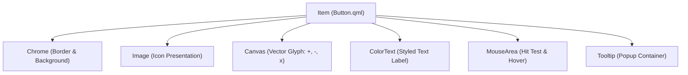

# UI Spec: Button
**File:** `app/qml/components/Button.qml`  **Pack:** `01-core-components.md`  **Legacy Reference:** `src/Classes/ButtonControl.lua` (~250 call sites)  **Status:** Test-Covered

--------------------------------------------------------------------------------

## 1. Purpose & Parity Notes
*   **Role:** Universal interactive push button used throughout all views, popups, and toolbars. Supports text labels, PoB color-coded strings, graphical image icons, and mathematical glyph shorthands (`+`, `-`, `x`), integrated with the Cyber Citrus chrome surface and hover tooltips.
*   **Intentional Deviations from Legacy PoB:**
    *   *Hover Eventing:* In legacy PoB, `onHover` is polled every single draw frame inside `ButtonControl:Draw()`. In Qt Quick's retained-mode architecture, `onHover` is invoked once upon mouse-enter; continuous polling is replaced by binding directly to the `hovered` property.
    *   *Tooltip Hosting:* Tooltip is hosted as an internal child component mapped to window contentItem coordinates rather than requiring a global window draw layer.
    *   *Visual Styling:* Uses `Chrome.qml` (flat navy background, Cyber Citrus borders, rounded corners) instead of legacy SimpleGraphic 5-step beveled greyscale rectangles.

--------------------------------------------------------------------------------

## 2. Lightweight Wireframe & Layout Box Model
# Component Box Model & Layout
```text
+-------------------------------------------------------------------------------+
| Button (implicitHeight: 24px, implicitWidth: dynamic or 80px)                 |
| Chrome (anchors.fill: parent, hovered, pressedLook, locked, controlEnabled)   |
| +---------------------------------------------------------------------------+ |
| | [Image: img] (visible if imageSource != "", margins: 2px)                 | |
| | [Canvas: glyph] (visible if label is "+", "-", or "x")                    | |
| | [ColorText: labelText] (visible if text label, margins: 3px, center/elide)| |
| +---------------------------------------------------------------------------+ |
| MouseArea [ma] (anchors.fill: parent, hoverEnabled: true)                     |
| Tooltip [tt] (local coordinates, viewport-flipped against Window.window)     |
+-------------------------------------------------------------------------------+
```

# ASCII Anatomy & Wireframe
```text
Standard Text Button:
+-------------------------------------------------+
|  [3px pad]       Save As Build        [3px pad] | (1)
+-------------------------------------------------+
  |<-------------- implicitWidth ---------------->|

Glyph Button ('+'):
+------+
|  +   | (2)
+------+
  24px

Disabled Button with Tooltip Active:
+ - - - - - - - - - - - - - - - - - - - - - - - - +
:  Check for Update (disabled look, theme.muted)  : (3)
+ - - - - - - - - - - - - - - - - - - - - - - - - +
  |
  v (Tooltip viewport flipped)
  +-----------------------------------------------+
  | Feature deferred to Phase 14 network update   | (4)
  +-----------------------------------------------+

Annotations:
(1) Standard Text Button: ColorText centered, font auto-sized to Math.min(theme.fontSize, height - 4).
(2) Canvas Glyph Button: mathematical vector rendering for '+', '-', 'x'; drawn using theme.text or theme.muted.
(3) Disabled Button: controlEnabled: false renders muted border/text while MouseArea remains active.
(4) Tooltip: displays single-line tooltipText, multi-line tooltipFunc(tt), or full label if truncated.
```

# Responsive / Overflow Rules
*   **Minimum safe width/height:** 24x20px for glyph buttons; 80x24px default fallback for image/custom buttons.
*   **Horizontal sizing policy:** If a text label is present, `implicitWidth` expands to `Math.max(24, Math.ceil(labelText.implicitWidth) + horizontalPadding * 2)`.
*   **Text truncation policy:** `labelText` elides right (`Text.ElideRight`). If text overflows its bounded width (`labelText.truncated === true`), hovering automatically displays the full label text in a tooltip.
*   **Z-Order & Tooltip Flip:** Tooltips calculate position via `mapToItem(win.contentItem, 0, 0)` and flip automatically if overflowing window edges.

# Component Hierarchy


--------------------------------------------------------------------------------

## 3. Interactive States & Controls
| Control (objectName) | Type | Default State | Interactive Behavior | Edge States (Disabled / Empty / Loading / Error / Long Text) |
| ------ | ------ | ------ | ------ | ------ |
| `pob.button.root` | Item | `controlEnabled: true` | Dispatches clicks and manages hover/tooltip cycle | Renders muted when `controlEnabled === false`. |
| `pob.button.chrome` | Chrome | Idle (`transparent`) | Reflects hovered, pressed, locked, and disabled colors | Displays `theme.disabled` fill when disabled. |
| `pob.button.text` | ColorText | `label` string | Renders text with PoB color codes (`^0-^9`, `^xRRGGBB`) | Elides right; sets `theme.muted` when disabled. |
| `pob.button.glyph` | Canvas | Hidden (`isGlyph: false`) | Paints vector lines for `+`, `-`, or `x` | Redraws on size or color change. |
| `pob.button.image` | Image | Hidden (`imageSource: ""`) | Displays external graphical icon | Opacity drops to 0.33 when disabled. |
| `pob.button.ma` | MouseArea | `hoverEnabled: true` | Tracks mouse enter/exit; gates `clicked()` signal | Remains enabled when disabled to allow tooltips. |

# Complete State Matrix
*   **Default (Idle):** `hovered: false`, `pressedLook: false`, `color: "transparent"`, `border: theme.border`.
*   **Hovered:** `hovered: true`, `color: theme.hover`, `border: theme.borderStrong`, tooltip displayed after delay.
*   **Pressed:** `pressedLook: true` (`ma.pressed && ma.containsMouse`), `color: theme.active`.
*   **Locked (Toggled):** `locked: true`, `color: theme.hover`, `border: theme.borderStrong` (persists without hover).
*   **Disabled:** `controlEnabled: false`, `color: theme.disabled`, `text: theme.muted`, clicks suppressed, tooltips remain active.
*   **Text Truncated:** `labelText.truncated: true`, displays full unclipped text on hover even if `tooltipText` is empty.

# State Matrix & Binding Hazards
*   *Disabled Tooltip Trap:* Never disable the root `MouseArea` (`ma.enabled = false`) when `controlEnabled: false`. Disabled buttons in PoB frequently explain *why* they are disabled via tooltips (e.g., Save button when clean, update button). The click handler must gate execution (`if (root.controlEnabled) root.clicked()`) while hover remains active.
*   *Font Sizing Formula:* Font size auto-calculation `Math.max(8, Math.min(theme.fontSize, height - 4))` must guard against `height === 0` during initial layout passes by checking `(root.height > 0 ? root.height : root.implicitHeight) - 4`.

--------------------------------------------------------------------------------

## 4. Data & Bridge Contract
*   **Reads (Properties):**
    *   `label: string` -> text or glyph shorthand (`"+"`, `"-"`, `"x"`)
    *   `imageSource: url` -> icon path
    *   `locked: bool` -> persistent toggle active look
    *   `controlEnabled: bool` -> interactive state gate
    *   `tooltipText: string` -> static single-line tooltip
    *   `tooltipFunc: var` -> callback `function(tooltip)` for dynamic multiline tooltips
    *   `onHover: var` -> callback `function()` triggered on mouse-enter
*   **Writes / Signals Emitted:**
    *   `clicked()` -> emitted on mouse release within button bounds when `controlEnabled === true`
*   **Qt6 Bridge Safety:** Color escape sequences in `label` are parsed safely through `ColorText` (`toStyledText`) without crashing if malformed strings are passed.

--------------------------------------------------------------------------------

## 5. Testable Acceptance Criteria (Qt6::QuickTest)
*   **AC-01 (Initial Render & Zero Warnings):** Given a valid label, when `Button.qml` mounts, 0 QML warnings are logged, `implicitHeight === 24`, and `implicitWidth` matches text metric width plus horizontal padding.
*   **AC-02 (Click Suppression When Disabled):** Given `controlEnabled === false`, when the user clicks the button, `clicked()` signal is NOT emitted, and `Chrome` displays `theme.disabled`.
*   **AC-03 (Disabled Tooltip Preservation):** Given `controlEnabled === false` and `tooltipText: "Disabled Reason"`, when mouse hovers over the button, `tt.visible` evaluates to `true` and displays `"Disabled Reason"`.
*   **AC-04 (Auto-Tooltip on Truncation):** Given a button constrained to a narrow width (`width: 30`) with a long label (`label: "Very Long Button Text"`), when hovered without an explicit `tooltipText`, the tooltip opens displaying the full label.
*   **AC-05 (Glyph Rendering):** When `label: "+"`, `isGlyph` evaluates to `true`, `labelText.visible === false`, and `Canvas` paints cross lines using `theme.text` (or `theme.muted` if disabled).

--------------------------------------------------------------------------------

## 6. Bug Audit Findings (Current Implementation vs Spec)
| Severity | File & Line | Symptom / Defect | Root Cause | Expected Behavior |
| ------ | ------ | ------ | ------ | ------ |
| Medium | `app/qml/components/Button.qml:135` | Disabled glyph buttons render completely invisible on dark theme backgrounds. | Canvas glyph color fell back to `theme.background`, which matches `theme.disabled`. | Fallback to `theme.muted` when disabled: `controlEnabled ? theme.text : theme.muted`. |
| Medium | `app/qml/components/Button.qml:240` | Tooltip clips off-screen when button is situated near bottom or right screen edge. | Positioning in local unconstrained coordinates. | Map origin to `win.contentItem` and pass viewport rectangle into `tt.showAt()`. |
| Low | `app/qml/components/Button.qml:110` | Button implicit height collapses during dynamic layout recalculations. | Reading `height - 4` directly when `height` is temporarily 0. | Fall back to `(root.height > 0 ? root.height : root.implicitHeight) - 4`. |
