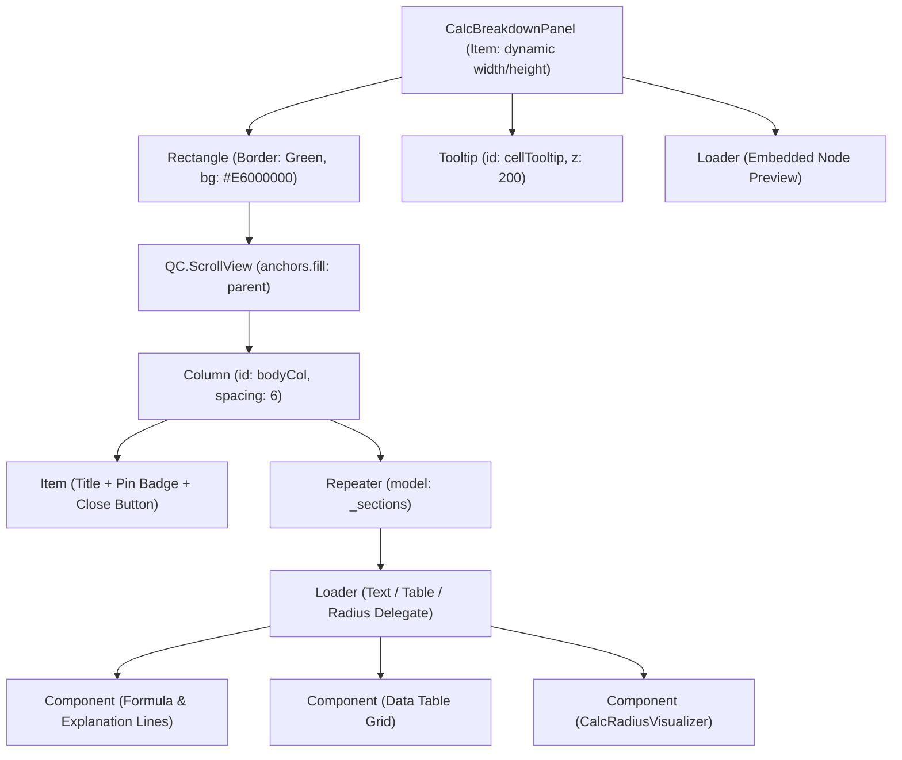

# UI Spec: CalcBreakdownPanel
**File:** `app/qml/components/CalcBreakdownPanel.qml`  **Pack:** `06-view-config-calcs.md`  **Legacy Reference:** `src/Classes/CalcBreakdownControl.lua`  **Status:** Test-Covered

--------------------------------------------------------------------------------

## 1. Purpose & Parity Notes
*   **Role:** Comprehensive contextual breakdown inspector popup rendering mathematical formula lines, multi-column source breakdown tables (mod source tabulations, reservations, damage type conversions), and embedded AoE radius visualizers. Supports both transient hover display and click-pinned inspection.
*   **Intentional Deviations from Legacy PoB:** In legacy Lua, hovering breakdown rows spawns immediate-mode secondary tooltips. In QML, cell tooltips dispatch cleanly to either a shared multiline tooltip, an item comparison tooltip (`pob_calcsItemTooltip`), or an embedded interactive passive tree preview (`TreeViewer` on `nodeId`).

--------------------------------------------------------------------------------

## 2. Lightweight Wireframe & Layout Box Model
# Default Panel Dimensions (Variable Width x Variable Height, Max: 600x480)
```text
+-------------------------------------------------------------+ <- Pinned: #40FF40
| Total Increased Life:                                   [X] | <- Title & Close (Pinned)
| ----------------------------------------------------------- |
| 14% increased maximum Life (Passive: Heart of the Oak)      | <- Text Lines Section
| 7% increased maximum Life (Cobalt Jewel)                    |
| +---------------------------------------------------------+ |
| | Source           | Base | Inc% | Total                  | | <- Table Section
| | ---------------- | ---- | ---- | ---------------------- | |
| | Base from Level  | 1245 |  --  | 1245                   | |
| | Strength Bonus   |  120 |  --  |  120                   | |
| | Equipment        |  350 |  --  |  350                   | |
| +---------------------------------------------------------+ |
| [ Embedded Radius Visualizer / Passive Tree Preview ]       |
+-------------------------------------------------------------+
```

# Responsive / Overflow Rules
*   **Minimum safe dimensions:** 180x120 px (Width adapts to content, max: `hostWidth - 16`; height max: `hostHeight - 8`).
*   **Horizontal scroll policy:** Forbidden. Table columns dynamically size based on `TextMetrics`.
*   **Text truncation policy:** Panel spawns a `QC.ScrollView` with custom scrollbars when content height exceeds host viewport limits.

# Component Hierarchy


--------------------------------------------------------------------------------

## 3. Interactive States & Controls
| Control (objectName) | Type | Default State | Interactive Behavior | Edge States (Disabled / Empty / Loading / Error / Long Text) |
| ------ | ------ | ------ | ------ | ------ |
| `pob.breakdown.frame` | `Rectangle` | Border: `#55AA55` | Container surface; border illuminates bright green (`#40FF40`) when pinned | Absorbs mouse clicks to prevent backdrop dismiss |
| `pob.breakdown.closeBtn` | `Button` | Visible if `pinned` | Emits `closeRequested()` to dismiss pinned breakdown | Hidden during transient hover mode |
| `pob.breakdown.tableCell` | `MouseArea` | Active if cell has tip | Hover shows source tooltip (lines, item tooltip, or passive node) | Dispatches to appropriate sub-tooltip engine |
| `pob.breakdown.treePreview` | `TreeViewer` | Hidden | Displays interactive passive skill tree focused on source notable | Instantiated on notable node hover |

# State Matrix & Binding Hazards
*   *Dynamic Smart Placement:* Position calculation (`x`, `y`) places the panel 5 px right of `anchorRect`. If the panel overflows `hostWidth`, it flips to the left (`anchorRect.x - 5 - width`) and clamps vertically inside `[2, hostHeight - height - 2]`.
*   *Scrollbar Width Budget:* When `needsScroll === true`, the content width budget adds 22 px to prevent the appearance of the vertical scrollbar from wrapping table cell text.

--------------------------------------------------------------------------------

## 4. Data & Bridge Contract
*   **Reads (LuaEngine / C++ Models):**
    *   `breakdownData`: `{ ok: bool, title: string, sections: QVariantList }`
    *   Section kinds: `"text"` (`lines: QVariantList`), `"table"` (`cols: QVariantList, rows: QVariantList`), `"radius"` (`radius: real, points: QVariantList`)
    *   `luaEngine.invoke("pob_calcsItemTooltip", [itemId, slot])` -> `{ lines: QVariantList }`
*   **Writes / Mutations (Signals Emitted):**
    *   `closeRequested()` -> signals host view to unpin and dismiss panel.
*   **Signals Observed:** None (Driven by active cell selection).
*   **Qt6 Bridge Safety:** Map `section.rows` and `section.cols` using `QmlBridge.toArray()`.

--------------------------------------------------------------------------------

## 5. Testable Acceptance Criteria (Qt6::QuickTest)
*   **AC-01 (Initial Render & Zero Warnings):** Setting `breakdownData` displays formatted breakdown lines and tables with zero QML console errors.
*   **AC-02 (Viewport Boundary Flip):** Positioning an anchor cell near the right edge of the screen flips panel layout to the left of the anchor.
*   **AC-03 (Pinned State Visual Styling):** Setting `pinned = true` shows the close button and switches border color from `#55AA55` to `#40FF40`.
*   **AC-04 (Table Cell Tooltip Dispatch):** Hovering a table row of kind `"lines"` renders the multi-source combination tooltip.
*   **AC-05 (Item Tooltip Integration):** Hovering an item source row invokes `pob_calcsItemTooltip` and renders the full item stat diff comparison card.

--------------------------------------------------------------------------------

## 6. Bug Audit Findings (Current Implementation vs Spec)
| Severity | File & Line | Symptom / Defect | Root Cause | Expected Behavior |
| ------ | ------ | ------ | ------ | ------ |
| Med | `app/qml/components/CalcBreakdownPanel.qml:2836` | Dynamic column width calculation crashes on empty table | `sec.cols.length` accessed without verifying array validity | Guard with `QmlBridge.toArray(sec.cols)` |
| Low | `app/qml/components/CalcBreakdownPanel.qml:2890` | Panel placement jitter when anchor cell height changes | `anchorRect.y` binding loops during scroll events | Coalesce layout updates via `Qt.callLater` |
| Low | `app/qml/components/CalcBreakdownPanel.qml:2922` | Passive tree preview stays visible after breakdown closes | `clearSubTooltips()` does not reset `_previewCellRect` | Clear `_previewCellRect = Qt.rect(0,0,0,0)` on close |
