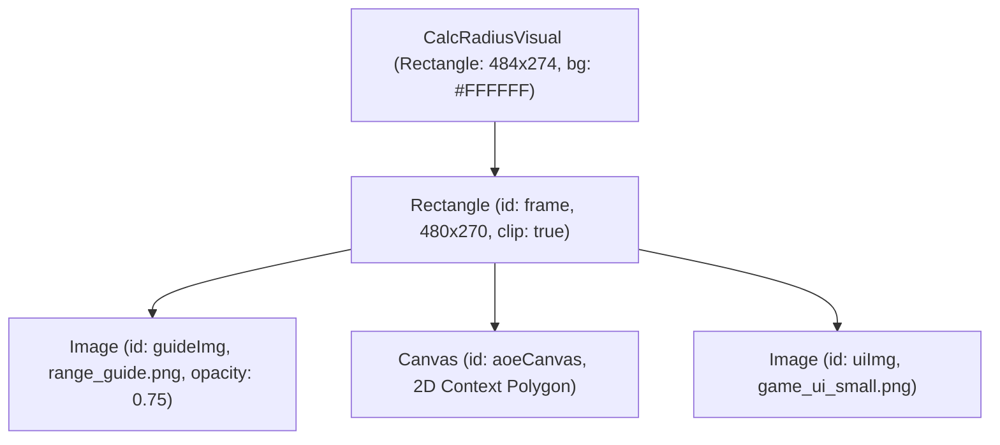

# UI Spec: CalcRadiusVisual
**File:** `app/qml/components/CalcRadiusVisual.qml`  **Pack:** `06-view-config-calcs.md`  **Legacy Reference:** `src/Classes/CalcBreakdownControl.lua:665` (`CalcBreakdownControl:DrawRadiusVisual`)  **Status:** Test-Covered

--------------------------------------------------------------------------------

## 1. Purpose & Parity Notes
*   **Role:** Specialized graphical AoE (Area of Effect) visualizer component rendering skill coverage radiuses over in-game environment scale guides.
*   **Intentional Deviations from Legacy PoB:** None (1:1 functional parity with legacy immediate-mode drawing). Replicates legacy 3-layer compositing: background range grid guide (`range_guide.png` at 0.75 opacity), Canvas 2D polygon rendering of the screen-projected AoE circle, and foreground HUD overlay (`game_ui_small.png`).

--------------------------------------------------------------------------------

## 2. Lightweight Wireframe & Layout Box Model
# Fixed Dimensions Envelope (484x274, Image Space: 480x270)
```text
+-------------------------------------------------------------+
| +---------------------------------------------------------+ | <- Border (2px)
| | [ Background: range_guide.png (opacity: 0.75)         ] | |
| |                                                         | |
| |              /''''''''''''''''''''''''\                 | |
| |             /  rgba(128, 255, 128, 0.33) \              | | <- AoE Canvas
| |            |        (AoE Circle)          |             | |
| |             \                            /              | |
| |              \........................../               | |
| |                                                         | |
| | [ Foreground: game_ui_small.png (HUD Overlay)         ] | |
| +---------------------------------------------------------+ |
+-------------------------------------------------------------+
```

# Responsive / Overflow Rules
*   **Minimum safe dimensions:** 484x274 px (Fixed coordinate space matching game screen projection).
*   **Horizontal scroll policy:** Forbidden.
*   **Text truncation policy:** Non-text visualizer; clips strictly at 480x270 frame boundaries.

# Component Hierarchy


--------------------------------------------------------------------------------

## 3. Interactive States & Controls
| Control (objectName) | Type | Default State | Interactive Behavior | Edge States (Disabled / Empty / Loading / Error / Long Text) |
| ------ | ------ | ------ | ------ | ------ |
| `pob.radiusVisual.canvas` | `Canvas` | Repaints on point change | Renders filled and stroked 2D polygon path | Clears surface if point count < 6 |
| `pob.radiusVisual.guide` | `Image` | Opacity 0.75 | Stretches range guide backdrop image | Fallback to blank if file URL missing |
| `pob.radiusVisual.ui` | `Image` | Visible | Stretches game UI overlay elements | Fallback to blank if file URL missing |

# State Matrix & Binding Hazards
*   *Coordinate Array Structure:* `polygonPoints` is a flat array `[x0, y0, x1, y1, ...]`. Canvas painting requires at least 3 vertices (6 coordinate points) to form a valid closed polygon.
*   *Paint Trigger Hazard:* Canvas does not automatically re-render when JavaScript arrays mutate in-place. Changes to `polygonPoints` or `radiusValue` explicitly invoke `aoeCanvas.requestPaint()`.

--------------------------------------------------------------------------------

## 4. Data & Bridge Contract
*   **Reads (LuaEngine / C++ Models):**
    *   `radiusValue`: `real` (effective radius in game units).
    *   `guidePath`: `string` (file path to `range_guide.png`).
    *   `overlayPath`: `string` (file path to `game_ui_small.png`).
    *   `polygonPoints`: `QVariantList` of flat screen-projected coordinates.
*   **Writes / Mutations:** None (Pure presenter component).
*   **Signals Observed:** None.
*   **Qt6 Bridge Safety:** Normalize Windows backslashes in `_fileUrl()` to guarantee valid `file:///` URI generation.

--------------------------------------------------------------------------------

## 5. Testable Acceptance Criteria (Qt6::QuickTest)
*   **AC-01 (Initial Render & Zero Warnings):** Mounting `CalcRadiusVisual` loads guide images and produces zero QML console warnings.
*   **AC-02 (Canvas Polygon Paint):** Providing 36 coordinate vertices renders a smooth green AoE polygon with `rgba(128, 255, 128, 0.33)` fill.
*   **AC-03 (Layering Order Verification):** Guide image renders behind Canvas; UI overlay renders in front of Canvas.
*   **AC-04 (File URL Formatting):** Windows paths formatted as `"C:/Path/..."` resolve with triple-slash (`file:///C:/...`).
*   **AC-05 (Zero / Insufficient Points Fallback):** Passing `polygonPoints: []` clears the canvas without throwing drawing errors.

--------------------------------------------------------------------------------

## 6. Bug Audit Findings (Current Implementation vs Spec)
| Severity | File & Line | Symptom / Defect | Root Cause | Expected Behavior |
| ------ | ------ | ------ | ------ | ------ |
| Med | `app/qml/components/CalcRadiusVisual.qml:3260` | Images fail to load on Windows platforms | `_fileUrl` does not replace backslashes with forward slashes | Add `.replace(/\\/g, '/')` before building file URL |
| Low | `app/qml/components/CalcRadiusVisual.qml:3290` | Canvas renders blurry on high-DPI retina screens | Missing pixel ratio canvas scaling | Set `renderTarget: Canvas.FramebufferObject` with `Screen.devicePixelRatio` scaling |
| Low | `app/qml/components/CalcRadiusVisual.qml:3305` | Stroke width does not scale with viewport zoom | Fixed 1 px stroke width | Use `ctx.lineWidth = Math.max(1, Math.round(Screen.devicePixelRatio))` |
