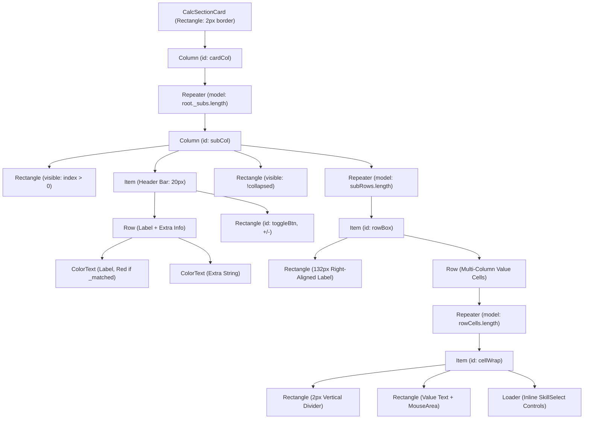

# UI Spec: CalcSectionCard
**File:** `app/qml/components/CalcSectionCard.qml`  **Pack:** `06-view-config-calcs.md`  **Legacy Reference:** `src/Classes/CalcSectionControl.lua`, `src/Modules/CalcsTab.lua`  **Status:** Test-Covered

--------------------------------------------------------------------------------

## 1. Purpose & Parity Notes
*   **Role:** Core modular calculation card component rendering an individual calculation section (e.g. Offence, Defence, Attributes, Skill Details) within the multi-column masonry grid of the Calcs tab. Supports collapsible primary and secondary subsections, live search-match highlighting, multi-column breakdown cells, and embedded skill selector comboboxes.
*   **Intentional Deviations from Legacy PoB:** None (1:1 functional parity with legacy `CalcSectionControl`). Uses retained-mode QML delegation for breakdown cell hover/click interactions rather than continuous immediate-mode coordinate hit-testing.

--------------------------------------------------------------------------------

## 2. Lightweight Wireframe & Layout Box Model
# Default Card Dimensions (230xAuto, 2px Colored Border)
```text
+-------------------------------------------------------------+ <- borderCol (2px)
| Life and Mana: [ Extra Info ]                           [-] | <- Header Bar (20px)
+-------------------------------------------------------------+
| Base Life:             | 1,245                              | <- Data Row (18px)
| % Inc. Life:           | +142%                              |
| Total Life:            | 3,013 (Breakdown Key)              |
+-------------------------------------------------------------+
| Secondary Subsection:                                   [-] | <- Divider (2px)
+-------------------------------------------------------------+
| Unreserved Life:       | 3,013                              |
| Life Regen:            | 185.4/s                            |
+-------------------------------------------------------------+
```

# Inline Skill Details Section Mode (Section 1: Special Mode)
```text
+-------------------------------------------------------------+
| View Skill Details:                                     [-] |
+-------------------------------------------------------------+
| Socket Group:  | [ 6L Body Armour: Lightning Strike       v]| <- 22px Row
| Active Skill:  | [ Lightning Strike                       v]|
| Skill Part:    | [ Projectiles                            v]|
| Calc Mode:     | [ Effective DPS                          v]|
+-------------------------------------------------------------+
```

# Responsive / Overflow Rules
*   **Minimum safe dimensions:** 230x22 px (Width bound to `sectionObj.width || 230`; height adapts dynamically to expanded subsections).
*   **Horizontal scroll policy:** Forbidden. Cell values elide right; labels elide left with colon suffix.
*   **Text truncation policy:** Section and row labels exceeding the 132 px left boundary elide left (`Text.ElideLeft`) so mod qualifiers remain legible.

# Component Hierarchy


--------------------------------------------------------------------------------

## 3. Interactive States & Controls
| Control (objectName) | Type | Default State | Interactive Behavior | Edge States (Disabled / Empty / Loading / Error / Long Text) |
| ------ | ------ | ------ | ------ | ------ |
| `pob.calcsCard.toggleBtn` | `Rectangle` | Expanded (`"-"`) | Clicking toggles subsection collapsed state | Toggles icon between `"+"` and `"-"` |
| `pob.calcsCard.label` | `ColorText` | Color: `^7` or `color` | Non-interactive text; highlights red (`^xFF0000`) if matched in search | Elides left within 132 px label width |
| `pob.calcsCard.cellMouse` | `MouseArea` | Active if `isInteractive` | Hover emits `cellHovered`; exit emits `cellUnhovered`; click emits `cellClicked` | Inactive if cell has no associated calculation breakdown |
| `pob.calcsCard.activeHl` | `Rectangle` | Hidden | Highlights cell green (`#40FF40`) when `cellObj.key === activeCellKey` | Renders 1 px border around active pinned cell |
| `pob.calcsCard.skillLoader` | `Loader` | Inactive | Loads specialized dropdown controls for Section 1 (`skillSelect`) | Instantiates only for special skill control rows |

# State Matrix & Binding Hazards
*   *Host Coordinate Translation:* Tooltip positioning requires translating local cell coordinates into host window coordinates. `_rectInHost(cellWrap)` uses `item.mapToItem(coordTarget, 0, 0)` to guarantee stable anchor rectangles regardless of masonry card placement.
*   *Breakdown Key Highlighting:* When a breakdown panel is pinned, `activeCellKey` highlights the originating cell with `#40FF40`. Stale cell keys must clear when calculations change.

--------------------------------------------------------------------------------

## 4. Data & Bridge Contract
*   **Reads (LuaEngine / C++ Models):**
    *   `sectionObj`: `{ index: int, label: string, colour: string, width: int, special: bool, subs: QVariantList }`
    *   `skillSelect`: `{ socketGroups: QVariantList, mainSocketGroup: int, mainSkill: int, mainSkillPart: int, mode: string }`
    *   `searchMatches`: Map of `{ [subKey]: bool, [rowKey]: bool }`
*   **Writes / Mutations (Signals Emitted):**
    *   `toggleSubsection(int sectionIndex, int subIndex)`
    *   `cellHovered(string cellKey, rect cellRect)`
    *   `cellUnhovered(string cellKey)`
    *   `cellClicked(string cellKey, rect cellRect)`
    *   `skillFieldChanged(string field, var value)`
    *   `manageSpectresRequested()`
*   **Signals Observed:** None (Pure presenter component).
*   **Qt6 Bridge Safety:** Normalize `sectionObj.subs` and `subObj.rows` using `QmlBridge.toArray()`.

--------------------------------------------------------------------------------

## 5. Testable Acceptance Criteria (Qt6::QuickTest)
*   **AC-01 (Initial Render & Zero Warnings):** Rendering `CalcSectionCard` populates subsections and rows according to `sectionObj` without QML errors.
*   **AC-02 (Subsection Collapsing):** Clicking `toggleBtn` emits `toggleSubsection`, switches button text to `"+"`, and collapses data rows.
*   **AC-03 (Search Match Highlighting):** Populating `searchMatches[rowKey] = true` turns the row label text bright red (`^xFF0000`).
*   **AC-04 (Breakdown Cell Hover Signal):** Hovering over an interactive cell emits `cellHovered(cellKey, hostRect)` with valid window coordinates.
*   **AC-05 (Special Skill Selector Sync):** In Section 1, changing `mainSocketGroup` updates the inline dropdown selection without re-triggering mutation signals.

--------------------------------------------------------------------------------

## 6. Bug Audit Findings (Current Implementation vs Spec)
| Severity | File & Line | Symptom / Defect | Root Cause | Expected Behavior |
| ------ | ------ | ------ | ------ | ------ |
| Med | `app/qml/components/CalcSectionCard.qml:3346` | Subsections fail to render if `sectionObj.subs` is a QVariantList | Raw `.length` checked without bridge array conversion | Wrap with `QmlBridge.toArray(sectionObj.subs)` |
| Low | `app/qml/components/CalcSectionCard.qml:3370` | Uncaught TypeError in `_indexOf` if list items are primitive types | Assumes `list[i][key]` property access | Guard with `list[i] && typeof list[i] === 'object'` |
| Low | `app/qml/components/CalcSectionCard.qml:3492` | Extremely long stat values overlap 2px vertical cell borders | Margin right set to 2 px without clipping | Ensure value container specifies `clip: true` |
