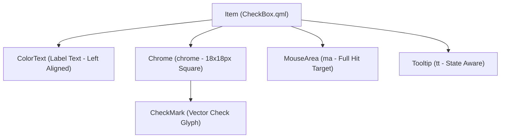

# UI Spec: CheckBox
**File:** `app/qml/components/CheckBox.qml`  **Pack:** `01-core-components.md`  **Legacy Reference:** `src/Classes/CheckBoxControl.lua`  **Status:** Test-Covered

--------------------------------------------------------------------------------

## 1. Purpose & Parity Notes
*   **Role:** Toggle control presenting a square checkbox with a checkmark glyph when checked, accompanied by a clickable label placed to the LEFT of the box living inside the unified hit area, an optional custom border color function override (`borderFunc`), and state-aware tooltip support.
*   **Intentional Deviations from Legacy PoB:**
    *   *Unified Hit-Testing:* Legacy PoB's `IsMouseOver` manually extends the hit-test bounding box to the left by `labelWidth`. CheckBox encapsulates both the label and the square box within a single root `Item`, providing natural hit-testing across both elements.
    *   *CheckMark Rendering:* Renders the checkmark using `CheckMark.qml` (vector-drawn theme accent glyph) rather than a bitmap texture.
    *   *State-Aware Tooltips:* Tooltip generation passes the CURRENT boolean state to `tooltipFunc(tooltip, state)`, directly matching legacy's `DrawTooltip(..., self.state)`.

--------------------------------------------------------------------------------

## 2. Lightweight Wireframe & Layout Box Model
# Component Box Model & Layout
```text
+-------------------------------------------------------------------------------+
| CheckBox (implicitHeight: 18px, implicitWidth: boxSize + labelWidth)          |
| +-----------------------------------------+ +-------------------------------+ |
| | ColorText [label]                       | | Chrome [chrome] (18x18px box) | |
| | (anchors.right: chrome.left, margin: 5) | |   CheckMark (visible: state)  | |
| | "Include In Full DPS"                   | |   border: _borderColor        | |
| +-----------------------------------------+ +-------------------------------+ |
| MouseArea [ma] (anchors.fill: parent, hoverEnabled: true)                     |
| Tooltip [tt] (state-aware: tooltipFunc(tt, root.state))                       |
+-------------------------------------------------------------------------------+
```

# ASCII Anatomy & Wireframe
```text
Unchecked State (with Label):
+----------------------------------------------------+
|  Include In Full DPS  [   ]                        | (1)
+----------------------------------------------------+
  |<-- labelWidth ---->| 5px |<- 18px ->|

Checked State:
+----------------------------------------------------+
|  Include In Full DPS  [ V ]                        | (2)
+----------------------------------------------------+
  CheckMark glyph colored theme.accent (Cyan/Lime)

Hovered with Custom Border (e.g. Config Option Warning):
+----------------------------------------------------+
|  Enemy is Boss:       [ V ]                        | (3)
+----------------------------------------------------+
  Border: _borderColor (derived from borderFunc() override)
```

# Responsive / Overflow Rules
*   **Minimum safe width/height:** 18x18px (box only, when `label === ""`).
*   **Horizontal sizing:** Expands to include `labelWidth` (`textMetrics.width(...) + 5px`) plus the square box size.
*   **Layout Alignment:** Label is right-aligned against the left edge of the checkbox square (`anchors.right: chrome.left; anchors.rightMargin: 5`).
*   **Hit-Test Bounding Box:** Clicking either the text label or the checkbox toggles the state.

# Component Hierarchy


--------------------------------------------------------------------------------

## 3. Interactive States & Controls
| Control (objectName) | Type | Default State | Interactive Behavior | Edge States (Disabled / Empty / Loading / Error / Long Text) |
| ------ | ------ | ------ | ------ | ------ |
| `pob.checkbox.root` | Item | `state: false` | Toggles state on click; emits `toggled(newState)` | Mutes colors when `controlEnabled === false`. |
| `pob.checkbox.chrome` | Chrome | 18x18px Square | Visual box surface | Applies `borderFunc()` override when unhovered. |
| `pob.checkbox.mark` | CheckMark | `visible: state` | Vector checkmark glyph | Displays `theme.accent` (or `theme.muted` if disabled). |
| `pob.checkbox.label` | ColorText | `label` string | Displays text to the left of the checkbox | Hidden if `label === ""`. |
| `pob.checkbox.ma` | MouseArea | `hoverEnabled: true` | Tracks hover and triggers toggle on click | Disabled clicks when `controlEnabled === false`. |

# Complete State Matrix
*   **Unchecked (Idle):** `state: false`, Box Fill: `transparent`, CheckMark: hidden.
*   **Checked (Idle):** `state: true`, Box Fill: `transparent`, CheckMark: visible (`theme.accent`).
*   **Hovered:** `hovered: true`, Box Fill: `theme.hover`, Border: `theme.borderStrong`.
*   **Custom Border:** When `borderFunc` is provided and control is idle, `_borderColor` evaluates `borderFunc()`.
*   **Disabled:** `controlEnabled: false`, Box Fill: `theme.disabled`, CheckMark: `theme.muted`, clicks suppressed.

# State Matrix & Binding Hazards
*   *Legacy Property Name Collision:* The boolean property is named `state` (`property bool state: false`), matching legacy PoB's `self.state`. In Qt Quick, `Item.state` is a built-in string property used for QML state machines. In CheckBox.qml, declaring `property bool state` overrides this property. Consumers must bind to boolean `state` without confusing it with QML state strings.
*   *Border Override Priority:* `_borderColor` evaluation order MUST be:
    1. `!controlEnabled` -> `theme.border`
    2. `hovered` -> `theme.borderStrong`
    3. `borderFunc` -> `Qt.rgba(...)`
    4. fallback -> `theme.border`
    Hover must always take precedence over `borderFunc` so interactive focus is never lost.

--------------------------------------------------------------------------------

## 4. Data & Bridge Contract
*   **Reads (Properties):**
    *   `label: string` -> text prompt
    *   `state: bool` -> active checked state
    *   `controlEnabled: bool` -> interactivity gate
    *   `borderFunc: var` -> callback `function(): [r,g,b]`
    *   `tooltipFunc: var` -> callback `function(tooltip, state)`
*   **Writes / Signals Emitted:**
    *   `toggled(bool newState)` -> emitted on click with inverted state
*   **Qt6 Bridge Safety:** `borderFunc` returning null, undefined, or malformed arrays gracefully falls back to `theme.border`.

--------------------------------------------------------------------------------

## 5. Testable Acceptance Criteria (Qt6::QuickTest)
*   **AC-01 (Initial Render & Zero Warnings):** Given `label: "Test Checkbox"`, when mounted, 0 QML warnings are logged, `implicitWidth === 18 + labelWidth`, and `implicitHeight === 18`.
*   **AC-02 (Toggle on Click):** Given `state: false`, when the user clicks the label text or the checkbox square, `toggled(true)` is emitted.
*   **AC-03 (State-Aware Tooltip Invocations):** When `tooltipFunc` is defined and the user hovers over the control, `tooltipFunc` is invoked with `(tt, root.state)`.
*   **AC-04 (Disabled Click Suppression):** Given `controlEnabled: false` and `state: true`, clicking the control does NOT emit `toggled`, and `CheckMark` renders with `theme.muted`.
*   **AC-05 (Dynamic Border Color Override):** When `borderFunc` returns ``, the checkbox border renders in red when unhovered and transitions to `theme.borderStrong` upon hover.

--------------------------------------------------------------------------------

## 6. Bug Audit Findings (Current Implementation vs Spec)
| Severity | File & Line | Symptom / Defect | Root Cause | Expected Behavior |
| ------ | ------ | ------ | ------ | ------ |
| Medium | `app/qml/components/CheckBox.qml:310` | Hovering over checkbox fails to highlight border when `borderFunc` is set. | `borderFunc` check was placed ahead of `hovered` check in ternary expression. | Place `root.hovered ? theme.borderStrong : ...` before `borderFunc`. |
| Low | `app/qml/components/CheckBox.qml:290` | Clicking label text does not toggle the checkbox on certain screen DPIs. | `MouseArea` was anchored only to the square box instead of the root item. | `MouseArea` must anchor to `parent` (`anchors.fill: parent`). |
