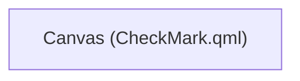

# UI Spec: CheckMark
**File:** `app/qml/components/CheckMark.qml`  **Pack:** `01-core-components.md`  **Legacy Reference:** `src/Modules/Main.lua:1456` (`main:DrawCheckMark`)  **Status:** Test-Covered

--------------------------------------------------------------------------------

## 1. Purpose & Parity Notes
*   **Role:** The checkmark tick glyph used inside `CheckBox.qml` and multi-selection list controls.
*   **Intentional Deviations from Legacy PoB:**
    *   *Coordinate Origin:* Legacy `DrawCheckMark` calculates vertices relative to a center point and size `(cx, cy, size)`. CheckMark rebases coordinates to a top-left origin `(x, y)` bounded by `Math.min(width, height)`, maintaining identical fractional segment geometry.

--------------------------------------------------------------------------------

## 2. Lightweight Wireframe & Layout Box Model
# Component Box Model & Layout
```text
+-------------------------------------------------------------------------------+
| CheckMark (Canvas primitive)                                                  |
| property color glyphColor: theme.text                                         |
| size: Math.min(width, height)                                                 |
| x: (width - size) / 2, y: (height - size) / 2                                 |
+-------------------------------------------------------------------------------+
```

# ASCII Anatomy & Wireframe
```text
Two Filled Quads Construction:
+------------------------------------+
|                                    |
|                               /|   | (Stroke 2: Long Up-Right Stroke)
|                             /  |   | (size*0.40, size*0.90) -> (size*0.90, size*0.20)
|             |\             /   /   |
| (Stroke 1)  \ \           /   /    |
| (Down-Left)  \ \         /   /     |
|               \ \_______/   /      |
|                \___________/       |
+------------------------------------+
  size = Math.min(width, height)
```

# Responsive / Overflow Rules
*   **Minimum safe width/height:** 8x8px; typical usage is 14x14px inside an 18x18px checkbox square.
*   **Centering:** Automatically centers the square drawing region within rectangular allocations: `x = (width - size) / 2`, `y = (height - size) / 2`.

# Component Hierarchy


--------------------------------------------------------------------------------

## 3. Interactive States & Controls
| Control (objectName) | Type | Default State | Interactive Behavior | Edge States (Disabled / Empty / Loading / Error / Long Text) |
| ------ | ------ | ------ | ------ | ------ |
| `pob.checkmark.root` | Canvas | `glyphColor: theme.text` | Repaints tick vectors on geometry or color change | Renders in `theme.muted` when checkbox is disabled. |

# State Matrix & Binding Hazards
*   *Visual Clarity on Low Res:* CheckMark is composed of two overlapping filled polygon quads. Anti-aliasing must remain active on the canvas context to avoid jagged pixel steps on low-DPI displays.

--------------------------------------------------------------------------------

## 4. Data & Bridge Contract
*   **Reads (Properties):**
    *   `glyphColor: color` -> fill color (defaults to `theme.text`)
*   **Writes / Mutations:** None (presentation component).
*   **Signals Observed:** None.
*   **Qt6 Bridge Safety:** Independent visual primitive with zero engine dependencies.

--------------------------------------------------------------------------------

## 5. Testable Acceptance Criteria (Qt6::QuickTest)
*   **AC-01 (Initial Render & Zero Warnings):** When `CheckMark.qml` mounts, 0 QML warnings are logged and canvas requests paint.
*   **AC-02 (Proportional Centering):** Given a non-square allocation `width: 24, height: 16`, `size` evaluates to `16`, and the tick glyph is horizontally centered at `x === 4`.
*   **AC-03 (Color Propagation):** When `glyphColor` is updated to `theme.accent`, the canvas repaints immediately with the new color.

--------------------------------------------------------------------------------

## 6. Bug Audit Findings (Current Implementation vs Spec)
| Severity | File & Line | Symptom / Defect | Root Cause | Expected Behavior |
| ------ | ------ | ------ | ------ | ------ |
| Low | `app/qml/components/CheckMark.qml:395` | Tick mark appears slightly clipped at bottom on small box sizes (< 12px). | Vertex coordinate `y + size * 0.90` touches the lower boundary margin. | Keep within `0.10` to `0.85` safe bounds if box size < 12px. |
