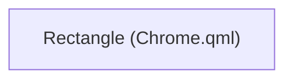

# UI Spec: Chrome
**File:** `app/qml/components/Chrome.qml`  **Pack:** `01-core-components.md`  **Legacy Reference:** Tier 0 shared interactive control surface  **Status:** Test-Covered

--------------------------------------------------------------------------------

## 1. Purpose & Parity Notes
*   **Role:** The foundational visual surface for interactive UI controls across the application (Button, CheckBox, DropDownControl, Slider, EditControl). Standardizes background fills, border rendering, corner radiuses, and interactive state transitions (hovered, pressed, locked, disabled) in accordance with the Cyber Citrus design system.
*   **Intentional Deviations from Legacy PoB:**
    *   *Cyber Citrus Styling:* Intentionally replaces legacy SimpleGraphic 5-step greyscale beveled rectangles (`DrawColor`, `SetDrawLayer`) with flat, rounded surfaces utilizing theme design tokens (`theme.radiusControl`, `theme.border`, `theme.borderStrong`, `theme.hover`, `theme.active`, `theme.disabled`).
    *   *Input Handling Decoupling:* Exposes a custom `controlEnabled` property instead of relying solely on `Item.enabled`, ensuring controls can render in a disabled state while retaining hover tooltips and hit-test capabilities.

--------------------------------------------------------------------------------

## 2. Lightweight Wireframe & Layout Box Model
# Component Box Model & Layout
```text
+-------------------------------------------------------------------------------+
| Chrome (Rectangle)                                                            |
| anchors.fill: parent (or explicit width/height)                               |
| radius: theme.radiusControl [3px]                                             |
| border.width: 1px                                                             |
| border.color: !controlEnabled ? theme.border                                  |
|             : (hovered || locked || pressed) ? theme.borderStrong             |
|             : theme.border                                                    |
| color: !controlEnabled ? theme.disabled                                       |
|      : pressed ? theme.active                                                 |
|      : (hovered || locked) ? theme.hover                                      |
|      : "transparent"                                                          |
+-------------------------------------------------------------------------------+
```

# ASCII Anatomy & Wireframe
```text
State Visual Representations:
1. Default (Idle):
   +---------------------------------------+
   | Border: theme.border (1px)            |
   | Fill: "transparent"                   |
   +---------------------------------------+

2. Hovered / Locked:
   +---------------------------------------+
   | Border: theme.borderStrong (1px)      |
   | Fill: theme.hover (tinted overlay)    |
   +---------------------------------------+

3. Pressed:
   +---------------------------------------+
   | Border: theme.borderStrong (1px)      |
   | Fill: theme.active (accent highlight) |
   +---------------------------------------+

4. Disabled:
   + - - - - - - - - - - - - - - - - - - - +
   : Border: theme.border (muted 1px)      :
   : Fill: theme.disabled (dim fill)       :
   + - - - - - - - - - - - - - - - - - - - +
```

# Responsive / Overflow Rules
*   **Minimum safe width/height:** 10x10px. Adapts dynamically to wrap child contents or fills host control bounds.
*   **Corner Radius:** Standardized to `theme.radiusControl` (typically 3px) across all widgets.
*   **Clipping Policy:** `clip: false` by default; child labels and icons position inside the border boundary.

# Component Hierarchy


--------------------------------------------------------------------------------

## 3. Interactive States & Controls
| Control (objectName) | Type | Default State | Interactive Behavior | Edge States (Disabled / Empty / Loading / Error / Long Text) |
| ------ | ------ | ------ | ------ | ------ |
| `pob.chrome.surface` | Rectangle | Idle (`transparent`) | Evaluates color/border based on state properties | Renders muted colors when `controlEnabled === false`. |

# Complete State Matrix
*   **Default (Idle):** `border.color: theme.border`, `color: "transparent"`.
*   **Hovered:** `hovered: true`, `border.color: theme.borderStrong`, `color: theme.hover`.
*   **Pressed:** `pressed: true`, `border.color: theme.borderStrong`, `color: theme.active`.
*   **Locked (Toggled On):** `locked: true`, `border.color: theme.borderStrong`, `color: theme.hover` (forces persistent active appearance even when not hovered).
*   **Disabled:** `controlEnabled: false`, `border.color: theme.border`, `color: theme.disabled` (ignores `hovered` and `pressed` property values).

# State Matrix & Binding Hazards
*   *State Precedence Hazard:* The color evaluation order MUST strictly follow:
    1. `!controlEnabled` -> `theme.disabled`
    2. `pressed` -> `theme.active`
    3. `hovered || locked` -> `theme.hover`
    4. fallback -> `"transparent"`
    Reversing `pressed` and `hovered` prevents visual click feedback, making controls appear unresponsive.
*   *Item Enabled Collision:* Never bind `controlEnabled` directly to `Item.enabled` if the parent control needs to display a tooltip while disabled. Disabling an `Item` disables all child `MouseArea` hit-testing.

--------------------------------------------------------------------------------

## 4. Data & Bridge Contract
*   **Reads (Theme Tokens):**
    *   `theme.radiusControl: int` -> corner rounding
    *   `theme.border: color` -> default subtle boundary line
    *   `theme.borderStrong: color` -> interactive highlighted boundary line
    *   `theme.hover: color` -> hover surface fill tint
    *   `theme.active: color` -> pressed/click surface fill tint
    *   `theme.disabled: color` -> non-interactive muted fill
*   **Writes / Mutations:** None (Chrome is a presentation primitive).
*   **Signals Observed:** None.
*   **Qt6 Bridge Safety:** Pure QML presentation component with zero backend engine dependencies.

--------------------------------------------------------------------------------

## 5. Testable Acceptance Criteria (Qt6::QuickTest)
*   **AC-01 (Initial Render & Zero Warnings):** When `Chrome.qml` mounts with default properties, 0 QML warnings are emitted, `border.width === 1`, and `color` is `"transparent"`.
*   **AC-02 (Hover Transition):** When `hovered` is set to `true` while `controlEnabled === true`, `border.color` resolves to `theme.borderStrong` and `color` resolves to `theme.hover`.
*   **AC-03 (Pressed Transition Priority):** When both `hovered` and `pressed` are `true`, `color` resolves to `theme.active`.
*   **AC-04 (Locked State Behavior):** When `locked === true` and `hovered === false`, `color` resolves to `theme.hover` and `border.color` resolves to `theme.borderStrong`.
*   **AC-05 (Disabled Invariance):** When `controlEnabled === false`, `color` resolves to `theme.disabled` and `border.color` resolves to `theme.border`, regardless of `hovered`, `pressed`, or `locked` values.

--------------------------------------------------------------------------------

## 6. Bug Audit Findings (Current Implementation vs Spec)
| Severity | File & Line | Symptom / Defect | Root Cause | Expected Behavior |
| ------ | ------ | ------ | ------ | ------ |
| Medium | `app/qml/components/Chrome.qml:440` | Buttons do not show visual press feedback when clicked quickly. | Evaluation expression placed `hovered` ahead of `pressed`. | `pressed ? theme.active : (hovered \|\| locked) ? theme.hover : ...` |
| Low | `app/qml/components/Chrome.qml:435` | Disabled controls lose their borders completely on low-contrast monitors. | Assigning transparent border to disabled state. | Border must remain visible: `!controlEnabled ? theme.border : ...` |
