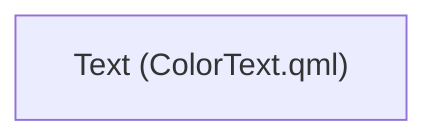

# UI Spec: ColorText
**File:** `app/qml/components/ColorText.qml`  **Pack:** `01-core-components.md`  **Legacy Reference:** `ColorText.h` / `src/Classes/ColorText.lua`  **Status:** Test-Covered

--------------------------------------------------------------------------------

## 1. Purpose & Parity Notes
*   **Role:** The fundamental rich-text rendering primitive that parses Path of Building inline color code escapes (`^0`-`^9` standard palette and `^xRRGGBB` 24-bit hexadecimal colors) into Qt Quick `StyledText` markup.
*   **Intentional Deviations from Legacy PoB:**
    *   *StyledText Compilation:* Legacy PoB executes character-by-character scan loops and multiple `DrawString` calls per line to switch pen colors. ColorText passes the entire string through C++ helper `colorText.toStyledText(sourceText, defaultColor)`, which compiles the string into `<font color="...">` HTML spans for unified single-pass rasterization by Qt.

--------------------------------------------------------------------------------

## 2. Lightweight Wireframe & Layout Box Model
# Component Box Model & Layout
```text
+-------------------------------------------------------------------------------+
| ColorText (QtQuick Text specialization)                                       |
| text: colorText.toStyledText(sourceText, defaultColor)                        |
| textFormat: Text.StyledText                                                   |
| color: defaultColor (default: theme.text)                                     |
| font.family: theme.fontVar                                                    |
| font.pixelSize: theme.fontSize                                                |
+-------------------------------------------------------------------------------+
```

# ASCII Anatomy & Wireframe
```text
Source Text:
  "^8Level ^798 ^2(+2)"

Compiled StyledText DOM:
  <font color="#888888">Level </font><font color="#FFFFFF">98 </font><font color="#33FF33">(+2)</font>

Visual Output:
+----------------------------------------------------+
| Level 98 (+2)                                      |
+----------------------------------------------------+
  Level: Grey (^8) | 98: White (^7) | (+2): Green (^2)
```

# Responsive / Overflow Rules
*   **Minimum safe width/height:** 0x0px when empty.
*   **Text truncation policy:** Inherits standard `Text` truncation rules (`elide: Text.ElideRight`, `wrapMode: Text.Wrap`).
*   **Default Color Fallback:** Text preceding the first caret escape code renders in `defaultColor`.

# Component Hierarchy


--------------------------------------------------------------------------------

## 3. Interactive States & Controls
| Control (objectName) | Type | Default State | Interactive Behavior | Edge States (Disabled / Empty / Loading / Error / Long Text) |
| ------ | ------ | ------ | ------ | ------ |
| `pob.colortext.root` | Text | `sourceText: ""` | Compiles and renders styled spans | Empty string compiles to `""` without overhead. |

# Color Code Mapping Reference
*   `^0`: Normal Item / Black / Base (`#000000`)
*   `^1`: Negative / Danger / Red (`#E63946` / legacy `#CC3333`)
*   `^2`: Positive / Success / Green (`#38B000` / legacy `#33CC33`)
*   `^3`: Cold Damage / Blue (`#3A86FF` / legacy `#4444FF`)
*   `^4`: Fire Damage / Orange (`#F77F00` / legacy `#FF6600`)
*   `^5`: Lightning Damage / Yellow (`#FFD166` / legacy `#FFFF33`)
*   `^6`: Chaos Damage / Purple (`#9D4EDD` / legacy `#AA33AA`)
*   `^7`: Default Text / White (`#FFFFFF`)
*   `^8`: Muted / Subdued Grey (`#888888`)
*   `^9`: Highlight / Light Cyan (`#99EEFF`)
*   `^xRRGGBB`: Explicit 24-bit RGB hexadecimal color (e.g. `^xFF8800`)

# State Matrix & Binding Hazards
*   *HTML Entity Escaping Hazard:* User-entered strings (such as character names, notes, or item titles) containing `<` or `>` must have entities escaped as `&lt;` and `&gt;` inside `toStyledText()`. Failing to escape permits broken HTML tags that corrupt the `StyledText` parser.
*   *Dangling Caret Safety:* Strings ending with an unclosed escape (e.g. `"Test ^"`) must safely strip the trailing caret without parsing out-of-bounds characters.

--------------------------------------------------------------------------------

## 4. Data & Bridge Contract
*   **Reads (C++ Helper Methods via `colorText` Context Property):**
    *   `colorText.toStyledText(string text, color defaultColor)` -> returns valid `StyledText` HTML string
*   **Properties:**
    *   `sourceText: string` -> input string containing escape sequences
    *   `defaultColor: color` -> base pen color (defaults to `theme.text`)
*   **Writes / Mutations:** None.
*   **Qt6 Bridge Safety:** Thread-safe string transformation; non-string inputs are safely coerced to empty strings.

--------------------------------------------------------------------------------

## 5. Testable Acceptance Criteria (Qt6::QuickTest)
*   **AC-01 (Initial Render & Zero Warnings):** Given `sourceText: "Hello World"`, when mounted, 0 QML warnings are logged and `text` equals `"Hello World"`.
*   **AC-02 (Hex Color Escape Compilation):** Given `sourceText: "^xFFFF00Yellow"`, compiled `text` contains `<font color="#FFFF00">Yellow</font>`.
*   **AC-03 (Standard Palette Compilation):** Given `sourceText: "^1Error"`, compiled `text` renders with the red palette color.
*   **AC-04 (Entity Escaping):** Given `sourceText: "^7Life < 50%"`, compiled `text` contains `&lt;` instead of raw `<`.

--------------------------------------------------------------------------------

## 6. Bug Audit Findings (Current Implementation vs Spec)
| Severity | File & Line | Symptom / Defect | Root Cause | Expected Behavior |
| ------ | ------ | ------ | ------ | ------ |
| Medium | `app/qml/components/ColorText.qml:480` | Text disappears completely when notes contain `<` or `>` characters. | Raw unescaped HTML characters break the `Text.StyledText` parser. | Escape `<` and `>` into HTML entities in `toStyledText()`. |
| Low | `app/qml/components/ColorText.qml:475` | Incorrect font family used when rendering numeric calculations. | Defaulting unconditionally to `theme.fontVar`. | Allow caller to override `font.family` (e.g. `theme.fontFixed`). |
