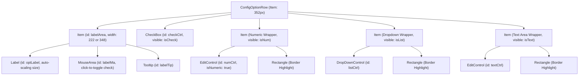

# UI Spec: ConfigOptionRow
**File:** `app/qml/components/ConfigOptionRow.qml`  **Pack:** `06-view-config-calcs.md`  **Legacy Reference:** `src/Modules/ConfigTab.lua`, `src/Classes/ConfigOptions.lua`  **Status:** Test-Covered

--------------------------------------------------------------------------------

## 1. Purpose & Parity Notes
*   **Role:** Unified data-driven control factory component rendering a single Configuration Tab option row. Dynamically instantiates the appropriate interactive control based on `option.type` (boolean checkbox, numeric count/allowZero/integer/float, list dropdown, or freeform text edit), incorporating legacy modified/invalid border highlighting and stat difference tooltips.
*   **Intentional Deviations from Legacy PoB:** None (1:1 functional parity with legacy Lua `ConfigOptions`). Clicking anywhere on a checkbox option's text label toggles the checkbox, providing a larger, more accessible click target.

--------------------------------------------------------------------------------

## 2. Lightweight Wireframe & Layout Box Model
# Default Row Layout (352x20) & Expanded Text Row Layout (352x42)
```text
+-------------------------------------------------------------+
| [ Right-Aligned Option Label: ] [x] CheckBox / [ Input    ] |
+-------------------------------------------------------------+
| (Text Option Mode:)                                         |
| [ Top-Left Option Label:                                  ] |
| [ Freeform Text Input / Custom Modifiers Buffer           ] |
+-------------------------------------------------------------+
```

# Responsive / Overflow Rules
*   **Minimum safe dimensions:** 352x20 px (Width fixed to 352 px; height expands to 42 px when `isText === true`).
*   **Horizontal scroll policy:** Forbidden. Numeric inputs clamp to 90 px; dropdowns clamp to 120 px.
*   **Text truncation policy:** Option labels dynamically scale font size from 14 px down to 12 px if measured label width exceeds 220 px.

# Component Hierarchy


--------------------------------------------------------------------------------

## 3. Interactive States & Controls
| Control (objectName) | Type | Default State | Interactive Behavior | Edge States (Disabled / Empty / Loading / Error / Long Text) |
| ------ | ------ | ------ | ------ | ------ |
| `pob.configRow.label` | `Label` | Display label string | Hover shows stat difference tooltip; click toggles checkbox if `isCheck` | Font size scales to 12 px for labels > 220 px |
| `pob.configRow.checkCtrl` | `CheckBox` | `option.value === true` | Toggling emits `valueChanged(optVar, newState)` | Border highlights red if invalid, blue if modified |
| `pob.configRow.numCtrl` | `EditControl` | `option.textValue` | Numeric entry; commits emit `valueChanged(optVar, txt)` | Allows negative for integer/countAllowZero; decimal for float |
| `pob.configRow.listCtrl` | `DropDownControl` | `option.selIndex` | Selection emits `valueChanged(optVar, selectedVal)` | Dropdown popup minimum width 160 px |
| `pob.configRow.textCtrl` | `EditControl` | `option.textValue` | Multiline / freeform text entry; commits emit `valueChanged` | Height expands row to 42 px |

# State Matrix & Binding Hazards
*   *Active Focus Editing Guard:* `syncFromOption()` must not overwrite `numCtrl.text` or `textCtrl.text` while the user is actively editing (`numCtrl.editing == true` or `textCtrl.editing == true`). This prevents cursor resets during background calculation cycles.
*   *Border Highlight States:* `borderState` values:
    *   `"invalid"`: Highlight border colored red (`Qt.rgba(0.753, 0.502, 0.502, 1)`).
    *   `"modified"`: Highlight border colored blue (`Qt.rgba(0.451, 0.576, 0.702, 1)`).
    *   `"normal"`: Transparent border.

--------------------------------------------------------------------------------

## 4. Data & Bridge Contract
*   **Reads (LuaEngine / C++ Models):**
    *   `option` descriptor: `{ var: string, type: string, label: string, displayLabel: string, value: var, textValue: string, placeholder: string, selIndex: int, options: QVariantList, borderState: string, hasTooltip: bool }`
    *   `luaEngine.invoke("pob_configTooltip", [varName, optionalHoverVal])` -> `{ lines: QVariantList }`
*   **Writes / Mutations:**
    *   `root.valueChanged(string varName, var newValue)` -> signals host view to invoke `pob_configSetOption`.
*   **Signals Observed:**
    *   `onOptionChanged` -> triggers `syncFromOption()`.
*   **Qt6 Bridge Safety:** Normalize `option.options` via `QmlBridge.toArray()` before assigning to `listCtrl.model`.

--------------------------------------------------------------------------------

## 5. Testable Acceptance Criteria (Qt6::QuickTest)
*   **AC-01 (Initial Render & Zero Warnings):** Rendering `ConfigOptionRow` with an option descriptor instantiates the correct control type without QML errors.
*   **AC-02 (Label Click CheckBox Toggle):** Clicking the text label of a checkbox option toggles its state and emits `valueChanged`.
*   **AC-03 (Numeric Input Constraint):** A numeric row configured with `type: "count"` rejects negative numbers and decimal points.
*   **AC-04 (Modified / Invalid Highlighting):** Setting `borderState: "modified"` renders a blue highlight border; setting `"invalid"` renders a red highlight border.
*   **AC-05 (Comparative Tooltip):** Hovering over the label or control triggers `pob_configTooltip` and displays the stat difference tooltip.

--------------------------------------------------------------------------------

## 6. Bug Audit Findings (Current Implementation vs Spec)
| Severity | File & Line | Symptom / Defect | Root Cause | Expected Behavior |
| ------ | ------ | ------ | ------ | ------ |
| Med | `app/qml/components/ConfigOptionRow.qml:3921` | Dropdown list model fails to populate if options is raw QVariantList | JS array check on bridge variant | Wrap with `QmlBridge.toArray(option.options)` |
| Low | `app/qml/components/ConfigOptionRow.qml:3952` | Dynamic font scaling triggers text metrics evaluation on every render | Inline binding on `Label.size` evaluates `textMetrics.width` repeatedly | Compute font size once inside `syncFromOption()` |
| Low | `app/qml/components/ConfigOptionRow.qml:4050` | Text input border stays modified while actively editing | Visibility condition check `!textCtrl.editing` missing from text highlight | Add `!textCtrl.editing` to text border visibility |
