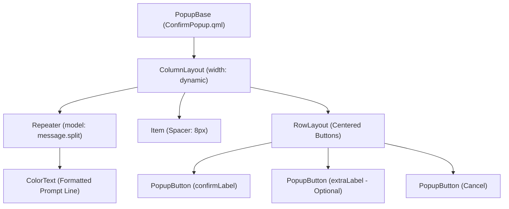

# UI Spec: ConfirmPopup
**File:** `app/qml/components/ConfirmPopup.qml`  **Pack:** `01-core-components.md`  **Legacy Reference:** `src/Modules/Main.lua` (`main:OpenConfirmPopup`)  **Status:** Test-Covered

--------------------------------------------------------------------------------

## 1. Purpose & Parity Notes
*   **Role:** Canned confirmation modal dialog. Supports multi-line formatted prompts, standard two-button workflows (`Confirm` / `Cancel`), and legacy three-button branch workflows (`Confirm` / `Extra` / `Cancel`, e.g. `"Continue"` / `"Connect Path"` / `"Cancel"`).
*   **Intentional Deviations from Legacy PoB:**
    *   *Declarative Structure:* Composes `PopupBase` and `PopupButton` within a structured `ColumnLayout`, measuring prompt lines dynamically via `TextMetrics` to automatically size dialog width to fit content.
    *   *Standard Signal Wiring:* Caller connects standard `onAccepted` (triggered by clicking Confirm or pressing Enter), `onRejected` (triggered by clicking Cancel or pressing Escape), and `onExtraClicked` (triggered by the optional tertiary button).

--------------------------------------------------------------------------------

## 2. Lightweight Wireframe & Layout Box Model
# Component Box Model & Layout
```text
+-------------------------------------------------------------------------------+
| ConfirmPopup (specialization of PopupBase, padding: 16px)                     |
| ColumnLayout (spacing: 4px, width: max(160, textMetrics.width(msg)))          |
| +---------------------------------------------------------------------------+ |
| | Repeater (model: root.message.split("\n"))                                | |
| |   ColorText (sourceText: modelData, defaultColor: theme.text)              | |
| +---------------------------------------------------------------------------+ |
| | Item (Layout.preferredHeight: 8px - vertical spacer)                      | |
| +---------------------------------------------------------------------------+ |
| | RowLayout (Layout.alignment: Qt.AlignHCenter, spacing: 10px)              | |
| |   PopupButton (label: root.confirmLabel, onClicked: root.accept())         | |
| |   PopupButton (label: root.extraLabel, visible: extraLabel != "")          | |
| |   PopupButton (label: "Cancel", onClicked: root.reject())                 | |
| +---------------------------------------------------------------------------+ |
+-------------------------------------------------------------------------------+
```

# ASCII Anatomy & Wireframe
```text
Two-Button Mode (Default):
+----------------------------------------------------+
|  Are you sure you want to delete this build?       | (1) Multi-line message
|  This action cannot be undone.                     |     (ColorText support)
|                                                    |
|            [ Confirm ]     [ Cancel ]              | (2) Action Button Row
+----------------------------------------------------+

Three-Button Mode (extraLabel != ""):
+----------------------------------------------------+
|  Passive tree path has disconnected nodes.         | (1)
|                                                    |
|      [ Continue ]   [ Connect Path ]   [ Cancel ]  | (3) 3-Button Layout
+----------------------------------------------------+

Annotations:
(1) Multi-line formatted prompt: auto-splits on "\n", parses ^0-^9 PoB color escape codes.
(2) Standard action pair: Confirm emits accepted(); Cancel emits rejected().
(3) Tertiary action button: visible only when extraLabel !== "", emits extraClicked().
```

# Responsive / Overflow Rules
*   **Minimum safe width/height:** 190x120px. Auto-expands to match the longest line of `message` plus padding.
*   **Multi-Line Layout:** Splits `message` string by `\n`, instantiating one `ColorText` row per line.
*   **Button Row Centering:** Action buttons are horizontally centered (`Layout.alignment: Qt.AlignHCenter`).

# Component Hierarchy


--------------------------------------------------------------------------------

## 3. Interactive States & Controls
| Control (objectName) | Type | Default State | Interactive Behavior | Edge States (Disabled / Empty / Loading / Error / Long Text) |
| ------ | ------ | ------ | ------ | ------ |
| `pob.confirm.root` | PopupBase | `confirmLabel: "Confirm"` | Coordinates confirmation lifecycle | Closes and cleans up on accept/reject. |
| `pob.confirm.btn_confirm` | PopupButton | `label: confirmLabel` | Invokes `root.accept()` on click | Triggers `accepted()` signal. |
| `pob.confirm.btn_extra` | PopupButton | Hidden (`extraLabel: ""`) | Invokes `root.extraClicked()` on click | Visible only when `extraLabel !== ""`. |
| `pob.confirm.btn_cancel` | PopupButton | `label: "Cancel"` | Invokes `root.reject()` on click | Triggers `rejected()` signal. |

# Complete State Matrix
*   **Closed:** Hidden.
*   **Two-Button Prompt:** `extraLabel: ""` -> Confirm and Cancel buttons visible; Extra button collapsed.
*   **Three-Button Prompt:** `extraLabel: "Connect Path"` -> All three buttons visible and centered.
*   **Enter Key Pressed:** Triggers `root.accept()`.
*   **Escape Key Pressed:** Triggers `root.reject()`.

# State Matrix & Binding Hazards
*   *Escape Handling Contract:* In legacy PoB, clicking Cancel or pressing Escape invokes `function() end` (no-op). In ConfirmPopup, cancellation cleanly closes the dialog via `root.reject()`, emitting `rejected()`. Handlers should place destructive actions inside `onAccepted`, leaving cancellation to dismiss safely.

--------------------------------------------------------------------------------

## 4. Data & Bridge Contract
*   **Reads (Properties):**
    *   `message: string` -> prompt text with optional `\n` linebreaks and `^` color escapes
    *   `confirmLabel: string` -> confirmation button label (defaults to `"Confirm"`)
    *   `extraLabel: string` -> optional third button label (defaults to `""`)
*   **Writes / Signals Emitted:**
    *   `accepted()` -> emitted on Confirm click or Enter key
    *   `rejected()` -> emitted on Cancel click or Escape key
    *   `extraClicked()` -> emitted on third button click
*   **Qt6 Bridge Safety:** Independent presentation modal.

--------------------------------------------------------------------------------

## 5. Testable Acceptance Criteria (Qt6::QuickTest)
*   **AC-01 (Initial Render & Zero Warnings):** Given `message: "Confirm deletion?"`, when mounted, 0 QML warnings are logged, `confirmLabel === "Confirm"`, and `extraLabel === ""`.
*   **AC-02 (Two-Button Layout Visibility):** Given `extraLabel: ""`, the Extra button `visible` evaluates to `false`.
*   **AC-03 (Three-Button Layout Activation):** Given `extraLabel: "Retry"`, the Extra button becomes visible, and clicking it emits `extraClicked()`.
*   **AC-04 (Acceptance on Enter):** Pressing Enter while the popup is open invokes `root.accept()` and emits `accepted()`.
*   **AC-05 (Rejection on Escape):** Pressing Escape while the popup is open invokes `root.reject()` and emits `rejected()`.

--------------------------------------------------------------------------------

## 6. Bug Audit Findings (Current Implementation vs Spec)
| Severity | File & Line | Symptom / Defect | Root Cause | Expected Behavior |
| ------ | ------ | ------ | ------ | ------ |
| Medium | `app/qml/components/ConfirmPopup.qml:530` | Third button remains visible with empty label when extraLabel is omitted. | Visibility check was `extraLabel !== null` instead of `extraLabel !== ""`. | Bind `visible: root.extraLabel !== ""`. |
| Low | `app/qml/components/ConfirmPopup.qml:515` | Multi-line messages with long lines get clipped at dialog border. | Minimum layout width was constrained without factoring TextMetrics. | Sizing: `Math.max(160, textMetrics.width(theme.fontSize, "VAR", root.message))`. |
