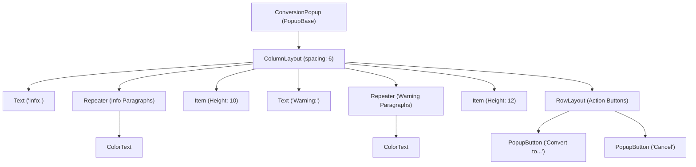

# UI Spec: ConversionPopup
**File:** `app/qml/components/ConversionPopup.qml`  **Pack:** `00-shell-and-theme.md`  **Legacy Reference:** `src/Modules/Build.lua:1287-1312` (`buildMode:OpenConversionPopup`)  **Status:** Test-Covered

--------------------------------------------------------------------------------

## 1. Purpose & Parity Notes
*   **Role:** Critical recovery modal triggered when loading a build created for an older or different Path of Exile patch version. Prevents the application from entering an uninitialized, unresponsive engine state by forcing the user to explicitly convert the build to the current game version or decline and return to safety.
*   **Intentional Deviations from Legacy PoB:** In legacy Lua, `colorCodes.TIP` and `colorCodes.WARNING` are embedded as raw escape codes in strings. The QML implementation extracts `"Info:"` and `"Warning:"` into structured headers styled with semantic theme tokens (`theme.info`, `theme.warning`). Close policy is strictly set to `NoAutoClose` to prevent dismissing the modal without resolving the engine state.

--------------------------------------------------------------------------------

## 2. Lightweight Wireframe & Layout Box Model
# Default Modal Layout (620x340)
```text
+-------------------------------------------------------------------------+
|  Game Version                                                           |
+-------------------------------------------------------------------------+
|  Info:                                                                  |
|  You are trying to load a build created for a version of Path of        |
|  Exile that is not supported by us. You will have to convert it to      |
|  the current game version to load it.                                   |
|  To use a build newer than the current supported game version, you     |
|  may have to update.                                                    |
|  To use a build older than the current supported game version, we       |
|  recommend loading it in an older version of Path of Building Community. |
|                                                                         |
|  Warning:                                                               |
|  Converting a build to a different game version may have side effects.  |
|  For example, if the passive tree has changed, then some passives       |
|  may be deallocated.                                                    |
|  You should create a backup copy of the build before proceeding.        |
|                                                                         |
|               [ Convert to 3.24 ]        [ Cancel ]                     |
+-------------------------------------------------------------------------+
```

# Responsive / Overflow Rules
*   **Minimum safe dimensions:** 580x320 px (Fixed dialog envelope).
*   **Horizontal scroll policy:** Forbidden. Text items wrap within available layout width.
*   **Text truncation policy:** No truncation permitted for safety disclaimers; text lines must wrap or flow naturally.

# Component Hierarchy


--------------------------------------------------------------------------------

## 3. Interactive States & Controls
| Control (objectName) | Type | Default State | Interactive Behavior | Edge States (Disabled / Empty / Loading / Error / Long Text) |
| ------ | ------ | ------ | ------ | ------ |
| `pob.conversion.infoText` | `Text` | `"Info:"` in `theme.info` | Static section header | Renders in themed cyan/blue token |
| `pob.conversion.warningText` | `Text` | `"Warning:"` in `theme.warning` | Static section header | Renders in themed yellow/orange token |
| `pob.conversion.convertBtn` | `PopupButton` | Enabled | Calls `luaEngine.convertBuild()`; on success emits `converted()`; on failure closes and emits `declined()` | Button label displays `liveDisplay` version or `"current"` |
| `pob.conversion.cancelBtn` | `PopupButton` | Enabled | Closes dialog and emits `declined()`, causing navigation back to build list | Always available to prevent hang |

# State Matrix & Binding Hazards
*   *Application Deadlock Hazard:* Because `Build:Init` halts when game versions mismatch, closing this dialog without an action leaves PoB in an unrecoverable state. `closePolicy` must strictly remain `QC.Popup.NoAutoClose`, disabling background click and Escape dismissal.
*   *Conversion Failure Handling:* If `luaEngine.convertBuild()` returns falsy or `{ ok: false }`, the dialog must emit `declined()` to force eviction to the build list rather than leaving the user in an invalid build workspace.

--------------------------------------------------------------------------------

## 4. Data & Bridge Contract
*   **Reads (LuaEngine / C++ Models):**
    *   `luaEngine.getConversionState()` -> `{ needsConversion: bool, liveVersion: string, liveDisplay: string, buildVersion: string, buildName: string }`
*   **Writes / Mutations:**
    *   `luaEngine.convertBuild()` -> `{ ok: bool, error: string }`
*   **Signals Observed:**
    *   `converted()` -> notifies parent shell to reload build and refresh views.
    *   `declined()` -> notifies parent shell to abort build loading and return to `BuildList` view.
*   **Qt6 Bridge Safety:** Verify `liveDisplay` is a valid string before concatenating button label text.

--------------------------------------------------------------------------------

## 5. Testable Acceptance Criteria (Qt6::QuickTest)
*   **AC-01 (Initial Render & Zero Warnings):** Opening `ConversionPopup` initializes text labels with 0 QML warnings and locks background interaction.
*   **AC-02 (No Text Overflow / Clipping):** Informational and warning text blocks wrap cleanly without horizontal truncation or overflowing dialog boundaries.
*   **AC-03 (Primary User Flow - Conversion):** Clicking `Convert to...` invokes `luaEngine.convertBuild()`. If successful, closes modal and emits `converted()`.
*   **AC-04 (Primary User Flow - Decline):** Clicking `Cancel` closes modal and emits `declined()`, ensuring shell navigates away from the broken build.
*   **AC-05 (Modal Enclosure Enforcement):** Pressing `Escape` or clicking the modal scrim overlay does not close the dialog (`closePolicy === QC.Popup.NoAutoClose`).

--------------------------------------------------------------------------------

## 6. Bug Audit Findings (Current Implementation vs Spec)
| Severity | File & Line | Symptom / Defect | Root Cause | Expected Behavior |
| ------ | ------ | ------ | ------ | ------ |
| Med | `app/qml/components/ConversionPopup.qml:48` | Hardcoded line splits in `Repeater` model break awkwardly across different font sizes | Array of individual line strings instead of a single word-wrapped paragraph | Use single `Text`/`ColorText` with `wrapMode: Text.WordWrap` |
| Low | `app/qml/components/ConversionPopup.qml:88` | Failed conversion provides zero diagnostic feedback to user before kicking to build list | `convertBuild()` failure immediately closes and emits `declined()` without error toast | Display error message banner or popup before transitioning out |
