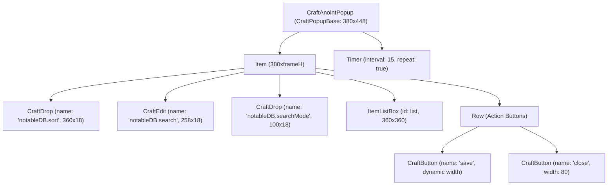

# UI Spec: CraftAnointPopup
**File:** `app/qml/components/CraftAnointPopup.qml`  **Pack:** `05-view-items.md`  **Legacy Reference:** `src/Modules/ItemsTab.lua:2597-2634` (`ItemsTab:AnointDisplayItem`)  **Status:** Test-Covered

--------------------------------------------------------------------------------

## 1. Purpose & Parity Notes
*   **Role:** Dedicated modal dialog for anointing passive tree notables onto amulets, blight rings, or infected unique equipment. Integrates a searchable notable list (`ItemListBox`) driven by background coroutine calculation steps.
*   **Intentional Deviations from Legacy PoB:** In legacy Lua, notable database searching and stat-sorting is stepped on every immediate-mode `Draw` call. In QML, stepping is managed by a 15 ms `Timer` active only while `notables.building === true`, terminating as soon as the notable list completes.

--------------------------------------------------------------------------------

## 2. Lightweight Wireframe & Layout Box Model
# Default Modal Layout (380x448)
```text
+-------------------------------------------------------------+
|  Anoint Item                                            [X] |
+-------------------------------------------------------------+
|  [ Sort: Default                                          v] |
|  [ Search notables...                     ] [Search: All  v] |
|  +--------------------------------------------------------+ |
|  | ^7Charisma (Clear, Golden, Golden)                     | |
|  | ^7Sovereignty (Silver, Silver, Silver)                 | |
|  | ^7Whispers of Doom (Black, Golden, Golden)             | |
|  |                                                        | |
|  | Sorting... (84%)                                       | | <- Progress
|  +--------------------------------------------------------+ |
|                                                             |
|           [ Anoint Charisma ]         [ Cancel ]            |
+-------------------------------------------------------------+
```

# Responsive / Overflow Rules
*   **Minimum safe dimensions:** 380x448 px (Fixed dialog envelope; parent window minimum: 960x640 px).
*   **Horizontal scroll policy:** Forbidden. Controls fixed to 360 px width.
*   **Text truncation policy:** Notable entries render oil recipes and names; Save button label dynamically adapts width to accommodate long notable names.

# Component Hierarchy


--------------------------------------------------------------------------------

## 3. Interactive States & Controls
| Control (objectName) | Type | Default State | Interactive Behavior | Edge States (Disabled / Empty / Loading / Error / Long Text) |
| ------ | ------ | ------ | ------ | ------ |
| `pob.anoint.sort` | `CraftDrop` | `"Default"` | Sorts notables alphabetically or by DPS/Life gain | Triggers asynchronous sort calculation |
| `pob.anoint.search` | `CraftEdit` | Empty text | Filters notables by name or granted stat description | Keystrokes forward to Lua search buffer |
| `pob.anoint.searchMode` | `CraftDrop` | `"All"` | Selects search scope (Name, Description, Both) | Re-queries matching notables |
| `pob.anoint.notableList` | `ItemListBox` | First notable selected | Single-click selects notable; hover shows tree node comparison tooltip | Displays progress text during calculation steps |
| `pob.anoint.saveBtn` | `CraftButton` | Label: `"Anoint X"` | Anoints selected notable and closes dialog; hover shows post-anoint item | Label reads `"Remove X"` or `"No Anoint"` depending on context |
| `pob.anoint.closeBtn` | `CraftButton` | `"Close"` / `"Cancel"` | Rejects modal without modifying item | Closes dialog via bridge |

# State Matrix & Binding Hazards
*   *Dynamic Save Button Width:* The save button label changes dynamically (e.g., `"Anoint Whispers of Doom"`). `SaveBtn.width` calculates width via `textMetrics.width(16, "VAR", r.label) * 1.2 + 24` to prevent label truncation.
*   *Selection Re-entrancy Hazard:* `ItemListBox` emits `onSelIndexChanged`. To avoid circular loops when `st` refreshes, `list.push()` sets `pushing = true` while synchronizing the index from the backend.

--------------------------------------------------------------------------------

## 4. Data & Bridge Contract
*   **Reads (LuaEngine / C++ Models):**
    *   Managed through `CraftPopupBase`:
    *   `rec("notableDB")` -> `{ rows: QVariantList, sel: int, text: string, building: bool }`
    *   `luaEngine.invoke("pob_itemsCraftStep", [])` -> `{ running: bool, text: string, error: string }`
    *   `root.fillTip(tt, "notableDB", index1Based)` -> populates comparative tooltip.
*   **Writes / Mutations:**
    *   `root.set("notableDB", selectedIndex1Based)` -> updates selected notable.
    *   `root.click("save")` -> applies anoint and closes dialog.
*   **Signals Observed:** None (Synchronous session protocol).
*   **Qt6 Bridge Safety:** Normalize `notables.rows` via `QmlBridge.toArray()`.

--------------------------------------------------------------------------------

## 5. Testable Acceptance Criteria (Qt6::QuickTest)
*   **AC-01 (Initial Render & Zero Warnings):** Opening anoint popup renders notable list, starts `StepTimer` if building, and emits zero QML warnings.
*   **AC-02 (Notable Selection):** Clicking a notable in the list updates the Save button label to `"Anoint <NotableName>"`.
*   **AC-03 (Primary User Flow - Anoint):** Clicking `Save` applies the selected notable to the amulet and closes the modal.
*   **AC-04 (Search Filtering):** Typing `"Charisma"` into `SearchEdit` filters list rows and selects Charisma.
*   **AC-05 (Remove Anoint):** If an item already possesses an anoint, selecting the matching notable sets the button label to `"Remove <NotableName>"`.

--------------------------------------------------------------------------------

## 6. Bug Audit Findings (Current Implementation vs Spec)
| Severity | File & Line | Symptom / Defect | Root Cause | Expected Behavior |
| ------ | ------ | ------ | ------ | ------ |
| Med | `app/qml/components/CraftAnointPopup.qml:24` | Timer continues running if popup closes while coroutine is active | Timer running condition relies on `root.notables.building` without checking `root.visible` | Verify `root.visible && root.live && root.notables.building === true` |
| Low | `app/qml/components/CraftAnointPopup.qml:64` | Save button overlaps Cancel button on extremely long notable names | `Math.max(80, ...)` calculation lacks upper clamp limit | Clamp max width to 200 px with `Text.ElideRight` |
| Low | `app/qml/components/CraftAnointPopup.qml:49` | `Connections` target warning on component destruction | Direct target connection to root without null guard | Safely disconnect or use QML declarative property bindings |
