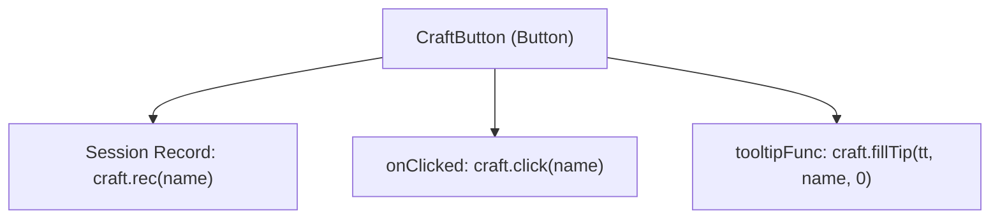

# UI Spec: CraftButton
**File:** `app/qml/components/CraftButton.qml`  **Pack:** `05-view-items.md`  **Legacy Reference:** `src/Classes/ButtonControl.lua` (within ItemsTab craft popups)  **Status:** Test-Covered

--------------------------------------------------------------------------------

## 1. Purpose & Parity Notes
*   **Role:** Specialized action button component designed for captured item crafting popup sessions (`CraftPopupBase`). Binds its label, visibility, enablement, and preview tooltip dynamically to a named control record within the active Lua craft session.
*   **Intentional Deviations from Legacy PoB:** None (1:1 functional parity with legacy Lua button controls). When configured with `tip: true`, hovering the button triggers `craft.fillTip(tt, name, 0)`, rendering a live comparison tooltip of the target item as it would exist after clicking the button.

--------------------------------------------------------------------------------

## 2. Lightweight Wireframe & Layout Box Model
# Default Component Dimensions (80x20)
```text
+-------------------------------------------------------------+
|  [ Anoint Charisma (Dynamic Width) ]                        |
+-------------------------------------------------------------+
|  ^7Item Preview Tooltip on Hover (when tip: true):          |
|  +--------------------------------------------------------+ |
|  | +16 to all Attributes                                  | |
|  | 8% increased maximum Mana                              | |
|  | 12% increased Mana Reservation Efficiency of Skills    | |
|  +--------------------------------------------------------+ |
+-------------------------------------------------------------+
```

# Responsive / Overflow Rules
*   **Minimum safe dimensions:** 60x20 px (Default height: 20 px; width specified by parent or dynamically scaled from text metrics).
*   **Horizontal scroll policy:** Forbidden.
*   **Text truncation policy:** Button label text centers horizontally; dynamic width instances (e.g., Anoint save button) expand to accommodate varying modifier names.

# Component Hierarchy


--------------------------------------------------------------------------------

## 3. Interactive States & Controls
| Control (objectName) | Type | Default State | Interactive Behavior | Edge States (Disabled / Empty / Loading / Error / Long Text) |
| ------ | ------ | ------ | ------ | ------ |
| `pob.craftButton.root` | `Button` | Visible if `r.shown === true` | Click invokes `craft.click(name)`; hover evaluates tooltip if `tip: true` | Disabled when `r.enabled === false`; hidden when `r.shown === false` |

# State Matrix & Binding Hazards
*   *Null Session Hazard:* If `craft` is null or undefined (e.g., during parent popup teardown), evaluating `craft.rec(name)` must return an empty object (`{}`) without throwing a script exception. Handled via `readonly property var r: craft ? craft.rec(name) : ({})`.
*   *Action Dismissal Synchronization:* When `craft.click(name)` succeeds, the backend Lua session may dictate immediate modal closure. The button delegates closure detection to `CraftPopupBase.click()`.

--------------------------------------------------------------------------------

## 4. Data & Bridge Contract
*   **Reads (LuaEngine / C++ Models):**
    *   `craft.rec(name)` -> `{ label: string, enabled: bool, shown: bool }`
    *   `craft.fillTip(tt, name, 0)` -> populates tooltip lines via `pob_itemsCraftTooltip`.
*   **Writes / Mutations:**
    *   `craft.click(name)` -> invokes `pob_itemsCraftClick`.
*   **Signals Observed:** None (Driven by `CraftPopupBase` property changes).
*   **Qt6 Bridge Safety:** Verify `r.label` is cast to a valid string before calculating text metrics.

--------------------------------------------------------------------------------

## 5. Testable Acceptance Criteria (Qt6::QuickTest)
*   **AC-01 (Initial Render & Zero Warnings):** Rendering `CraftButton` attached to an active `CraftPopupBase` session displays the control's live label with zero QML console warnings.
*   **AC-02 (Visibility & Enablement Binding):** Setting `r.shown = false` hides the button; setting `r.enabled = false` disables user interaction and dims appearance.
*   **AC-03 (Primary User Flow - Click):** Clicking `CraftButton` invokes `craft.click(name)` on the session controller and dispatches the corresponding Lua action.
*   **AC-04 (Preview Tooltip Hover):** When `tip: true`, hovering the button triggers `craft.fillTip` and displays the post-craft item stat diff tooltip.
*   **AC-05 (Dynamic Label Update):** Modifying the selection in a companion dropdown updates `r.label` and re-renders button text immediately.

--------------------------------------------------------------------------------

## 6. Bug Audit Findings (Current Implementation vs Spec)
| Severity | File & Line | Symptom / Defect | Root Cause | Expected Behavior |
| ------ | ------ | ------ | ------ | ------ |
| Med | `app/qml/components/CraftButton.qml:81` | Button tooltip throws TypeError if `craft` is unbound | `craft.fillTip` called directly without checking `craft != null` | Check `if (craft) craft.fillTip(tt, name, 0)` inside tooltip callback |
| Low | `app/qml/components/CraftButton.qml:83` | Button triggers click handler while disabled via backend record | `onClicked` does not guard against `controlEnabled === false` | Guard click handler with `if (controlEnabled && craft) craft.click(name)` |
| Low | `app/qml/components/CraftButton.qml:77` | Button height hardcoded to 20 px ignores touch/accessibility scaling | Hardcoded `height: 20` | Use `implicitHeight: Math.max(20, theme.controlHeight)` |
