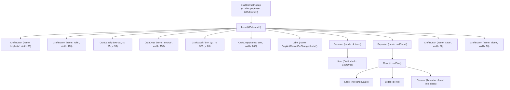

# UI Spec: CraftCorruptPopup
**File:** `app/qml/components/CraftCorruptPopup.qml`  **Pack:** `05-view-items.md`  **Legacy Reference:** `src/Modules/ItemsTab.lua:2637-2970` (`ItemsTab:CorruptDisplayItem`)  **Status:** Test-Covered

--------------------------------------------------------------------------------

## 1. Purpose & Parity Notes
*   **Role:** Dedicated modal dialog for corrupting the currently edited item, selecting corruption implicit modifier sources (Standard Corrupted or Scourge tiers), choosing up to 2–4 replacement implicit modifiers with mutual exclusion guards, or adjusting unique item numeric modifier roll ranges (0.78x–1.22x).
*   **Intentional Deviations from Legacy PoB:** None (1:1 functional parity with legacy Lua). Built on `CraftPopupBase`. Implements legacy dynamic dialog height resizing via `root.frameH` driven directly by the bridge session.

--------------------------------------------------------------------------------

## 2. Lightweight Wireframe & Layout Box Model
# Default Modal Layout (605x220, Expanded up to 605x420)
```text
+----------------------------------------------------------------------------------+
|  Corrupted Item                                                              [X] |
+----------------------------------------------------------------------------------+
|  [ Implicits ] [ Roll Ranges ]                                                   |
|      Source: [ Corrupted               v]        Sort by: [ Default            v]|
|                                                                                  |
|  Implicit #1: [ +1 to Level of all Socketed Gems                               v]|
|  Implicit #2: [ (4-6)% increased maximum Life                                  v]|
|                                                                                  |
|  (Roll Ranges View Mode:)                                                        |
|  [ 1.05 ] [====o====] +105% to maximum Life (Base: +100%)                        |
|                       15% increased maximum Mana                                 |
|                                                                                  |
|                           [   Save   ]   [ Cancel ]                              |
+----------------------------------------------------------------------------------+
```

# Responsive / Overflow Rules
*   **Minimum safe dimensions:** 605x180 px (Width fixed to 605 px; height adapts dynamically via session `st.height`).
*   **Horizontal scroll policy:** Forbidden. Controls follow legacy coordinate layout.
*   **Text truncation policy:** Implicit modifier descriptions in dropdowns elide right with full stat delta tooltip on hover; multi-line mod text wraps vertically.

# Component Hierarchy


--------------------------------------------------------------------------------

## 3. Interactive States & Controls
| Control (objectName) | Type | Default State | Interactive Behavior | Edge States (Disabled / Empty / Loading / Error / Long Text) |
| ------ | ------ | ------ | ------ | ------ |
| `pob.craftCorrupt.implicits` | `CraftButton` | Active tab | Switches view to corrupt implicit modifier dropdowns | Always available |
| `pob.craftCorrupt.rolls` | `CraftButton` | Inactive tab | Switches view to unique modifier roll range sliders | Visible only when item is Unique |
| `pob.craftCorrupt.source` | `CraftDrop` | `"Corrupted"` | Selects corrupt source pool (Corrupted, Scourge T1/T2/T3) | Updates available implicit tiers |
| `pob.craftCorrupt.sort` | `CraftDrop` | `"Default"` | Sorts available corruptions by name or stat gain | Re-sorts dropdown candidate lists |
| `pob.craftCorrupt.implicit1-4` | `CraftDrop` | None / Selected | Selects corrupt implicit; picked mod is omitted from peer dropdowns | Mutually exclusive across slots 1-4 |
| `pob.craftCorrupt.rollSlider` | `Slider` | `1.0` (Range: 0.78-1.22) | Adjusts modifier multiplier roll; live recalculation | Imperative push guards against feedback loops |
| `pob.craftCorrupt.saveBtn` | `CraftButton` | Enabled | Applies corrupt implicits or roll ranges to item; closes modal | Tooltip shows preview of corrupted item |
| `pob.craftCorrupt.closeBtn` | `CraftButton` | Enabled | Closes dialog via `reject()` without modifying item | Terminate session via bridge |

# State Matrix & Binding Hazards
*   *Repeater Re-creation During Drag:* Binding the roll sliders to `model: rollRows` recreates the delegate instances on every frame because `rollRows` returns a new JavaScript array. Using `model: root.rollCount` and fetching `root.rollRows[index]` inside the delegate preserves active slider drag state.
*   *Dynamic Offset Calculation:* Each roll range row grows vertically by 16 px for every extra wrapped text line of preceding rows. `rollRows` recalculates `offset` to prevent slider collision on long multi-line modifiers.

--------------------------------------------------------------------------------

## 4. Data & Bridge Contract
*   **Reads (LuaEngine / C++ Models):**
    *   Managed through `CraftPopupBase`:
    *   `rec("source")`, `rec("sort")`, `rec("implicit1")` through `rec("implicit4")`
    *   `rec("rollRangeSliderN")`, `rec("rollRangeLabelN")`, `rec("rollRangeValueN")`
    *   `luaEngine.invoke("pob_itemsCraftTooltip", [name, index])` -> `{ lines: QVariantList }`
*   **Writes / Mutations:**
    *   `root.set(controlName, value)` -> updates selection or roll value via `pob_itemsCraftSet`.
    *   `root.click(buttonName)` -> executes action via `pob_itemsCraftClick`.
*   **Signals Observed:** None (Synchronous session protocol).
*   **Qt6 Bridge Safety:** Normalize `rollRows` parsing regex and array accesses against undefined control values.

--------------------------------------------------------------------------------

## 5. Testable Acceptance Criteria (Qt6::QuickTest)
*   **AC-01 (Initial Render & Zero Warnings):** Opening `CraftCorruptPopup` loads corrupt implicit dropdowns, sets frame height, and emits zero QML warnings.
*   **AC-02 (Mutual Exclusion):** Selecting an implicit mod in `implicit1` removes that mod from the options list in `implicit2`.
*   **AC-03 (Unique Roll Ranges Tab):** Clicking `Roll Ranges` hides implicit dropdowns, displays sliders for each explicit modifier, and resizes popup height.
*   **AC-04 (Roll Slider Adjustment):** Dragging a roll slider updates the adjacent percentage label and invokes `pob_itemsCraftSet` with the new float multiplier.
*   **AC-05 (Primary User Flow - Corrupt Save):** Clicking `Save` applies corruption to the display item, closes the modal, and renders corrupted status badge in item pane.

--------------------------------------------------------------------------------

## 6. Bug Audit Findings (Current Implementation vs Spec)
| Severity | File & Line | Symptom / Defect | Root Cause | Expected Behavior |
| ------ | ------ | ------ | ------ | ------ |
| Med | `app/qml/components/CraftCorruptPopup.qml:177` | Dragging roll slider resets thumb position unexpectedly | `rollRows` recalculation produces a new JS array on every keystroke/move | Bind Repeater model to `rollCount` and read `rollRows[index]` |
| Low | `app/qml/components/CraftCorruptPopup.qml:156` | Long corruption modifier names clip in dropdowns | Fixed width of 440 px on `implicitN` dropdowns | Expand dropdown width to 510 px with `elide: Text.ElideRight` |
| Low | `app/qml/components/CraftCorruptPopup.qml:184` | Missing null check on `rr` in `rollRow` delegate | Accessing `rr.lines` throws TypeError if index is invalid | Guard with `rr && rr.lines ? rr.lines : []` |
