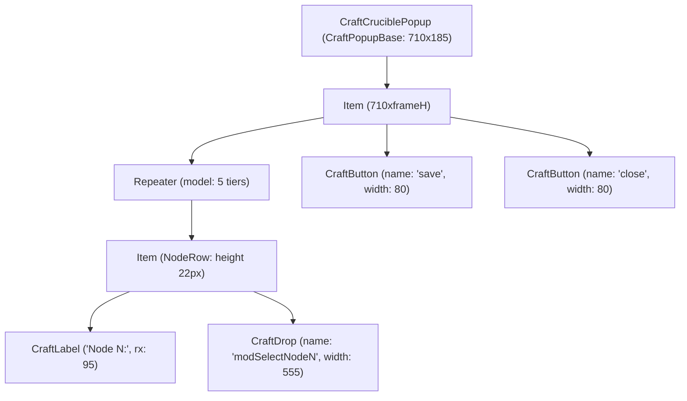

# UI Spec: CraftCruciblePopup
**File:** `app/qml/components/CraftCruciblePopup.qml`  **Pack:** `05-view-items.md`  **Legacy Reference:** `src/Modules/ItemsTab.lua:3276-3386` (`ItemsTab:AddCrucibleModifierToDisplayItem`)  **Status:** Test-Covered

--------------------------------------------------------------------------------

## 1. Purpose & Parity Notes
*   **Role:** Dedicated modal dialog for configuring Crucible passive skill tree modifiers on weapons and shields, providing 5 tier-allocated node selection dropdowns (Node 1 through Node 5).
*   **Intentional Deviations from Legacy PoB:** None (1:1 functional parity with legacy Lua). Built on `CraftPopupBase`, using a structured `Repeater` over the 5 Crucible tree depth tiers.

--------------------------------------------------------------------------------

## 2. Lightweight Wireframe & Layout Box Model
# Default Modal Layout (710x185)
```text
+----------------------------------------------------------------------------------+
|  Add Crucible Modifier to Item                                               [X] |
+----------------------------------------------------------------------------------+
|     Node 1: [ 10% increased Attack Speed, 5% reduced Global Damage             v]|
|     Node 2: [ +0.4% to Critical Strike Chance                                  v]|
|     Node 3: [ Adds 15 to 25 Cold Damage                                        v]|
|     Node 4: [ 20% chance to deal Double Damage with Lightning Skills           v]|
|     Node 5: [ Voidforge: 100% of Physical Damage Converted to a Random Element  v]|
|                                                                                  |
|                           [   Save   ]   [ Cancel ]                              |
+----------------------------------------------------------------------------------+
```

# Responsive / Overflow Rules
*   **Minimum safe dimensions:** 710x185 px (Fixed dialog envelope; parent window minimum: 960x640 px).
*   **Horizontal scroll policy:** Forbidden. Dropdowns fixed to 555 px width.
*   **Text truncation policy:** Crucible node descriptions elide right with full stat comparison tooltip on hover.

# Component Hierarchy


--------------------------------------------------------------------------------

## 3. Interactive States & Controls
| Control (objectName) | Type | Default State | Interactive Behavior | Edge States (Disabled / Empty / Loading / Error / Long Text) |
| ------ | ------ | ------ | ------ | ------ |
| `pob.craftCrucible.node1-5` | `CraftDrop` | None / Selected | Selects Crucible passive node for specific tree depth tier (1-5) | Searchable dropdown; hover displays full stat delta tooltip |
| `pob.craftCrucible.saveBtn` | `CraftButton` | Enabled | Applies Crucible tree modifiers to item and closes modal | Tooltip shows preview of updated weapon/shield |
| `pob.craftCrucible.closeBtn` | `CraftButton` | Enabled | Rejects modal without modifying item | Terminates session via bridge |

# State Matrix & Binding Hazards
*   *Repeater Index Offset Hazard:* The repeater uses 0-based indices (`index: 0..4`). Node names and controls are 1-based (`modSelectNode1`..`modSelectNode5`). Mappings must consistently evaluate `n = index + 1`.
*   *Tier Prerequisite Gaps:* Selecting higher-tier nodes (e.g. Node 5) while intermediate nodes are unallocated is supported by legacy PoB mechanics. The backend manages tree path validity.

--------------------------------------------------------------------------------

## 4. Data & Bridge Contract
*   **Reads (LuaEngine / C++ Models):**
    *   Managed through `CraftPopupBase`:
    *   `rec("modSelectNode1")` through `rec("modSelectNode5")`
    *   `luaEngine.invoke("pob_itemsCraftTooltip", [name, index])` -> `{ lines: QVariantList }`
*   **Writes / Mutations:**
    *   `root.set("modSelectNode" + n, selectedIndex1Based)`
    *   `root.click("save")`
*   **Signals Observed:** None (Synchronous session protocol).
*   **Qt6 Bridge Safety:** Controlled by `CraftPopupBase` and `CraftDrop`.

--------------------------------------------------------------------------------

## 5. Testable Acceptance Criteria (Qt6::QuickTest)
*   **AC-01 (Initial Render & Zero Warnings):** Opening Crucible dialog on an eligible weapon renders 5 node dropdowns and emits zero QML warnings.
*   **AC-02 (Node Dropdown Selection):** Selecting a passive in `Node 1` invokes `pob_itemsCraftSet("modSelectNode1", index)` and updates item preview.
*   **AC-03 (Tooltip Comparison):** Hovering an option in any node dropdown renders stat comparison tooltip showing DPS and attribute deltas.
*   **AC-04 (Primary User Flow - Save):** Selecting nodes across multiple tiers and clicking `Save` applies the Crucible tree to the weapon.
*   **AC-05 (Cancellation & Teardown):** Clicking `Cancel` or pressing `Escape` dismisses the modal and closes the session without writing changes.

--------------------------------------------------------------------------------

## 6. Bug Audit Findings (Current Implementation vs Spec)
| Severity | File & Line | Symptom / Defect | Root Cause | Expected Behavior |
| ------ | ------ | ------ | ------ | ------ |
| Low | `app/qml/components/CraftCruciblePopup.qml:236` | Long Crucible passives elide without full tooltip if cursor leaves dropdown bounds | Dropdown delegate lacks inline full-text tooltip fallback | Add explicit tooltip fallback on delegate label truncation |
| Low | `app/qml/components/CraftCruciblePopup.qml:240` | Hardcoded button coordinate math (`710 / 2 - 45 - 40`) | Absolute pixel layout | Center buttons using declarative anchor layout |
