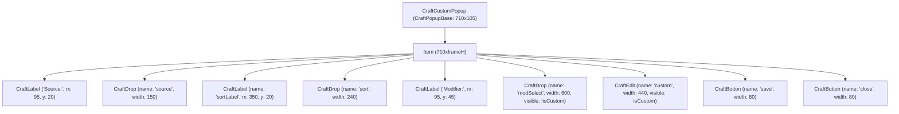

# UI Spec: CraftCustomPopup
**File:** `app/qml/components/CraftCustomPopup.qml`  **Pack:** `05-view-items.md`  **Legacy Reference:** `src/Modules/ItemsTab.lua:2973-3274` (`ItemsTab:AddCustomModifierToDisplayItem`)  **Status:** Test-Covered

--------------------------------------------------------------------------------

## 1. Purpose & Parity Notes
*   **Role:** Dedicated modal dialog for adding explicit modifiers to an item from crafting systems (Crafting Bench, Essences, Veiled mods, Beastcrafting, Necropolis, Delve fossils, raw Prefix/Suffix pools) or entering arbitrary custom modifier text.
*   **Intentional Deviations from Legacy PoB:** None (1:1 functional parity with legacy Lua). Switches seamlessly between structured catalog browsing and freeform text input when the "Custom" source is selected.

--------------------------------------------------------------------------------

## 2. Lightweight Wireframe & Layout Box Model
# Default Modal Layout (710x105, Structured Source)
```text
+----------------------------------------------------------------------------------+
|  Add Modifier to Item                                                        [X] |
+----------------------------------------------------------------------------------+
|     Source: [ Crafting Bench         v]        Sort by: [ Default              v]|
|   Modifier: [ (21-25)% increased Spell Damage (Cost: 4x Orb of Transmutation)  v]|
|                                                                                  |
|                           [   Save   ]   [ Cancel ]                              |
+----------------------------------------------------------------------------------+
```

# Custom Text Mode Layout (710x105, Source: Custom)
```text
+----------------------------------------------------------------------------------+
|  Add Modifier to Item                                                        [X] |
+----------------------------------------------------------------------------------+
|     Source: [ Custom                 v]        Sort by: [ Default              v]|
|   Modifier: [ +50 to maximum Life                                              ] | <- CraftEdit
|                                                                                  |
|                           [   Save   ]   [ Cancel ]                              |
+----------------------------------------------------------------------------------+
```

# Responsive / Overflow Rules
*   **Minimum safe dimensions:** 710x105 px (Fixed dialog envelope; parent viewport minimum: 960x640 px).
*   **Horizontal scroll policy:** Forbidden. Controls fit within 710 px envelope.
*   **Text truncation policy:** Modifier descriptions elide right with full stat comparison tooltip on hover; custom input scrolls horizontally.

# Component Hierarchy


--------------------------------------------------------------------------------

## 3. Interactive States & Controls
| Control (objectName) | Type | Default State | Interactive Behavior | Edge States (Disabled / Empty / Loading / Error / Long Text) |
| ------ | ------ | ------ | ------ | ------ |
| `pob.craftCustom.source` | `CraftDrop` | `"Crafting Bench"` | Selects modifier source: Bench, Essence, Veiled, Beast, Delve, Custom | Switches input mode between dropdown and text box |
| `pob.craftCustom.sort` | `CraftDrop` | `"Default"` | Sorts candidate modifiers by Alphabetical, DPS, or Life | Hidden if source does not provide sorting options |
| `pob.craftCustom.modDrop` | `CraftDrop` | First mod | Selects specific modifier to add to item | Visible when `isCustom === false`; width 600 px |
| `pob.craftCustom.customEdit` | `CraftEdit` | Empty text | Freeform text entry for custom modifier string | Visible when `isCustom === true`; forwards changes quietly |
| `pob.craftCustom.saveBtn` | `CraftButton` | Enabled | Adds selected modifier to item and closes modal | Tooltip shows preview of updated item |
| `pob.craftCustom.closeBtn` | `CraftButton` | Enabled | Rejects modal without modifying item | Terminates session via bridge |

# State Matrix & Binding Hazards
*   *Shared Row Layout Hazard:* `modSelect` and `customEdit` occupy the identical position (`x: 100, y: 45`). Their visibility states must be mutually exclusive (`visible: !isCustom` vs `visible: isCustom`) to prevent visual z-fighting or overlapped focus.
*   *Quiet Buffer Commit:* Freeform text input via `customEdit` sends `quiet: true` to prevent resetting caret position on typing. The final text is committed when clicking `Save`.

--------------------------------------------------------------------------------

## 4. Data & Bridge Contract
*   **Reads (LuaEngine / C++ Models):**
    *   Managed through `CraftPopupBase`:
    *   `rec("source")`, `rec("sort")`, `rec("modSelect")`, `rec("custom")`
    *   `luaEngine.invoke("pob_itemsCraftTooltip", [name, index])` -> `{ lines: QVariantList }`
*   **Writes / Mutations:**
    *   `root.set("source", index1Based)`
    *   `root.set("modSelect", index1Based)`
    *   `root.set("custom", text, true)` (quiet edit)
    *   `root.click("save")`
*   **Signals Observed:** None (Synchronous session protocol).
*   **Qt6 Bridge Safety:** Verify `rec("custom").shown` evaluates to a strict boolean.

--------------------------------------------------------------------------------

## 5. Testable Acceptance Criteria (Qt6::QuickTest)
*   **AC-01 (Initial Render & Zero Warnings):** Opening custom modifier popup initializes Crafting Bench source and produces zero QML warnings.
*   **AC-02 (Source Switch to Custom):** Selecting "Custom" in `source` hides `modSelect`, shows `customEdit`, and focuses text area.
*   **AC-03 (Primary User Flow - Catalog Mod):** Selecting an Essence modifier and clicking `Save` adds the modifier to the display item and closes modal.
*   **AC-04 (Primary User Flow - Custom Text):** Typing `"+30% to Fire Resistance"` into `customEdit` and clicking `Save` adds custom modifier line.
*   **AC-05 (Sort Filtering):** Selecting "Sort by DPS" updates ordering in `modSelect` with highest damage impact modifiers at top.

--------------------------------------------------------------------------------

## 6. Bug Audit Findings (Current Implementation vs Spec)
| Severity | File & Line | Symptom / Defect | Root Cause | Expected Behavior |
| ------ | ------ | ------ | ------ | ------ |
| Med | `app/qml/components/CraftCustomPopup.qml:265` | `modSelect` intercepts mouse events while `customEdit` is active | `modSelect` lacks `visible: !root.isCustom` condition | Set `visible: !root.isCustom && root.rec("modSelect").shown === true` |
| Low | `app/qml/components/CraftCustomPopup.qml:258` | Sort label shows generic text on unsorted sources | `sortLabel` does not hide when `sort` dropdown is hidden | Bind `visible: root.rec("sort").shown === true` |
| Low | `app/qml/components/CraftCustomPopup.qml:269` | Action button coordinates hardcoded to 710 px envelope | Pixel arithmetic (`710 / 2 - 45 - 40`) | Use declarative layout or center anchor |
