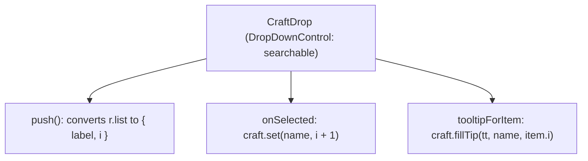

# UI Spec: CraftDrop
**File:** `app/qml/components/CraftDrop.qml`  **Pack:** `05-view-items.md`  **Legacy Reference:** `src/Classes/DropDownControl.lua`, `src/Classes/SearchHost.lua` (within ItemsTab craft popups)  **Status:** Test-Covered

--------------------------------------------------------------------------------

## 1. Purpose & Parity Notes
*   **Role:** Specialized searchable dropdown component designed for captured crafting popups (`CraftPopupBase`). Translates backend Lua 1-based string lists into index-mapped model arrays, forwards user selections, and renders per-item comparison tooltips.
*   **Intentional Deviations from Legacy PoB:** None (1:1 functional parity with legacy Lua dropdowns). Emulates legacy `SearchHost` behavior by providing live type-to-filter capabilities while the dropdown popup is opened.

--------------------------------------------------------------------------------

## 2. Lightweight Wireframe & Layout Box Model
# Default Component Dimensions (180x18 to 600x18, Max Height: 260)
```text
+-------------------------------------------------------------+
| [ (15-17)% increased Attack Speed                         v]|
+-------------------------------------------------------------+
| +---------------------------------------------------------+ | <- Dropdown Popup
| | (11-14)% increased Attack Speed                         | |
| | (15-17)% increased Attack Speed (Selected)              | |
| | (18-20)% increased Attack Speed                         | |
| |                                                         | |
| +---------------------------------------------------------+ |
+-------------------------------------------------------------+
```

# Responsive / Overflow Rules
*   **Minimum safe dimensions:** 100x18 px (Width assigned by parent layout; default height: 18 px).
*   **Horizontal scroll policy:** Forbidden.
*   **Text truncation policy:** Dropdown options elide right with full stat comparison tooltip displayed on row hover.

# Component Hierarchy


--------------------------------------------------------------------------------

## 3. Interactive States & Controls
| Control (objectName) | Type | Default State | Interactive Behavior | Edge States (Disabled / Empty / Loading / Error / Long Text) |
| ------ | ------ | ------ | ------ | ------ |
| `pob.craftDrop.root` | `DropDownControl` | Visible if `r.shown === true` | Click opens popup menu; typing filters; selection invokes `craft.set` | Disabled if `r.enabled === false`; empty model renders blank box |

# State Matrix & Binding Hazards
*   *Imperative Selection Synchronization:* `DropDownControl` writes its own internal `currentIndex` upon user selection. Binding `currentIndex` declaratively can create circular event loops. Handled via an imperative `push()` function called on `onRChanged` and `Component.onCompleted`.
*   *1-Based Lua Index Mapping:* The model maps items as `{ label: r.list[i], i: i + 1 }`. This preserves the exact 1-based index required by Lua backend callbacks (`craft.set(name, i + 1)`).

--------------------------------------------------------------------------------

## 4. Data & Bridge Contract
*   **Reads (LuaEngine / C++ Models):**
    *   `craft.rec(name)` -> `{ list: QVariantList, sel: int, shown: bool, enabled: bool }`
    *   `craft.fillTip(tt, name, item.i)` -> populates stat delta tooltip lines.
*   **Writes / Mutations:**
    *   `craft.set(name, 1BasedIndex)` -> invokes `pob_itemsCraftSet`.
*   **Signals Observed:** None (Driven by session `st` updates).
*   **Qt6 Bridge Safety:** Normalize `r.list` through `QmlBridge.toArray()` to ensure iterable JavaScript array semantics.

--------------------------------------------------------------------------------

## 5. Testable Acceptance Criteria (Qt6::QuickTest)
*   **AC-01 (Initial Render & Zero Warnings):** Rendering `CraftDrop` loads option strings from the session record, selects the active index, and emits zero QML warnings.
*   **AC-02 (Type-to-Search Filter):** Opening the dropdown and typing filters options to matching strings.
*   **AC-03 (Primary User Flow - Selection):** Selecting an item at index 3 invokes `craft.set(name, 4)` and updates parent session state.
*   **AC-04 (Row Tooltip Inspection):** Hovering an item within the opened dropdown invokes `craft.fillTip` with the item's 1-based index and renders stat deltas.
*   **AC-05 (Empty List Fallback):** When `r.list` is empty or undefined, `CraftDrop` clears its model and sets `currentIndex = -1` without errors.

--------------------------------------------------------------------------------

## 6. Bug Audit Findings (Current Implementation vs Spec)
| Severity | File & Line | Symptom / Defect | Root Cause | Expected Behavior |
| ------ | ------ | ------ | ------ | ------ |
| Med | `app/qml/components/CraftDrop.qml:318` | `r.list.length` undefined when bridge returns non-JS array | Missing `QmlBridge.toArray()` normalization | Use `QmlBridge.toArray(r.list)` |
| Low | `app/qml/components/CraftDrop.qml:324` | `currentIndex` evaluates to -1 if `r.sel` is undefined | Math expression `(r.sel or 1) - 1` falls back to 0, not -1 | Explicitly set `currentIndex = r.sel !== undefined ? r.sel - 1 : -1` |
| Low | `app/qml/components/CraftDrop.qml:329` | Selection callback fails silently if `craft` becomes null | `craft.set` called without null check | Verify `craft != null` before invoking `craft.set` |
