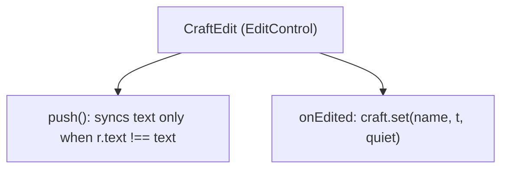

# UI Spec: CraftEdit
**File:** `app/qml/components/CraftEdit.qml`  **Pack:** `05-view-items.md`  **Legacy Reference:** `src/Classes/EditControl.lua` (within ItemsTab craft popups)  **Status:** Test-Covered

--------------------------------------------------------------------------------

## 1. Purpose & Parity Notes
*   **Role:** Single-line text input component designed for captured crafting popups (`CraftPopupBase`). Used for search filters (Anoint popup search) and arbitrary modifier text entry (Custom/Implicit mod popups).
*   **Intentional Deviations from Legacy PoB:** None (1:1 functional parity with legacy Lua edit controls). Supports a `quiet` flag that forwards user keystrokes to the Lua buffer while suppressing full round-trip session state refreshes, preventing cursor jumping.

--------------------------------------------------------------------------------

## 2. Lightweight Wireframe & Layout Box Model
# Default Component Dimensions (258x18 to 440x18)
```text
+-------------------------------------------------------------+
| [ Search notables... / Custom modifier text               ] |
+-------------------------------------------------------------+
```

# Responsive / Overflow Rules
*   **Minimum safe dimensions:** 120x18 px (Width specified by parent layout; default height: 18 px).
*   **Horizontal scroll policy:** Allowed internally via cursor navigation (`clip: true`).
*   **Text truncation policy:** Text scrolls horizontally; placeholder text displays when buffer is empty.

# Component Hierarchy


--------------------------------------------------------------------------------

## 3. Interactive States & Controls
| Control (objectName) | Type | Default State | Interactive Behavior | Edge States (Disabled / Empty / Loading / Error / Long Text) |
| ------ | ------ | ------ | ------ | ------ |
| `pob.craftEdit.root` | `EditControl` | Visible if `r.shown === true` | User text entry; keystrokes forwarded via `craft.set` | Disabled if `r.enabled === false`; hidden if `r.shown === false` |

# State Matrix & Binding Hazards
*   *Caret Reset Hazard:* Declaratively binding `text: r.text` causes the cursor to jump to the end of the line on every keystroke as the bridge updates. The component uses an imperative `push()` function that updates `text` only when `r.text !== undefined && r.text !== text`.
*   *Quiet Mode Forwarding:* Setting `quiet: true` notifies `CraftPopupBase.set()` to omit re-reading the full session state table, preserving smooth typing performance.

--------------------------------------------------------------------------------

## 4. Data & Bridge Contract
*   **Reads (LuaEngine / C++ Models):**
    *   `craft.rec(name)` -> `{ text: string, shown: bool, enabled: bool }`
*   **Writes / Mutations:**
    *   `craft.set(name, text, quiet)` -> invokes `pob_itemsCraftSet`.
*   **Signals Observed:** None (Driven by session `st` updates).
*   **Qt6 Bridge Safety:** Verify `r.text` is a string before evaluating inequality.

--------------------------------------------------------------------------------

## 5. Testable Acceptance Criteria (Qt6::QuickTest)
*   **AC-01 (Initial Render & Zero Warnings):** Rendering `CraftEdit` initializes text buffer from session record and produces zero QML warnings.
*   **AC-02 (Keystroke Forwarding):** Typing into `CraftEdit` invokes `craft.set(name, text, quiet)` on every character.
*   **AC-03 (Caret Position Stability):** Rapidly typing text maintains the user's cursor position without unexpected jumping or hitching.
*   **AC-04 (External State Synchronization):** When the backend changes the text buffer externally (e.g. on clear), `push()` updates `text` to match `r.text`.
*   **AC-05 (Visibility & Enablement):** Toggling `r.shown` and `r.enabled` modifies component visibility and input capability accordingly.

--------------------------------------------------------------------------------

## 6. Bug Audit Findings (Current Implementation vs Spec)
| Severity | File & Line | Symptom / Defect | Root Cause | Expected Behavior |
| ------ | ------ | ------ | ------ | ------ |
| Med | `app/qml/components/CraftEdit.qml:351` | Typing freezes or loses characters if `craft` is null | `craft.set` invoked without checking `craft != null` | Check `if (craft) craft.set(name, t, quiet)` |
| Low | `app/qml/components/CraftEdit.qml:347` | External empty string sync fails if `r.text` is null | Loose inequality check `r.text !== undefined` | Check `typeof r.text === 'string' && r.text !== text` |
| Low | `app/qml/components/CraftEdit.qml:342` | Missing tab key navigation hook | Default edit control lacks explicit tab navigation bindings | Support tab navigation across sibling popup controls |
