# UI Spec: CraftEnchantPopup
**File:** `app/qml/components/CraftEnchantPopup.qml`  **Pack:** `05-view-items.md`  **Legacy Reference:** `src/Modules/ItemsTab.lua:2280-2489` (`ItemsTab:EnchantDisplayItem`)  **Status:** Test-Covered

--------------------------------------------------------------------------------

## 1. Purpose & Parity Notes
*   **Role:** Dedicated modal dialog for applying labyrinth, heist, or weapon/body-armour enchantments to the currently edited item. Features skill filtering, "All skills" expansion checkbox, source filtering, sort mode dropdown, and enchantment selection.
*   **Intentional Deviations from Legacy PoB:** None (1:1 functional parity with legacy `ItemsTab:EnchantDisplayItem`). Built on `CraftPopupBase`, inheriting dynamic session state reflection and automated tooltip formatting.

--------------------------------------------------------------------------------

## 2. Lightweight Wireframe & Layout Box Model
# Default Modal Layout (605x130)
```text
+----------------------------------------------------------------------------------+
|  Enchant Item                                                                [X] |
+----------------------------------------------------------------------------------+
|      Skill: [ Lightning Strike           v] [x] All skills:                      |
|     Source: [ Merciless Labyrinth        v]        Sort by: [ Default          v]|
|  Enchantment: [ 40% increased Lightning Strike Damage                          v]|
|                                                                                  |
|             [   Save   ]            [  Remove  ]            [ Cancel ]           |
+----------------------------------------------------------------------------------+
```

# Responsive / Overflow Rules
*   **Minimum safe dimensions:** 605x130 px (Fixed dialog envelope; parent window minimum: 960x640 px).
*   **Horizontal scroll policy:** Forbidden. Controls positioned via legacy fixed coordinates.
*   **Text truncation policy:** Enchantment dropdown labels elide right with full stat comparison tooltip on hover.

# Component Hierarchy

```mermaid
flowchart TD
    Root["CraftEnchantPopup (CraftPopupBase)"] --> ContentItem["Item (605xframeH)"]
    ContentItem --> SkillLbl["CraftLabel ('Skill:', rx: 95, y: 20)"]
    ContentItem --> SkillDrop["CraftDrop (name: 'skill', width: 180)"]
    ContentItem --> AllSkillsCheck["CheckBox (id: allSkills, x: 350, y: 20)"]
    ContentItem --> SourceLbl["CraftLabel ('Source:', rx: 95, y: 45)"]
    ContentItem --> SourceDrop["CraftDrop (name: 'enchantmentSource', width: 180)"]
    ContentItem --> SortLbl["CraftLabel ('Sort by:', rx: 350, y: 45)"]
    ContentItem --> SortDrop["CraftDrop (name: 'sort', width: 240)"]
    ContentItem --> EnchantLbl["CraftLabel ('Enchantment:', rx: 95, y: 70)"]
    ContentItem --> EnchantDrop["CraftDrop (name: 'enchantment', width: 495)"]
    ContentItem --> SaveBtn["CraftButton (name: 'save')"]
    ContentItem --> RemoveBtn["CraftButton (name: 'remove')"]
    ContentItem --> CloseBtn["CraftButton (name: 'close')"]
```


--------------------------------------------------------------------------------

## 3. Interactive States & Controls
| Control (objectName) | Type | Default State | Interactive Behavior | Edge States (Disabled / Empty / Loading / Error / Long Text) |
| ------ | ------ | ------ | ------ | ------ |
| `pob.enchant.skill` | `CraftDrop` | First matching skill | Filters available enchantments by selected gem skill | Hidden if item is not a helmet |
| `pob.enchant.allSkills` | `CheckBox` | Unchecked (False) | Toggles display of all skills versus only skills socketed in build | Tooltip explains filter criteria |
| `pob.enchant.source` | `CraftDrop` | Default labyrinth tier | Filters enchantments by source (Labyrinth tiers, Heist, Harvest) | Searchable dropdown |
| `pob.enchant.sort` | `CraftDrop` | `"Default"` | Sorts enchantments by Alphabetical, DPS, or Life | Updates ordering in `enchantment` dropdown |
| `pob.enchant.enchantment` | `CraftDrop` | Active enchantment | Selects specific enchantment mod to apply | Width 495 px; hover displays stat delta tooltip |
| `pob.enchant.save` | `CraftButton` | Enabled | Applies selected enchantment and closes modal | Bound to legacy `save` action |
| `pob.enchant.remove` | `CraftButton` | Enabled if item enchanted | Strips existing enchantment from item and closes modal | Bound to legacy `remove` action |
| `pob.enchant.close` | `CraftButton` | Enabled | Closes dialog via `reject()` without modifying item | Bound to legacy `close` action |

# State Matrix & Binding Hazards
*   *Conditional Control Layout:* For non-helmet slots (boots, gloves, belts), the `skill` dropdown and `allSkills` checkbox are hidden (`shown === false`). Fixed vertical offsets for `Source` and `Enchantment` remain constant to match legacy coordinate mapping.
*   *Remove Button Enablement:* If the target item has no active enchantment, the `remove` button is disabled or hidden by the backend session table.

--------------------------------------------------------------------------------

## 4. Data & Bridge Contract
*   **Reads (LuaEngine / C++ Models):**
    *   Managed through `CraftPopupBase`:
    *   `openCraft("enchant", slot)` -> populates `st` with `skill`, `allSkills`, `enchantmentSource`, `sort`, `enchantment`, `save`, `remove`, `close` controls.
*   **Writes / Mutations:**
    *   `root.set(name, value)` -> invokes `pob_itemsCraftSet`.
    *   `root.click(name)` -> invokes `pob_itemsCraftClick`.
*   **Signals Observed:** None (Synchronous session protocol).
*   **Qt6 Bridge Safety:** Controlled by `CraftPopupBase` and `CraftDrop` model arrays.

--------------------------------------------------------------------------------

## 5. Testable Acceptance Criteria (Qt6::QuickTest)
*   **AC-01 (Initial Render & Zero Warnings):** Opening enchantment dialog on a helmet displays skill filter, all skills checkbox, and emits zero QML warnings.
*   **AC-02 (Non-Helmet Slot Adaptation):** Opening on boots hides `skill` and `allSkills` controls while rendering source and enchantment controls.
*   **AC-03 (Primary User Flow - Enchant):** Selecting an enchantment and clicking `Save` writes enchantment to the item and closes dialog.
*   **AC-04 (Remove Enchantment):** Clicking `Remove` strips existing enchantment and closes dialog.
*   **AC-05 (All Skills Toggle):** Checking `All skills` invokes `root.set("allSkills", true)` and refreshes available skill options.

--------------------------------------------------------------------------------

## 6. Bug Audit Findings (Current Implementation vs Spec)
| Severity | File & Line | Symptom / Defect | Root Cause | Expected Behavior |
| ------ | ------ | ------ | ------ | ------ |
| Low | `app/qml/components/CraftEnchantPopup.qml:392` | CheckBox text truncates on high-DPI scaling | Fixed width of 18 px on `CheckBox` with label | Set width to fit label content or omit fixed width |
| Low | `app/qml/components/CraftEnchantPopup.qml:407` | Action buttons clip if dialog title bar is wide | Hardcoded x offsets (`605 / 2 - 88 - 40`) | Use declarative layout or center-aligned container |
