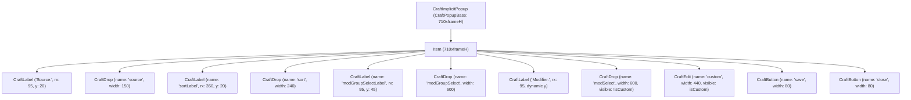

# UI Spec: CraftImplicitPopup
**File:** `app/qml/components/CraftImplicitPopup.qml`  **Pack:** `05-view-items.md`  **Legacy Reference:** `src/Modules/ItemsTab.lua:3389-3751` (`ItemsTab:AddImplicitToDisplayItem`)  **Status:** Test-Covered

--------------------------------------------------------------------------------

## 1. Purpose & Parity Notes
*   **Role:** Dedicated modal dialog for adding Eldritch implicits (Searing Exarch, Eater of Worlds), Delve special implicits, or custom arbitrary implicit modifiers to the currently edited item.
*   **Intentional Deviations from Legacy PoB:** None (1:1 functional parity). When the "Custom" source is selected, the dialog dynamically toggles between a structured modifier dropdown and a free-text input field (`CraftEdit`), relocating the "Modifier:" label to preserve legacy layout symmetry.

--------------------------------------------------------------------------------

## 2. Lightweight Wireframe & Layout Box Model
# Default Modal Layout (710x130, Eldritch / Structured Source)
```text
+----------------------------------------------------------------------------------+
|  Add Implicit to Item                                                        [X] |
+----------------------------------------------------------------------------------+
|     Source: [ Searing Exarch         v]        Sort by: [ Default              v]|
|   Mod Type: [ Attack Modifiers                                                 v]|
|   Modifier: [ (15-17)% increased Attack Speed                                  v]|
|                                                                                  |
|                           [   Save   ]   [ Cancel ]                              |
+----------------------------------------------------------------------------------+
```

# Custom Text Mode Layout (710x105, Source: Custom)
```text
+----------------------------------------------------------------------------------+
|  Add Implicit to Item                                                        [X] |
+----------------------------------------------------------------------------------+
|     Source: [ Custom                 v]        Sort by: [ Default              v]|
|   Modifier: [ Cannot be Frozen                                                 ] | <- CraftEdit
|                                                                                  |
|                           [   Save   ]   [ Cancel ]                              |
+----------------------------------------------------------------------------------+
```

# Responsive / Overflow Rules
*   **Minimum safe dimensions:** 710x105 px (Height adapts between 105 px and 130 px via `frameH`).
*   **Horizontal scroll policy:** Forbidden. Controls fit within 710 px envelope.
*   **Text truncation policy:** Mod group and modifier dropdown options elide right with full stat comparison tooltip on hover; custom text field scrolls horizontally.

# Component Hierarchy


--------------------------------------------------------------------------------

## 3. Interactive States & Controls
| Control (objectName) | Type | Default State | Interactive Behavior | Edge States (Disabled / Empty / Loading / Error / Long Text) |
| ------ | ------ | ------ | ------ | ------ |
| `pob.craftImplicit.source` | `CraftDrop` | `"Searing Exarch"` | Selects implicit origin: Searing Exarch, Eater of Worlds, Delve, Custom | Switches UI mode between structured and freeform text |
| `pob.craftImplicit.sort` | `CraftDrop` | `"Default"` | Sorts candidate modifiers by Alphabetical, DPS, or Defense | Hidden or disabled if source does not support sorting |
| `pob.craftImplicit.groupDrop` | `CraftDrop` | First category | Filters candidate modifiers by mod group / tag | Hidden when `isCustom === true` |
| `pob.craftImplicit.modDrop` | `CraftDrop` | First modifier | Selects specific implicit mod to apply | Visible only when `isCustom === false`; width 600 px |
| `pob.craftImplicit.customEdit` | `CraftEdit` | Empty text | Freeform text entry for user-defined implicit mod lines | Visible only when `isCustom === true`; quiet mode enabled |
| `pob.craftImplicit.saveBtn` | `CraftButton` | Enabled | Adds implicit modifier to item and closes modal | Tooltip shows preview of updated item |
| `pob.craftImplicit.closeBtn` | `CraftButton` | Enabled | Rejects modal without modifying item | Closes session via bridge |

# State Matrix & Binding Hazards
*   *Dynamic Label Relocation:* When `isCustom === true`, `modGroupSelect` is hidden, and `Modifier:` label moves from `y: 70` to `y: 45`. Bound via `y: root.isCustom ? 45 : 70` to match legacy layout behavior.
*   *Quiet Mode Forwarding:* Keystrokes inside `customEdit` use `quiet: true` in `pob_itemsCraftSet`. This skips full round-trip session state refreshes while typing, preventing cursor position resets.

--------------------------------------------------------------------------------

## 4. Data & Bridge Contract
*   **Reads (LuaEngine / C++ Models):**
    *   Managed through `CraftPopupBase`:
    *   `rec("source")`, `rec("sort")`, `rec("modGroupSelect")`, `rec("modSelect")`, `rec("custom")`
    *   `luaEngine.invoke("pob_itemsCraftTooltip", [name, index])` -> `{ lines: QVariantList }`
*   **Writes / Mutations:**
    *   `root.set("source", index1Based)`
    *   `root.set("modGroupSelect", index1Based)`
    *   `root.set("modSelect", index1Based)`
    *   `root.set("custom", text, true)` (quiet edit)
    *   `root.click("save")`
*   **Signals Observed:** None (Synchronous session protocol).
*   **Qt6 Bridge Safety:** Verify `rec("custom").shown` evaluates to a strict boolean.

--------------------------------------------------------------------------------

## 5. Testable Acceptance Criteria (Qt6::QuickTest)
*   **AC-01 (Initial Render & Zero Warnings):** Opening implicit popup initializes Eldritch source dropdowns and produces zero QML warnings.
*   **AC-02 (Custom Source Mode Switch):** Selecting "Custom" in `source` hides `modGroupSelect` and `modSelect`, renders `customEdit` at y=45, and adjusts frame height.
*   **AC-03 (Primary User Flow - Eldritch Implicit):** Selecting an Exarch modifier and clicking `Save` writes the implicit modifier and closes modal.
*   **AC-04 (Primary User Flow - Custom Text):** Typing `"10% increased Movement Speed"` into `customEdit` and clicking `Save` adds the custom implicit line.
*   **AC-05 (Sort Mode Application):** Changing `sort` to DPS re-orders candidate mods in `modSelect` based on calculated character damage impact.

--------------------------------------------------------------------------------

## 6. Bug Audit Findings (Current Implementation vs Spec)
| Severity | File & Line | Symptom / Defect | Root Cause | Expected Behavior |
| ------ | ------ | ------ | ------ | ------ |
| Med | `app/qml/components/CraftImplicitPopup.qml:435` | Mod dropdown stays visible when switching to Custom mode | `modSelect` missing explicit `visible: !root.isCustom` guard | Set `visible: !root.isCustom && root.rec("modSelect").shown === true` |
| Low | `app/qml/components/CraftImplicitPopup.qml:431` | `modGroupSelectLabel` retains stale text when hidden | Label visibility not tied to `!root.isCustom` | Add `visible: !root.isCustom && root.rec("modGroupSelectLabel").shown === true` |
| Low | `app/qml/components/CraftImplicitPopup.qml:437` | Save button coordinates hardcoded for 710 px window | Pixel arithmetic (`710 / 2 - 45 - 40`) | Use declarative layout or center anchor |
