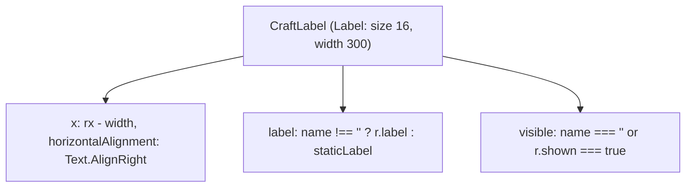

# UI Spec: CraftLabel
**File:** `app/qml/components/CraftLabel.qml`  **Pack:** `05-view-items.md`  **Legacy Reference:** `src/Classes/LabelControl.lua` (within ItemsTab craft popups)  **Status:** Test-Covered

--------------------------------------------------------------------------------

## 1. Purpose & Parity Notes
*   **Role:** Specialized right-aligned descriptor label component for captured crafting popups (`CraftPopupBase`). Supports both record-driven dynamic labels (bound to `craft.rec(name)`) and static string labels (`staticLabel`), aligning to a legacy right anchor point `rx`.
*   **Intentional Deviations from Legacy PoB:** In legacy Lua, labels are anchored as `{"TOPRIGHT", popup, "TOPLEFT"}` based on estimated font widths. In QML, `CraftLabel` allocates an explicit bounding box with `horizontalAlignment: Text.AlignRight` and positions at `x: rx - width`, ensuring precise typography rendering.

--------------------------------------------------------------------------------

## 2. Lightweight Wireframe & Layout Box Model
# Default Component Dimensions (300x16, Right-Aligned to rx)
```text
+-------------------------------------------------------------+
|                                  [ Right-Aligned Label: ]   | <- Aligned to rx (e.g., 95)
+-------------------------------------------------------------+
```

# Responsive / Overflow Rules
*   **Minimum safe dimensions:** 100x16 px (Fixed height: 16 px; width fixed to 300 px to accommodate long translated labels).
*   **Horizontal scroll policy:** Forbidden.
*   **Text truncation policy:** Text aligns right towards `rx`; overflowing strings elide left or wrap if multi-line is enabled.

# Component Hierarchy


--------------------------------------------------------------------------------

## 3. Interactive States & Controls
| Control (objectName) | Type | Default State | Interactive Behavior | Edge States (Disabled / Empty / Loading / Error / Long Text) |
| ------ | ------ | ------ | ------ | ------ |
| `pob.craftLabel.root` | `Label` | Visible if `name === ""` or `r.shown === true` | Non-interactive text display | Displays `staticLabel` or `r.label` |

# State Matrix & Binding Hazards
*   *Static vs Dynamic Mode:* If `name === ""`, the label operates in static mode using `staticLabel` and remains permanently visible. If `name !== ""`, label text and visibility bind directly to `r.label` and `r.shown`.
*   *Sub-Pixel Jitter Hazard:* `x: rx - width` with fixed width 300 ensures the right boundary remains pinned exactly at `rx`, preventing horizontal text shifting when labels update dynamically.

--------------------------------------------------------------------------------

## 4. Data & Bridge Contract
*   **Reads (LuaEngine / C++ Models):**
    *   `craft.rec(name)` -> `{ label: string, shown: bool }`
*   **Writes / Mutations:** None (Read-only presentation component).
*   **Signals Observed:** None (Driven by session `st` updates).
*   **Qt6 Bridge Safety:** Coerce `r.label` to string before rendering.

--------------------------------------------------------------------------------

## 5. Testable Acceptance Criteria (Qt6::QuickTest)
*   **AC-01 (Initial Render & Zero Warnings):** Rendering `CraftLabel` with a static string aligns right edge to `rx` with zero QML console warnings.
*   **AC-02 (Dynamic Record Binding):** Providing `name: "sortLabel"` binds text to `r.label` and visibility to `r.shown`.
*   **AC-03 (Right Anchor Precision):** The right edge of the label box lands precisely on coordinate `rx` (`x + width === rx`).
*   **AC-04 (Color Code Formatting):** Color escape prefixes (e.g. `^7Source:`) format cleanly according to theme text rendering rules.
*   **AC-05 (Empty / Null Safety):** If `craft` is null or `r.label` is undefined, `CraftLabel` renders an empty string without throwing errors.

--------------------------------------------------------------------------------

## 6. Bug Audit Findings (Current Implementation vs Spec)
| Severity | File & Line | Symptom / Defect | Root Cause | Expected Behavior |
| ------ | ------ | ------ | ------ | ------ |
| Low | `app/qml/components/CraftLabel.qml:454` | Label width hardcoded to 300 px can clip in narrow dialog containers | Fixed width of 300 px | Constrain width to `Math.min(300, rx)` |
| Low | `app/qml/components/CraftLabel.qml:457` | Null pointer exception if `craft` is invalid object | `craft.rec` called without verifying `typeof craft.rec === 'function'` | Verify method existence before invoking |
