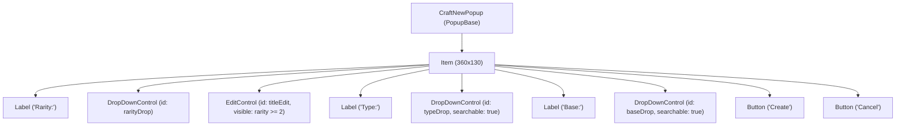

# UI Spec: CraftNewPopup
**File:** `app/qml/components/CraftNewPopup.qml`  **Pack:** `05-view-items.md`  **Legacy Reference:** `src/Modules/ItemsTab.lua:2774-2858` (`ItemsTab:CraftItem`)  **Status:** Test-Covered

--------------------------------------------------------------------------------

## 1. Purpose & Parity Notes
*   **Role:** Starting creation dialog for crafting new items from scratch. Allows the user to select item rarity, optional item title (for Rare, Unique, and Relic rarities), base item category type, and specific equipment base type with live base-stat tooltips.
*   **Intentional Deviations from Legacy PoB:** None (1:1 functional parity). For non-crafted and non-Normal rarities (Unique and Relic), clicking Create constructs the item base and immediately delegates to `ItemTextPopup` via the `created(true)` signal.

--------------------------------------------------------------------------------

## 2. Lightweight Wireframe & Layout Box Model
# Default Modal Layout (376x150, Content Width: 360)
```text
+-------------------------------------------------------------+
|  Craft Item                                             [X] |
+-------------------------------------------------------------+
|    Rarity: [ Rare         v] [ Spine Bow                  ] | <- Title if Rare/Uniq
|      Type: [ Bow                                          v] |
|      Base: [ Spine Bow                                    v] |
|                                                             |
|                    [  Create  ]   [ Cancel ]                |
+-------------------------------------------------------------+
```

# Responsive / Overflow Rules
*   **Minimum safe dimensions:** 376x150 px (Fixed dialog envelope; parent window minimum: 960x640 px).
*   **Horizontal scroll policy:** Forbidden. Dropdowns and inputs fit within 360 px width.
*   **Text truncation policy:** Type and Base dropdown items elide right with full-text tooltip on hover.

# Component Hierarchy


--------------------------------------------------------------------------------

## 3. Interactive States & Controls
| Control (objectName) | Type | Default State | Interactive Behavior | Edge States (Disabled / Empty / Loading / Error / Long Text) |
| ------ | ------ | ------ | ------ | ------ |
| `pob.craftNew.rarityDrop` | `DropDownControl` | `"Rare"` (index 2) | Selects item rarity; toggles visibility of `titleEdit` | Standard rarities: Normal, Magic, Rare, Unique, Relic |
| `pob.craftNew.titleEdit` | `EditControl` | Empty text | Custom item name; visible only when `rarityDrop.currentIndex >= 2` | Hidden for Normal and Magic items |
| `pob.craftNew.typeDrop` | `DropDownControl` | Default base category | Selects gear category (Bow, Body Armour, etc.); queries bases | Searchable list |
| `pob.craftNew.baseDrop` | `DropDownControl` | First base item | Selects equipment base; hover shows implicit and baseline stats | Searchable list; displays base comparison tooltip |
| `pob.craftNew.createBtn` | `Button` | Enabled | Invokes `pob_itemsCraftNewCreate`; closes dialog; emits `created` | Always enabled when selections valid |
| `pob.craftNew.cancelBtn` | `Button` | Enabled | Closes dialog via `reject()` | Discards craft setup |

# State Matrix & Binding Hazards
*   *Asynchronous Category Resynchronization:* Changing `typeDrop` invokes `pob_itemsCraftNewInit(typeIndex)`. `_setBases()` must clamp `baseDrop.currentIndex` against `mapped.length - 1` to prevent out-of-bounds selection errors on categories with fewer base types.
*   *Text Popup Handoff:* When creating Unique or Relic items, `r.openEditText` is true. The parent view must observe `created(bool openEditText)` and immediately open `ItemTextPopup` with `alsoAdd = true`.

--------------------------------------------------------------------------------

## 4. Data & Bridge Contract
*   **Reads (LuaEngine / C++ Models):**
    *   `luaEngine.invoke("pob_itemsCraftNewInit", [optionalTypeIndex])` -> `{ ok: bool, rarities: QVariantList, raritySel: int, types: QVariantList, typeSel: int, bases: QVariantList, baseSel: int }`
    *   `luaEngine.invoke("pob_itemsCraftNewTooltip", [rarity, title, type, base])` -> `{ lines: QVariantList }`
*   **Writes / Mutations:**
    *   `luaEngine.invoke("pob_itemsCraftNewCreate", [rarity, title, type, base])` -> `{ ok: bool, openEditText: bool }`
*   **Signals Observed:**
    *   `created(bool openEditText)` -> emitted on successful item construction.
*   **Qt6 Bridge Safety:** Normalize `init.bases` and `init.types` via `QmlBridge.toArray()`.

--------------------------------------------------------------------------------

## 5. Testable Acceptance Criteria (Qt6::QuickTest)
*   **AC-01 (Initial Render & Zero Warnings):** Calling `openFresh()` populates dropdowns, sets default Rare rarity, and emits zero QML warnings.
*   **AC-02 (Title Visibility Toggle):** Changing rarity to "Normal" hides `titleEdit`; changing to "Rare" shows `titleEdit`.
*   **AC-03 (Category Switch Re-populates Bases):** Selecting "Amulet" in `typeDrop` updates `baseDrop` with amulet bases and resets selection to index 0.
*   **AC-04 (Base Tooltip Inspection):** Hovering over `baseDrop` fetches and displays base item implicits and attribute requirements.
*   **AC-05 (Primary User Flow - Create):** Clicking `Create` invokes `pob_itemsCraftNewCreate`, accepts the popup, and emits `created(openEditText)`.

--------------------------------------------------------------------------------

## 6. Bug Audit Findings (Current Implementation vs Spec)
| Severity | File & Line | Symptom / Defect | Root Cause | Expected Behavior |
| ------ | ------ | ------ | ------ | ------ |
| Med | `app/qml/components/CraftNewPopup.qml:776` | Base dropdown displays blank selection when switching categories | `_setBases()` does not clamp index if `sel` exceeds `mapped.length` | Clamp with `Math.max(0, Math.min(mapped.length - 1, (sel || 1) - 1))` |
| Low | `app/qml/components/CraftNewPopup.qml:868` | Hardcoded button coordinate math overlaps on non-English locales | Absolute pixel positioning (`x: 180 - 45 - 40`) | Replace with centered `RowLayout` |
| Low | `app/qml/components/CraftNewPopup.qml:843` | Typing in `titleEdit` does not refresh base tooltip | `_fillBaseTooltip` called without watching title text edits | Re-query tooltip when `titleEdit.text` changes |
