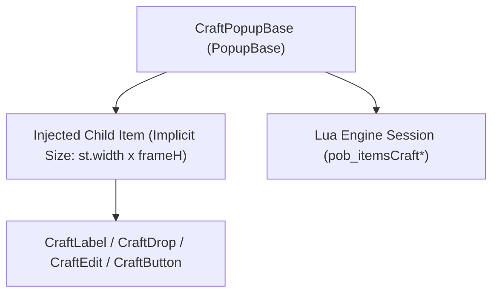

# UI Spec: CraftPopupBase
**File:** `app/qml/components/CraftPopupBase.qml`  **Pack:** `05-view-items.md`  **Legacy Reference:** `src/Modules/ItemsTab.lua` (Craft popups session architecture)  **Status:** Test-Covered

--------------------------------------------------------------------------------

## 1. Purpose & Parity Notes
*   **Role:** Abstract base shell and session controller for display-item crafting dialogs (Enchant, Anoint, Corrupt, Implicit, Custom, Crucible). Captures legacy Lua popup control state tables into a unified bridge session, routing user mutations and actions by control name.
*   **Intentional Deviations from Legacy PoB:** In legacy Lua, crafting popups are created as procedural immediate-mode tables that mutate dialog dimensions dynamically. In QML, `CraftPopupBase` provides declarative state reflection (`st`), automatic frame height adaptation (`frameH`), and safe session termination on modal dismiss.

--------------------------------------------------------------------------------

## 2. Lightweight Wireframe & Layout Box Model
# Base Container Envelope (Dynamic Width x Dynamic frameH)
```text
+-------------------------------------------------------------+
|  [Session Title (e.g., "Corrupted Item", "Enchant Item")] [X]|
+-------------------------------------------------------------+
|                                                             |
|  [ Child Crafting Controls Layout Injected Here ]            |
|  (Derived popups instantiate CraftLabel, CraftDrop, etc.)   |
|                                                             |
|  +--------------------------------------------------------+ |
|  | Derived action buttons:                                | |
|  |              [  Save  ]   [ Cancel ]                   | |
|  +--------------------------------------------------------+ |
+-------------------------------------------------------------+
```

# Responsive / Overflow Rules
*   **Minimum safe dimensions:** 360x100 px (Width and height dictated by session descriptor `st.width` and `st.height`).
*   **Horizontal scroll policy:** Forbidden. Child components position within the session coordinate space.
*   **Text truncation policy:** Child control labels right-align to anchor offsets; dropdowns elide right.

# Component Hierarchy


--------------------------------------------------------------------------------

## 3. Interactive States & Controls
| Control (objectName) | Type | Default State | Interactive Behavior | Edge States (Disabled / Empty / Loading / Error / Long Text) |
| ------ | ------ | ------ | ------ | ------ |
| `pob.craftBase.root` | `PopupBase` | Closed (`visible: false`) | Modal shell; manages session lifecycle and padding | Frame height dynamically binds to `st.height` |
| `pob.craftBase.session` | `Property (st)` | Empty map (`{}`) | Holds captured controls, visibility states, and sizes | Stale sessions trigger immediate `close()` |

# Session Control Routing Protocol
*   `openCraft(kind, slot)`: Invokes `pob_itemsCraftOpen` and initializes `st`.
*   `rec(name)`: Resolves a control record by dotted path (e.g., `"notableDB.sort"` resolves sub-control `sort` inside list `notableDB`).
*   `set(name, value, quiet)`: Invokes `pob_itemsCraftSet`. If `quiet === true`, suppresses full state refresh for fast text entry.
*   `click(name)`: Invokes `pob_itemsCraftClick`; closes popup if `r.closed === true`.
*   `fillTip(tt, name, index)`: Invokes `pob_itemsCraftTooltip` and populates tooltip lines.

# State Matrix & Binding Hazards
*   *Session Leak Hazard:* Closing the popup via Esc, close button, or scrim click must unconditionally invoke `pob_itemsCraftClose` to release the Lua session table. Handled via `onClosed`.
*   *Dead Session Loop:* If `pob_itemsCraftState` reports `open === false` during a refresh, the dialog must close immediately to prevent zombie control interaction.

--------------------------------------------------------------------------------

## 4. Data & Bridge Contract
*   **Reads (LuaEngine / C++ Models):**
    *   `luaEngine.invoke("pob_itemsCraftOpen", [kind, slot])` -> `{ open: bool, title: string, width: int, height: int, controls: QVariantMap }`
    *   `luaEngine.invoke("pob_itemsCraftState", [])` -> `{ open: bool, width: int, height: int, controls: QVariantMap }`
    *   `luaEngine.invoke("pob_itemsCraftTooltip", [name, index])` -> `{ lines: QVariantList }`
*   **Writes / Mutations:**
    *   `luaEngine.invoke("pob_itemsCraftSet", [name, value])` -> `{ open: bool, ok: bool, controls: QVariantMap }`
    *   `luaEngine.invoke("pob_itemsCraftClick", [name])` -> `{ ok: bool, closed: bool }`
    *   `luaEngine.invoke("pob_itemsCraftClose", [])` -> `{ ok: bool }`
*   **Signals Observed:** None (Synchronous session calls).
*   **Qt6 Bridge Safety:** Dotted path resolution in `rec(name)` must guard against null intermediate parent objects.

--------------------------------------------------------------------------------

## 5. Testable Acceptance Criteria (Qt6::QuickTest)
*   **AC-01 (Initial Render & Zero Warnings):** Invoking `openCraft("enchant", 1)` opens the modal, sets the window title, and produces zero QML warnings.
*   **AC-02 (Dynamic Resize):** Modifying `st.height` dynamically adjusts `frameH` without distorting child anchors.
*   **AC-03 (Sub-Control Dotted Path):** Calling `rec("notableDB.search")` correctly resolves the nested sub-control descriptor map.
*   **AC-04 (Action Button Dismissal):** Clicking a control that results in `closed: true` terminates the session and dismisses the popup.
*   **AC-05 (Session Cleanup on Escape):** Pressing `Escape` closes the popup and triggers `pob_itemsCraftClose`.

--------------------------------------------------------------------------------

## 6. Bug Audit Findings (Current Implementation vs Spec)
| Severity | File & Line | Symptom / Defect | Root Cause | Expected Behavior |
| ------ | ------ | ------ | ------ | ------ |
| Med | `app/qml/components/CraftPopupBase.qml:502` | TypeError when `name` contains dot and parent control is undefined | Unchecked property access on `parent.sub` | Ensure `parent && parent.sub` is checked before reading sub-key |
| Low | `app/qml/components/CraftPopupBase.qml:528` | Stale session persists if `openCraft` fails on network/engine hang | `st` not cleared when `openCraft` returns falsy | Reset `st = {}` and return false |
| Low | `app/qml/components/CraftPopupBase.qml:490` | `padding: 0` causes child controls to clip against modal border on macOS | Zero margin frame configuration | Apply 4 px minimum margin inside child containers |
