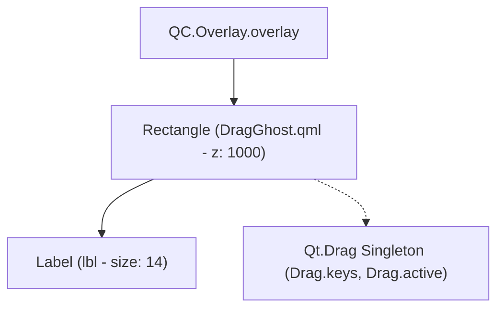

# UI Spec: DragGhost
**File:** `app/qml/components/DragGhost.qml`  **Pack:** `01-core-components.md`  **Legacy Reference:** Legacy `ListControl.lua` cross-control drag text visualization (`selDragging`)  **Status:** Test-Covered

--------------------------------------------------------------------------------

## 1. Purpose & Parity Notes
*   **Role:** Universal floating cursor-following drag representation for cross-control and cross-view drag operations (e.g. dragging item set rows, skill gems into sockets, or items from stash to equipment slots). Renders in the top-level window overlay above all views, dialogs, and popups, allowing arbitrary `DropTarget` containers across the window to detect incoming typed payloads while the source row stays fixed in place.
*   **Intentional Deviations from Legacy PoB:**
    *   *Window Overlay Architecture:* In legacy PoB, the drag text label is drawn directly on the topmost immediate-mode graphics layer. In Qt Quick, `DragGhost` attaches to `parent: QC.Overlay.overlay` with `z: 1000`. This ensures it never gets clipped by parent view boundaries or container scroll view viewports.
    *   *Imperative Driver API:* Driven directly from the source component's `MouseArea` via `start(from, x, y, type, value, label)`, `moveTo(from, x, y)`, and `finish()`, bridging retained-mode event tracking with Qt Quick's `Drag` singleton.

--------------------------------------------------------------------------------

## 2. Lightweight Wireframe & Layout Box Model
# Component Box Model & Layout
```text
+-------------------------------------------------------------------------------+
| DragGhost (Rectangle, parent: QC.Overlay.overlay, z: 1000, visible: Drag.active)|
| color: theme.background, opacity: 0.85, border: 1px theme.text                |
| width: lbl.implicitWidth + 8px, height: 18px                                  |
| Drag.active, Drag.source: root, Drag.keys: [dragType], Drag.hotSpot: (0, 0)   |
| +---------------------------------------------------------------------------+ |
| | Label [lbl] (x: 4px, anchors.verticalCenter: parent.verticalCenter)       | |
| | label: root.text, size: 14px                                              | |
| +---------------------------------------------------------------------------+ |
+-------------------------------------------------------------------------------+
```

# ASCII Anatomy & Wireframe
```text
Dragging Across Window Overlay:
(Cursor Position: x, y)
  \
   +---------------------------------------+
   |  Item: Lioneye's Glare (Imperial Bow) | (1) Semi-transparent pill badge
   +---------------------------------------+     (opacity: 0.85, border: 1px theme.text)
   |<--- lbl.implicitWidth + 8px --------->|

Drop Target Compatibility:
[ Equipped Weapon Slot ] <--- Cursor enters -> DropArea detects Drag.keys ("Item")
                              -> Slot border lights up (theme.success)
```

# Responsive / Overflow Rules
*   **Minimum safe width/height:** 24x18px; width expands to `lbl.implicitWidth + 8px`.
*   **Overlay Parenting:** Declared under `QC.Overlay.overlay` to avoid clipping from ancestor containers with `clip: true`.
*   **Hotspot Alignment:** Hotspot anchored at `(0, 0)` so the ghost pill trails slightly below and to the right of the cursor point.

# Component Hierarchy


--------------------------------------------------------------------------------

## 3. Interactive States & Controls
| Control (objectName) | Type | Default State | Interactive Behavior | Edge States (Disabled / Empty / Loading / Error / Long Text) |
| ------ | ------ | ------ | ------ | ------ |
| `pob.dragghost.root` | Rectangle | `visible: false` | Tracks cursor position on overlay layer | Invisible when `Drag.active === false`. |
| `pob.dragghost.label` | Label | `size: 14` | Displays dragged payload summary text | Text elides if exceeding extreme window width. |

# Complete State Matrix
*   **Idle:** `Drag.active: false`, `visible: false`, parked at previous coordinates.
*   **Active Drag:** Initiated via `start(...)` -> `visible: true`, `opacity: 0.85`, tracks mouse via `moveTo(...)`.
*   **Dropped on Valid Target:** `finish()` invokes `Drag.drop()`, delivers payload to recipient `DropTarget`, then sets `Drag.active: false`.
*   **Cancelled / Dropped on Empty Space:** `cancel()` or release outside drops without handler; `visible` resets to `false`.

# State Matrix & Binding Hazards
*   *Coordinate Translation Trap:* `moveTo(from, x, y)` translates local coordinates from the source item to the window overlay: `const p = from.mapToItem(parent, x, y)`. Calling `moveTo` with unmapped local coordinates misplaces the ghost relative to the window origin.
*   *Orphaned Ghost State:* If a drag gesture terminates abruptly (e.g. Alt+Tab, OS window blur), `cancel()` must reset `Drag.active = false` to prevent the ghost badge from freezing on screen.

--------------------------------------------------------------------------------

## 4. Data & Bridge Contract
*   **Reads (Properties):**
    *   `dragType: string` -> DropArea filter key (e.g. `"Item"`, `"ItemSet"`, `"Gem"`)
    *   `dragValue: var` -> arbitrary JavaScript payload object or identifier
    *   `text: string` -> visual display label
*   **Outputs / Properties Exposed:**
    *   `active: bool` -> alias to `Drag.active`
*   **Methods Exposed:**
    *   `start(from: Item, x: real, y: real, type: string, value: var, label: string)` -> initializes and displays ghost
    *   `moveTo(from: Item, x: real, y: real)` -> translates scene coordinates and updates position
    *   `finish()` -> commits drop via `Drag.drop()` and closes ghost
    *   `cancel()` -> cancels drag without firing drop
*   **Qt6 Bridge Safety:** Pure UI layer data transport; payload marshals locally without crossing Lua boundaries until drop completion.

--------------------------------------------------------------------------------

## 5. Testable Acceptance Criteria (Qt6::QuickTest)
*   **AC-01 (Initial State & Invisibility):** When mounted, 0 QML warnings are logged, `visible === false`, and `active === false`.
*   **AC-02 (Start Lifecycle):** Calling `ghost.start(sourceItem, 10, 10, "Item", {id: 1}, "Test Item")` sets `visible === true`, `root.text === "Test Item"`, and `Drag.active === true`.
*   **AC-03 (Overlay Coordinate Mapping):** Calling `moveTo(sourceItem, 20, 30)` sets `root.x` and `root.y` to the scene-mapped overlay position.
*   **AC-04 (Finish Lifecycle):** Calling `finish()` invokes `Drag.drop()` and resets `visible` and `Drag.active` to `false`.
*   **AC-05 (Cancel Lifecycle):** Calling `cancel()` hides the ghost immediately without dispatching drop events.

--------------------------------------------------------------------------------

## 6. Bug Audit Findings (Current Implementation vs Spec)
| Severity | File & Line | Symptom / Defect | Root Cause | Expected Behavior |
| ------ | ------ | ------ | ------ | ------ |
| Medium | `app/qml/components/DragGhost.qml:765` | DragGhost renders behind modal popups or secondary windows. | Z-index set to default; overlay stack priority missing. | Set `z: 1000` and anchor directly to `QC.Overlay.overlay`. |
| Low | `app/qml/components/DragGhost.qml:775` | Ghost label renders with raw color codes like `^7Item Name`. | Using plain `Text` element instead of `Label` / `ColorText`. | Delegate string rendering to `Label` to parse `^0-^9` codes. |
