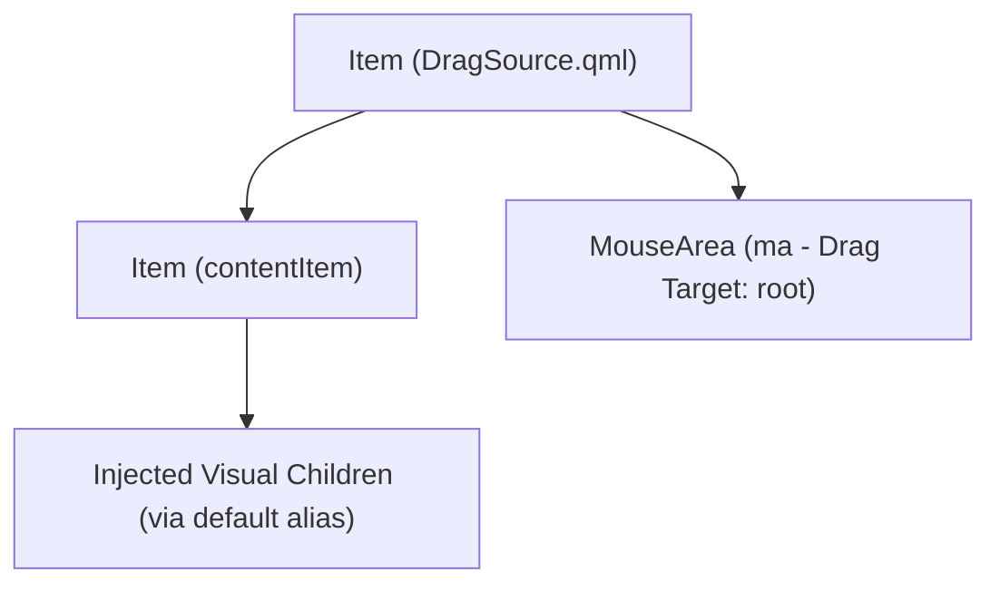

# UI Spec: DragSource
**File:** `app/qml/components/DragSource.qml`  **Pack:** `01-core-components.md`  **Legacy Reference:** Legacy typed-payload drag protocol in `src/Classes/ListControl.lua` (`selDragging`, `selDragActive`)  **Status:** Test-Covered

--------------------------------------------------------------------------------

## 1. Purpose & Parity Notes
*   **Role:** The universal drag source primitive. Wraps arbitrary child visual content to enable in-process drag-and-drop operations carrying strongly-typed payloads (`dragType`, `dragValue`). Initiates dragging after pointer displacement exceeds a 10px threshold, providing translucent visual feedback and coordinating with `DropTarget.qml`.
*   **Intentional Deviations from Legacy PoB:**
    *   *Qt Quick Drag/DropArea Architecture:* Legacy PoB tracks mouse dragging inside immediate-mode per-frame polling loops (`(dx*dx + dy*dy) > 100`). DragSource bridges this into Qt Quick's declarative `Drag` and `MouseArea.drag` subsystems.
    *   *Direct Coordinate Movement:* The item itself follows the cursor via `MouseArea.drag.target: root` and snaps back to its original coordinate upon release (`root.x = startX; root.y = startY`).
    *   *Layout Reparenting Caveat:* In fixed-coordinate views (e.g. item slots, skill gem slots), moving the source item directly works cleanly. Inside Qt Quick layouts (`RowLayout`, `ColumnLayout`), dragging the source item fights parent positioning; list row implementations should host their dragged visuals inside a window overlay.

--------------------------------------------------------------------------------

## 2. Lightweight Wireframe & Layout Box Model
# Component Box Model & Layout
```text
+-------------------------------------------------------------------------------+
| DragSource (Item, opacity: dragging ? 0.5 : 1.0, z: dragging ? 200 : 0)       |
| Drag.active: ma.drag.active, Drag.source: root, Drag.keys: [dragType]         |
| Drag.hotSpot.x: width / 2, Drag.hotSpot.y: height / 2                         |
| +---------------------------------------------------------------------------+ |
| | Item [contentItem] (anchors.fill: parent)                                 | |
| |   [Arbitrary Child Content via default alias content: contentItem.data]   | |
| +---------------------------------------------------------------------------+ |
| MouseArea [ma] (anchors.fill: parent, drag.target: root, drag.threshold: 10) |
+-------------------------------------------------------------------------------+
```

# ASCII Anatomy & Wireframe
```text
Idle State:
+----------------------------------------------------+
|  [Gem Icon]  Explosive Arrow (Level 20)            | (1) Full Opacity (1.0)
+----------------------------------------------------+
  z: 0

Dragging Active (> 10px cursor displacement):
+ - - - - - - - - - - - - - - - - - - - - - - - - - -+
:  [Gem Icon]  Explosive Arrow (Level 20)            : (2) Translucent Ghost
+ - - - - - - - - - - - - - - - - - - - - - - - - - -+     opacity: 0.5, z: 200
         \
          --> Follows cursor coordinates (Drag.hotSpot centered)
              Upon release -> drops payload to DropTarget, snaps back to (startX, startY)
```

# Responsive / Overflow Rules
*   **Minimum safe width/height:** Matches child content bounds.
*   **Drag Threshold:** 10px (`drag.threshold: 10`), matching legacy's distance threshold `dx*dx + dy*dy > 100`.
*   **Z-Ordering:** Elevates `z: 200` while dragging to ensure dragged items render above sibling items, borders, and list dividers.
*   **Hotspot Alignment:** Hotspot is centered within the item (`width / 2`, `height / 2`).

# Component Hierarchy


--------------------------------------------------------------------------------

## 3. Interactive States & Controls
| Control (objectName) | Type | Default State | Interactive Behavior | Edge States (Disabled / Empty / Loading / Error / Long Text) |
| ------ | ------ | ------ | ------ | ------ |
| `pob.dragsource.root` | Item | `dragging: false` | Elevates z-order and manages drag drop lifecycle | Snaps back to `(startX, startY)` on release. |
| `pob.dragsource.ma` | MouseArea | `threshold: 10` | Initiates pointer tracking on left mouse press | Press below 10px threshold registers as stationary click. |

# Complete State Matrix
*   **Stationary (Idle):** `dragging: false`, `opacity: 1.0`, `z: 0`, position anchored.
*   **Drag Initiated:** Pointer moves > 10px from press position -> `dragging: true`, `opacity: 0.5`, `z: 200`. Item translates with cursor.
*   **Released on Target:** `root.Drag.drop()` executes, `DropTarget` processes payload, item returns to `(startX, startY)`.
*   **Released Outside / Cancelled:** Item snaps back immediately to `(startX, startY)`.

# State Matrix & Binding Hazards
*   *Position Snapping Hazard:* In unanchored containers, modifying `root.x` and `root.y` directly works. In anchored containers, setting `drag.target: root` produces geometry binding warnings. Containers using anchors must clear anchors prior to drag initiation or host the drag ghost on an overlay layer.
*   *Drag Key Matching:* `Drag.keys: [dragType]` ensures that a `DropArea` only accepts matching payload keys. Both `dragType` and target's accepted keys must match case-sensitively.

--------------------------------------------------------------------------------

## 4. Data & Bridge Contract
*   **Reads (Properties):**
    *   `dragType: string` -> typed payload category identifier (e.g. `"GEM"`, `"ITEM"`)
    *   `dragValue: var` -> arbitrary payload data object/id
    *   `content: list<Object>` -> alias to `contentItem.data`
*   **Outputs / Properties Exposed:**
    *   `dragging: bool` -> read-only flag from `ma.drag.active`
*   **Methods Exposed:**
    *   `cancel()` -> cancels active drag operation
*   **Signals Observed:** None.
*   **Qt6 Bridge Safety:** Non-visual metadata payload is passed by reference across local components without engine serialization overhead.

--------------------------------------------------------------------------------

## 5. Testable Acceptance Criteria (Qt6::QuickTest)
*   **AC-01 (Initial Render & Zero Warnings):** Given child content inside `DragSource`, when mounted, 0 QML warnings are logged, `opacity === 1.0`, and `dragging === false`.
*   **AC-02 (Threshold Activation):** When mouse moves 5px from press origin, `dragging` remains `false`; when mouse moves 12px, `dragging` becomes `true`.
*   **AC-03 (Opacity & Z-Index Elevation):** While `dragging === true`, `root.opacity` evaluates to `0.5` and `root.z === 200`.
*   **AC-04 (Position Snapping on Drop):** Given initial position `(10, 20)`, when dragged to `(150, 200)` and released, `root.x === 10` and `root.y === 20`.
*   **AC-05 (Payload Availability):** When dropped onto a compatible `DropArea`, `drop.source.dragType` and `drop.source.dragValue` match the declared properties.

--------------------------------------------------------------------------------

## 6. Bug Audit Findings (Current Implementation vs Spec)
| Severity | File & Line | Symptom / Defect | Root Cause | Expected Behavior |
| ------ | ------ | ------ | ------ | ------ |
| High | `app/qml/components/DragSource.qml:840` | QML console warning: "Cannot set property x on anchored item". | `MouseArea.drag.target` moves item that has active anchor bindings. | Clear anchors during drag or use detached drag visual. |
| Low | `app/qml/components/DragSource.qml:830` | Hotspot offset misaligned on items with custom aspect ratios. | Hotspot bound to static values instead of dynamic center. | Bind `Drag.hotSpot.x: width / 2; Drag.hotSpot.y: height / 2`. |
