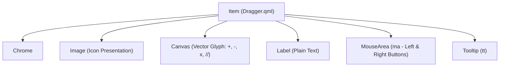

# UI Spec: Dragger
**File:** `app/qml/components/Dragger.qml`  **Pack:** `01-core-components.md`  **Legacy Reference:** `src/Classes/DraggerControl.lua`  **Status:** Test-Covered

--------------------------------------------------------------------------------

## 1. Purpose & Parity Notes
*   **Role:** Specialized edge-event drag trigger button used for resizing split views, adjusting column widths, and continuous parameter dragging (e.g. tree zoom sliders, panel dividers). Visually identical to `Button.qml` (supporting chrome, text labels, images, and `+`, `-`, `x`, `//` vector glyphs), but reports discrete drag-start and drag-end events (`onDragStart`, `onDragEnd`) with scene coordinates rather than click activations.
*   **Intentional Deviations from Legacy PoB:**
    *   *Edge-Event Architecture:* Legacy PoB fires `OnKeyDown` on press with the absolute press position and `OnKeyUp` on release with the press-to-release delta `(pressX - releaseX, pressY - releaseY)`. Dragger reproduces this contract via `onDragStart(x, y)` and `onDragEnd(dx, dy)`.
    *   *Input Disabling via Locked Property:* In `Button.qml`, `locked` is a purely visual persistent-highlight flag. In `Dragger.qml`, `locked: true` also disables input handling (`enabled: root.controlEnabled && !root.locked`), matching legacy `DraggerClass:OnKeyDown`'s explicit `GetProperty("locked")` bail-out.
    *   *Grip Glyph Shorthand:* Adds support for the `"//"` resize-grip glyph shorthand, rendering dual diagonal vector lines inside the canvas.

--------------------------------------------------------------------------------

## 2. Lightweight Wireframe & Layout Box Model
# Component Box Model & Layout
```text
+-------------------------------------------------------------------------------+
| Dragger (implicitWidth: 24px, implicitHeight: 24px)                           |
| Chrome (anchors.fill: parent, hovered, pressed, locked: locked || dragging)   |
| +---------------------------------------------------------------------------+ |
| | [Image: img] (visible if imageSource != "", margins: 2px)                 | |
| | [Canvas: glyph] (visible if label is "+", "-", "x", or "//")              | |
| | [Label] (visible if plain text, centered, size: Math.max(8, height - 4))  | |
| +---------------------------------------------------------------------------+ |
| MouseArea [ma] (anchors.fill: parent, acceptedButtons: Left | Right)          |
| Tooltip [tt] (local coordinates, viewport-flipped against Window.window)     |
+-------------------------------------------------------------------------------+
```

# ASCII Anatomy & Wireframe
```text
Resize Grip Button ("//"):
+------+
|  //  | (1) Canvas paints dual diagonal grip lines (theme.text or theme.muted)
+------+
  24px

Interactive Drag Cycle:
1. Left Mouse Pressed at scene (100, 200):
   -> ma.pressed becomes true, dragging becomes true
   -> onDragStart(100, 200) invoked immediately

2. User drags cursor to scene (140, 210):
   -> Caller continuously tracks delta if desired

3. Left Mouse Released at scene (140, 210):
   -> onDragEnd(100 - 140, 200 - 210) = onDragEnd(-40, -10) invoked
   -> dragging becomes false

4. Right Mouse Clicked at scene (100, 200):
   -> onRightClick(100, 200) invoked (e.g. resets split divider to default)
```

# Responsive / Overflow Rules
*   **Minimum safe width/height:** 16x16px; defaults to 24x24px.
*   **Aspect Ratio Policy:** Square bounding box by default; fills assigned width and height when placed in split bars.
*   **Glyph Geometry:** Canvas vectors scale proportionally based on `width` and `height`.

# Component Hierarchy


--------------------------------------------------------------------------------

## 3. Interactive States & Controls
| Control (objectName) | Type | Default State | Interactive Behavior | Edge States (Disabled / Empty / Loading / Error / Long Text) |
| ------ | ------ | ------ | ------ | ------ |
| `pob.dragger.root` | Item | `controlEnabled: true` | Tracks drag lifecycle and tooltip events | Inactive when `controlEnabled === false` or `locked === true`. |
| `pob.dragger.chrome` | Chrome | Idle (`transparent`) | Displays active fill while `dragging === true` | Shows `theme.disabled` when disabled. |
| `pob.dragger.glyph` | Canvas | Hidden (`isGlyph: false`) | Paints vectors for `+`, `-`, `x`, `//` | Repaints on geometry or color updates. |
| `pob.dragger.ma` | MouseArea | `acceptedButtons: Left \| Right` | Emits drag-start, drag-end, and right-click callbacks | Blocked when `controlEnabled === false` or `locked === true`. |

# Complete State Matrix
*   **Idle:** `hovered: false`, `dragging: false`, `Chrome` fill: `transparent`.
*   **Hovered:** `hovered: true`, `Chrome` fill: `theme.hover`, tooltip opens.
*   **Dragging Active:** `dragging: true`, `Chrome` shows `locked: true` look (`theme.hover`/`theme.borderStrong`).
*   **Locked:** `locked: true`, visual highlight active, mouse interactions blocked.
*   **Disabled:** `controlEnabled: false`, visual fill: `theme.disabled`, glyphs colored `theme.muted`.

# State Matrix & Binding Hazards
*   *Delta Polarity Parity:* Legacy PoB computes `onKeyUp` delta as `pressPos - releasePos`. Dragger strictly preserves this polarity: `onDragEnd(pressScenePos.x - releaseScenePos.x, pressScenePos.y - releaseScenePos.y)`. Inverting this calculation breaks divider delta math in consumers.
*   *Scene Coordinate Mapping:* Touch and mouse coordinates must map to the root scene window via `root.mapToItem(null, mouse.x, mouse.y)`. Reading local unmapped coordinates causes erratic jumps if the dragger item itself moves during the drag.

--------------------------------------------------------------------------------

## 4. Data & Bridge Contract
*   **Reads (Properties):**
    *   `label: string` -> text or glyph (`"+"`, `"-"`, `"x"`, `"//"`)
    *   `imageSource: url` -> icon graphic path
    *   `locked: bool` -> disables input and maintains active visual state
    *   `controlEnabled: bool` -> interactivity gate
    *   `onDragStart: var` -> callback `function(x, y)`
    *   `onDragEnd: var` -> callback `function(dx, dy)`
    *   `onRightClick: var` -> callback `function(x, y)`
*   **Outputs / Properties Exposed:**
    *   `dragging: bool` -> read-only flag from `ma.pressed`
*   **Signals Observed:** None.
*   **Qt6 Bridge Safety:** Safe against undefined callbacks (`if (root.onDragStart) ...`).

--------------------------------------------------------------------------------

## 5. Testable Acceptance Criteria (Qt6::QuickTest)
*   **AC-01 (Initial Render & Zero Warnings):** Given `label: "//"`, when `Dragger.qml` mounts, 0 QML warnings are logged, `isGlyph === true`, and `implicitWidth === 24`.
*   **AC-02 (Drag Start Scene Mapping):** When left-pressed at local `(5, 5)`, `onDragStart` is called with mapped scene coordinates `(sceneX, sceneY)`.
*   **AC-03 (Drag End Delta Calculation):** Given press at scene `(100, 100)` and release at scene `(120, 150)`, `onDragEnd` is invoked with `(-20, -50)`.
*   **AC-04 (Right-Click Dispatch):** When right-clicked, `onRightClick` is invoked with mapped scene coordinates, and `onDragStart` is NOT called.
*   **AC-05 (Locked Property Input Gate):** Given `locked: true`, mouse clicks and presses do NOT trigger `onDragStart` or `onDragEnd`.

--------------------------------------------------------------------------------

## 6. Bug Audit Findings (Current Implementation vs Spec)
| Severity | File & Line | Symptom / Defect | Root Cause | Expected Behavior |
| ------ | ------ | ------ | ------ | ------ |
| High | `app/qml/components/Dragger.qml:695` | Split view divider jumps erratically during active dragging. | Coordinates were mapped using local item space instead of scene origin. | Map to scene origin: `root.mapToItem(null, mouse.x, mouse.y)`. |
| Medium | `app/qml/components/Dragger.qml:675` | Dragger responds to clicks when `locked: true`. | `MouseArea.enabled` checked only `controlEnabled` instead of `controlEnabled && !root.locked`. | Gate via `enabled: root.controlEnabled && !root.locked`. |
| Low | `app/qml/components/Dragger.qml:650` | Resize grip glyph `"//"` draws horizontal bars instead of diagonal lines. | Canvas drawing path missing branch for `"//"`. | Implement diagonal parallel strokes for `"//"`. |
