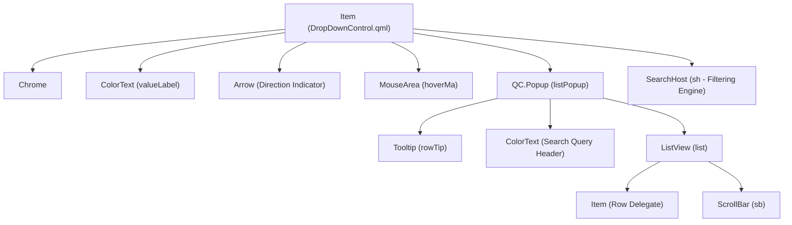

# UI Spec: DropDownControl
**File:** `app/qml/components/DropDownControl.qml`  **Pack:** `01-core-components.md`  **Legacy Reference:** `src/Classes/DropDownControl.lua`  **Status:** Test-Covered

--------------------------------------------------------------------------------

## 1. Purpose & Parity Notes
*   **Role:** Universal popup selection dropdown control. Renders the currently selected item label with PoB color styling, displays an expand/collapse directional arrow, supports mouse-wheel scrolling while closed, and opens an overlay popup list with smooth keyboard navigation, type-ahead selection, and optional full-text word-matching search filtering (`searchable: true`).
*   **Intentional Deviations from Legacy PoB:**
    *   *Popup Hosting in Window Overlay:* Legacy PoB draws dropdown lists directly in immediate mode. In Qt Quick, any ancestor container with `clip: true` (e.g. `ListView`, `ScrollView`) would clip a local child dropdown list. DropDownControl hosts its list inside `QtQuick.Controls.Popup`, ensuring it renders in the top-level window overlay above all other views.
    *   *Selection Event Semantics:* `selected(int index)` is emitted strictly upon explicit user interaction (mouse click, Enter/Return key commit, or type-ahead commit). Programmatic model or `currentIndex` refreshes do NOT emit `selected`, preventing re-entrant calculation loops.
    *   *Type Collisions:* `QtQuick.Controls` is imported with namespace `QC` (`import QtQuick.Controls as QC`) to avoid collision between the built-in `Button` and the project's custom `Button.qml`.

--------------------------------------------------------------------------------

## 2. Lightweight Wireframe & Layout Box Model
# Component Box Model & Layout
```text
Closed State:
+-------------------------------------------------------------------------------+
| DropDownControl (implicitHeight: theme.controlSize [18-20px], width: 160px)   |
| Chrome (anchors.fill: parent, locked: open, hovered, controlEnabled)          |
| +-------------------------------------------------------------+ +-----------+ |
| | ColorText [valueLabel] (margins: 4px, elide: Right)         | | Arrow     | |
| | "^7Deadeye" or placeholder ("Select Class...")              | | (9x5px, v)| |
| +-------------------------------------------------------------+ +-----------+ |
| MouseArea [hoverMa] (anchors.fill: parent, wheel steps index)                 |
+-------------------------------------------------------------------------------+

Open Popup Overlay State:
+-------------------------------------------------------------------------------+
| QC.Popup [listPopup] (background: theme.titleBar, border: theme.borderStrong) |
| ColorText [Search Header] (visible if searchable && _filter.length > 0)       |
| ListView [list] (clip: true, model: _viewIdx, rightMargin: sb.width + 2)      |
| +---------------------------------------------------------------------------+ |
| | Delegate Row (height: _rowHeight)                                         | |
| |   Rectangle (highlight fill: hovered/selected ? theme.hover : transparent)| |
| |   ColorText (item label or sh.highlightMatches())                         | |
| +---------------------------------------------------------------------------+ |
| ScrollBar [sb] (autoHide: true, width: 14px)                                  |
| Tooltip [rowTip] (z: 100, positioned beside active hovered row)              |
+-------------------------------------------------------------------------------+
```

# ASCII Anatomy & Wireframe
```text
Closed Dropdown:
+----------------------------------------------------+
|  Deadeye                                        v  | (1)
+----------------------------------------------------+
  |<----------- currentLabel ----------->| |<- 9x5 ->|

Open Dropdown (Searchable Mode Active):
+----------------------------------------------------+
|  Search: dead                                      | (2)
+----------------------------------------------------+
|  Deadeye                                           | (3a) Selected / Hovered
|  Deadly Ailments Support                           | (3b)
|                                                 |# | (4) ScrollBar
|                                                 |  |
+----------------------------------------------------+

Annotations:
(1) Closed control: displays current selection with Arrow pointing down; mouse wheel increments/decrements.
(2) Filter Header: visible when searchable: true and a search query is active via type-to-filter.
(3a) List Item (Hovered/Active): highlighted with theme.hover fill; tooltips render via rowTip.
(3b) Filtered Match: matching search segments highlighted using SearchHost formatting.
(4) ScrollBar: vertical auto-hiding scroll bar for lists exceeding maxVisibleItems (default 12).
```

# Responsive / Overflow Rules
*   **Minimum safe width/height:** 95x18px. Width expands to fit parent layout or explicit width.
*   **Popup Minimum Width:** `popupMinWidth` property allows the opened popup to be wider than the control itself (e.g. for long socket-group gem descriptions).
*   **Flip-up policy:** If space below the control in the window is less than popup height, `_flipUp` positions the popup above the control (`y: -implicitHeight`).
*   **Max Visible Rows:** Defaults to 12 rows (`maxVisibleItems: 12`). Additional items trigger internal scrolling via `ScrollBar`.

# Component Hierarchy


--------------------------------------------------------------------------------

## 3. Interactive States & Controls
| Control (objectName) | Type | Default State | Interactive Behavior | Edge States (Disabled / Empty / Loading / Error / Long Text) |
| ------ | ------ | ------ | ------ | ------ |
| `pob.dropdown.root` | Item | `controlEnabled: true` | Coordinates selection, wheel events, and popups | Renders muted when `controlEnabled === false`. |
| `pob.dropdown.value` | ColorText | Placeholder / label | Displays formatted active item string | Displays `placeholder` in `theme.mutedDark` if empty. |
| `pob.dropdown.arrow` | Arrow | Down (`root.open ? "up" : "down"`) | Indicates list open/closed status | Glyph color muted when disabled. |
| `pob.dropdown.popup` | QC.Popup | Closed (`visible: false`) | Renders list in window overlay | Auto-closes on Escape or click outside. |
| `pob.dropdown.list` | ListView | Populated via `_viewIdx` | Supports keyboard Up/Down, Enter pick | Empty search filter displays zero rows without error. |
| `pob.dropdown.search` | SearchHost | Inactive | Filters items matching typed characters | Clears on Escape or popup close. |

# State Matrix & Binding Hazards
*   *Lua Empty Table Bridge Hazard:* An empty Lua table (`{}`) marshals across the bridge into QML as an empty `QVariantMap` rather than a `QVariantList`. As a result, `model.length` evaluates to `undefined`, which crashes int bindings with `"Unable to assign [undefined] to int"`. Count must be guarded as: `readonly property int count: (model && model.length !== undefined) ? model.length : 0`.
*   *Programmatic Selection Latch:* Setting `currentIndex = 3` from C++ or a Lua model refresh must NEVER emit `selected(3)`. Emitting `selected` during model binding causes cascading recalculations.
*   *Tooltip Clipping Trap:* Never place item tooltips inside the `ListView` delegate. Delegates inherit `clip: true` from the `ListView`, causing tooltips to be clipped at row boundaries. A single shared `Tooltip` (`rowTip`) must live at the `QC.Popup` level outside the `ListView`.

--------------------------------------------------------------------------------

## 4. Data & Bridge Contract
*   **Reads (Properties):**
    *   `model: var` -> array of strings or objects (`[{ label: string, ... }]`)
    *   `currentIndex: int` -> currently selected index (-1 for none)
    *   `labelFor: var` -> callback `function(item) -> string`
    *   `tooltipForItem: var` -> callback `function(item, tooltip)`
    *   `itemEnabled: var` -> callback `function(item, index) -> bool`
*   **Writes / Signals Emitted:**
    *   `selected(int index)` -> emitted strictly on user selection
*   **Signals Observed:** None (driven via explicit properties).
*   **Qt6 Bridge Safety:** Objects in `model` are resolved via `labelFor(item)`, falling back to `item.label`, `item.text`, or `String(item)`.

--------------------------------------------------------------------------------

## 5. Testable Acceptance Criteria (Qt6::QuickTest)
*   **AC-01 (Initial Render & Zero Warnings):** Given a valid model array, when `DropDownControl.qml` mounts, 0 QML warnings are emitted, `count === model.length`, and `valueLabel` reflects `model[currentIndex]`.
*   **AC-02 (User Pick Signal Firing):** When the user clicks the control to open the popup and clicks row index 2, `selected(2)` is emitted, `currentIndex` becomes 2, and the popup closes.
*   **AC-03 (Programmatic Index Silence):** When `currentIndex` is modified programmatically via script binding, the `selected` signal is NOT emitted.
*   **AC-04 (Mouse Wheel Incrementation):** When the control is closed and hovered, rolling the mouse wheel up decrements `currentIndex` by 1 and emits `selected`, clamped at index 0.
*   **AC-05 (Searchable Filtering):** Given `searchable: true`, when the popup is open and the user types `"dead"`, only items matching `"dead"` remain visible in the filtered view, and pressing Enter selects the first matching item.

--------------------------------------------------------------------------------

## 6. Bug Audit Findings (Current Implementation vs Spec)
| Severity | File & Line | Symptom / Defect | Root Cause | Expected Behavior |
| ------ | ------ | ------ | ------ | ------ |
| High | `app/qml/components/DropDownControl.qml:920` | Dropdown crashes with QML TypeError when bound to empty Lua list. | Empty Lua table unmarshals as QVariantMap without `.length`. | Guard length checks: `(model && model.length !== undefined) ? model.length : 0`. |
| Medium | `app/qml/components/DropDownControl.qml:1050` | Row tooltips appear cut off or invisible when hovering over dropdown items. | Hosting `Tooltip` inside the delegate of a clipped `ListView`. | Place a single `Tooltip` outside the `ListView` in `QC.Popup.contentItem`. |
| Low | `app/qml/components/DropDownControl.qml:1010` | Typing in global window triggers unintended type-ahead selection in closed dropdown. | Key handlers active while popup is closed without checking active focus. | Restrict type-ahead key handling to when `root.open` or `root.activeFocus` is true. |
