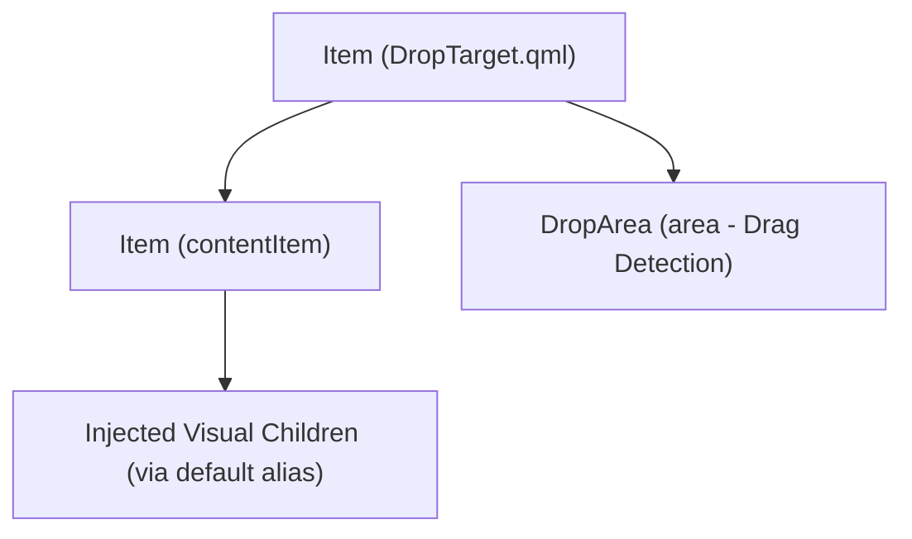

# UI Spec: DropTarget
**File:** `app/qml/components/DropTarget.qml`  **Pack:** `01-core-components.md`  **Legacy Reference:** Legacy drop target contract in `src/Classes/ListControl.lua` (`CanReceiveDrag`, `ReceiveDrag`)  **Status:** Test-Covered

--------------------------------------------------------------------------------

## 1. Purpose & Parity Notes
*   **Role:** The universal drop target receptacle. Wraps arbitrary child visual content to accept incoming drag operations from `DragSource.qml`, executing compatibility validation via `canReceiveDrag(type, value)`, rendering a drag-over highlight, and executing drops via `receiveDrag(type, value, source)`.
*   **Intentional Deviations from Legacy PoB:**
    *   *DropArea Encapsulation:* Wraps Qt Quick's native `DropArea`, handling drag acceptance filtering during `onEntered` events rather than polling cursor coordinates during the render pass.
    *   *Highlight State Token:* Exposes `readonly property bool highlighted: area.containsDrag`, mirroring legacy's green drag-target tint (`SetDrawColor(0.2, 0.6, 0.2)`). Consumers bind their visual surface colors directly to `dropTarget.highlighted ? theme.success : "transparent"`.

--------------------------------------------------------------------------------

## 2. Lightweight Wireframe & Layout Box Model
# Component Box Model & Layout
```text
+-------------------------------------------------------------------------------+
| DropTarget (Item, anchors.fill: parent or explicit geometry)                  |
| property var canReceiveDrag: function(type, value): bool                      |
| property var receiveDrag: function(type, value, source): void                 |
| readonly property bool highlighted: area.containsDrag                         |
| +---------------------------------------------------------------------------+ |
| | Item [contentItem] (anchors.fill: parent)                                 | |
| |   [Arbitrary Child Content via default alias content: contentItem.data]   | |
| +---------------------------------------------------------------------------+ |
| DropArea [area] (anchors.fill: parent, evaluates onEntered & onDropped)       |
+-------------------------------------------------------------------------------+
```

# ASCII Anatomy & Wireframe
```text
Idle State (Empty Item Slot):
+----------------------------------------------------+
|  [+] Empty Gem Socket                              | (1) Highlight: false
+----------------------------------------------------+
  Border: theme.border

Hovered with Valid Drag Payload (Gem Item Dragged Over):
+====================================================+
|# [+] Empty Gem Socket                             #| (2) Highlight: true
+====================================================+
  Border / Tint: theme.success (Green highlight: area.containsDrag)
  canReceiveDrag("GEM", gemData) returned true -> drag accepted
```

# Responsive / Overflow Rules
*   **Minimum safe width/height:** Matches child content bounds.
*   **Hit-Test Region:** `DropArea` fills the entire bounds of the `DropTarget` item (`anchors.fill: parent`).
*   **Content Passthrough:** Injected visual content remains fully interactive when no drag operation is active.

# Component Hierarchy


--------------------------------------------------------------------------------

## 3. Interactive States & Controls
| Control (objectName) | Type | Default State | Interactive Behavior | Edge States (Disabled / Empty / Loading / Error / Long Text) |
| ------ | ------ | ------ | ------ | ------ |
| `pob.droptarget.root` | Item | `highlighted: false` | Coordinates drag acceptance and drop dispatch | Ignores incompatible drag types. |
| `pob.droptarget.area` | DropArea | Idle | Validates incoming payloads via `canReceiveDrag` | Rejects drop if payload fails validation. |

# Complete State Matrix
*   **Idle:** No drag hovering; `highlighted: false`.
*   **Compatible Drag Enters:** `canReceiveDrag` returns `true` -> `drag.accepted: true`, `highlighted: true`.
*   **Incompatible Drag Enters:** `canReceiveDrag` returns `false` -> `drag.accepted: false`, `highlighted: false`.
*   **Drop Completed:** Fires `receiveDrag(src.dragType, src.dragValue, src)` and resets `highlighted: false`.

# State Matrix & Binding Hazards
*   *Null Source Guard:* External OS drag events or drag operations from non-DragSource items can have `drag.source === null`. `onEntered` and `onDropped` guard against null sources: `const src = drag.source; drag.accepted = !!src && root.canReceiveDrag(...)`.
*   *Re-entrant Drop Mutex:* If `receiveDrag` triggers an asynchronous model reload or view destruction, the `DropArea` must complete the event cleanly before the delegate is destroyed.

--------------------------------------------------------------------------------

## 4. Data & Bridge Contract
*   **Reads (Functional Properties):**
    *   `canReceiveDrag: var` -> callback `(type: string, value: var) -> bool`
    *   `receiveDrag: var` -> callback `(type: string, value: var, source: Item) -> void`
    *   `content: list<Object>` -> alias to `contentItem.data`
*   **Outputs / Properties Exposed:**
    *   `highlighted: bool` -> read-only flag from `area.containsDrag`
*   **Writes / Mutations:** None (calls `receiveDrag` callback on drop).
*   **Qt6 Bridge Safety:** Pure presentation and input routing component; robust against arbitrary drag payloads.

--------------------------------------------------------------------------------

## 5. Testable Acceptance Criteria (Qt6::QuickTest)
*   **AC-01 (Initial Render & Zero Warnings):** When `DropTarget.qml` mounts, 0 QML warnings are logged and `highlighted === false`.
*   **AC-02 (Compatibility Filtering):** Given `canReceiveDrag` returns `true` only for `"GEM"`, dragging an item with `dragType: "ITEM"` sets `drag.accepted === false` and `highlighted === false`.
*   **AC-03 (Drag-Over Highlighting):** When an item with matching `dragType: "GEM"` hovers over the drop target, `highlighted` evaluates to `true`.
*   **AC-04 (Drop Callback Dispatch):** Dropping a valid drag source triggers `receiveDrag` with the exact `dragType`, `dragValue`, and source `Item` reference.
*   **AC-05 (Child Component Hit-Testing):** Normal button clicks on child controls hosted inside `DropTarget` function as expected when no drag is active.

--------------------------------------------------------------------------------

## 6. Bug Audit Findings (Current Implementation vs Spec)
| Severity | File & Line | Symptom / Defect | Root Cause | Expected Behavior |
| ------ | ------ | ------ | ------ | ------ |
| Medium | `app/qml/components/DropTarget.qml:1395` | Crash or TypeError when hovering system files over the application window. | Accessing `drag.source.dragType` without verifying `drag.source` is non-null. | Check `!!src && root.canReceiveDrag(...)`. |
| Low | `app/qml/components/DropTarget.qml:1375` | Injected child controls do not receive mouse clicks. | Stacking order of `contentItem` placed behind default rectangle. | Declare `DropArea` without visual overlap over interactive children. |
