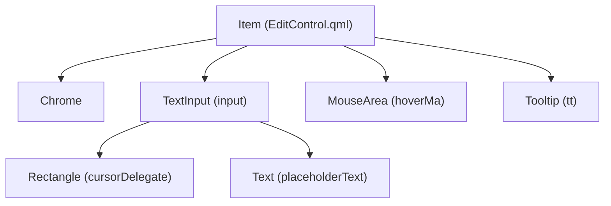

# UI Spec: EditControl
**File:** `app/qml/components/EditControl.qml`  **Pack:** `01-core-components.md`  **Legacy Reference:** `src/Classes/EditControl.lua` (751 lines)  **Status:** Test-Covered

--------------------------------------------------------------------------------

## 1. Purpose & Parity Notes
*   **Role:** Universal single-line text input field. Supports plain text editing, character filtering, numeric clamping on commit, placeholder prompt text, select-all on focus, Enter commit / Escape revert mechanics, clipboard copy/paste, and custom hover tooltips.
*   **Intentional Deviations from Legacy PoB:**
    *   *Native Qt Caret & Selection:* Legacy PoB hand-rolls caret placement, glyph cursor indexing, selection boxes, and horizontal scrolling via bitmap font atlas metrics (`DrawStringCursorIndex`). In Qt Quick, text is rasterized by Qt's font engine, so caret placement and selection are delegated to native `TextInput` to prevent visible drift between character bounds and the cursor.
    *   *External Sizing via TextMetrics:* Text layout measurement for column sizing remains available via `measuredWidth` using `textMetrics.width` to preserve legacy layout calculations.
    *   *Numeric Clamping on Commit:* In accordance with legacy PoB, numeric bounds (`numericMin`, `numericMax`) are clamped strictly on COMMIT (Enter, focus loss), never on individual keystrokes. This allows typing intermediate values (e.g. typing "1" while typing "15" where `numericMin: 10`).

--------------------------------------------------------------------------------

## 2. Lightweight Wireframe & Layout Box Model
# Component Box Model & Layout
```text
+-------------------------------------------------------------------------------+
| EditControl (implicitHeight: theme.controlSize [18-20px], implicitWidth: 120px)
| Chrome (anchors.fill: parent, hovered, locked: editing, controlEnabled)       |
| +---------------------------------------------------------------------------+ |
| | TextInput [input] (margins: left/right 4px, verticalCenter, clip: true)   | |
| |   color: controlEnabled ? theme.text : theme.muted                        | |
| |   cursorDelegate: Rectangle (width: 1px, color: theme.accent)             | |
| |   Text [placeholderText] (visible: empty && !editing, color: mutedDark)   | |
| +---------------------------------------------------------------------------+ |
| MouseArea [hoverMa] (anchors.fill: parent, hoverEnabled: true)                 |
| Tooltip [tt] (showAt local coordinates with viewport flip)                    |
+-------------------------------------------------------------------------------+
```

# ASCII Anatomy & Wireframe
```text
Idle Field with Text:
+----------------------------------------------------+
|  100                                               | (1)
+----------------------------------------------------+

Active Editing Field (Focused with Caret):
+----------------------------------------------------+
|  100|                                              | (2)
+----------------------------------------------------+
  Border: theme.borderStrong, Caret: theme.accent (1px)

Empty Field with Placeholder:
+----------------------------------------------------+
|  Search gems...                                    | (3)
+----------------------------------------------------+
  Color: theme.mutedDark, visible only when !editing && empty
```

# Responsive / Overflow Rules
*   **Minimum safe width/height:** 40x18px (compact numeric fields like character level); defaults to 120x18px.
*   **Horizontal scroll policy:** Internal horizontal scrolling handled by `TextInput` (`clip: true`) when text length exceeds field width.
*   **Text truncation policy:** Text does not truncate; characters scroll horizontally past the field boundaries as the caret advances.
*   **Caret Visibility:** Caret is rendered using `theme.accent` (cyan/yellow) with a 1px width, visible only while `input.activeFocus === true`.

# Component Hierarchy


--------------------------------------------------------------------------------

## 3. Interactive States & Controls
| Control (objectName) | Type | Default State | Interactive Behavior | Edge States (Disabled / Empty / Loading / Error / Long Text) |
| ------ | ------ | ------ | ------ | ------ |
| `pob.edit.root` | Item | `controlEnabled: true` | Coordinates commit, revert, and focus transitions | Disables editing when `readOnly` or disabled. |
| `pob.edit.input` | TextInput | Active text | Native caret, selection, paste, and keystrokes | Sanitizes input via `filterFunc` and `maxChars`. |
| `pob.edit.placeholder`| Text | `placeholder` string | Displays prompt when field is empty and unfocused | Hidden immediately when field gains focus. |
| `pob.edit.chrome` | Chrome | Idle (`transparent`) | Shows `theme.borderStrong` when `editing === true` | Shows `theme.disabled` fill when disabled. |

# Complete State Matrix
*   **Idle (With Text):** Border: `theme.border`, Text: `theme.text`, Caret: hidden.
*   **Hovered:** Border: `theme.borderStrong`, Tooltip displayed if defined.
*   **Focused (Editing):** `editing: true`, Border: `theme.borderStrong`, Caret: active, text selected if `selectAllOnFocus === true`.
*   **Empty & Unfocused:** Displays `placeholder` string in `theme.mutedDark`.
*   **Disabled:** `controlEnabled: false`, Text: `theme.muted`, Border: `theme.border`, mouse interactions suppressed except hover tooltip.
*   **Read-Only:** `readOnly: true`, text selectable, caret hidden, editing blocked.

# State Matrix & Binding Hazards
*   *Re-entrant Echo Hazard:* When a user types, `input.text` updates, emitting `edited(text)`. If the parent handler mutates `root.text` directly, `onTextChanged` re-triggers, which can reposition the caret to the end of the line. EditControl uses `_internalWrite: true` during internal text updates to differentiate user keystrokes from external model updates.
*   *Commit vs Keystroke Clamping:* Never clamp numbers during typing. Typing `1` with `numericMin: 10` would instantly jump to `10`, preventing the user from entering `15`. Clamping must execute strictly inside `_commit()`.

--------------------------------------------------------------------------------

## 4. Data & Bridge Contract
*   **Reads (Properties):**
    *   `text: string` -> active string value
    *   `isNumeric: bool` -> restricts input to integers or floats
    *   `allowNegative: bool` -> allows `-` prefix
    *   `allowDecimal: bool` -> allows `.` separator
    *   `numericMin: var`, `numericMax: var` -> numeric clamp range
    *   `filterFunc: var` -> callback `function(char) -> bool`
*   **Writes / Signals Emitted:**
    *   `edited(string text)` -> emitted per keystroke
    *   `committed(string text)` -> emitted on Enter/Return or focus-out
    *   `reverted()` -> emitted on Escape key (restores `_preEditText`)
*   **Qt6 Bridge Safety:** Non-numeric strings in numeric mode resolve to `numericMin` or `0` without causing NaN propagation to C++ bridge methods.

--------------------------------------------------------------------------------

## 5. Testable Acceptance Criteria (Qt6::QuickTest)
*   **AC-01 (Initial Render & Zero Warnings):** Given a default EditControl, when mounted, 0 QML warnings are logged, `implicitHeight === theme.controlSize`, and `text === input.text`.
*   **AC-02 (Select-All on Focus):** Given `selectAllOnFocus: true`, when the field gains active focus, the entire text string is selected (`input.selectedText === input.text`).
*   **AC-03 (Escape Key Reverts Value):** Given initial text `"Level 90"`, when the user types `"Level 95"` and presses Escape, `input.text` reverts to `"Level 90"` and `reverted()` is emitted.
*   **AC-04 (Numeric Clamping on Commit):** Given `isNumeric: true`, `numericMin: 1`, and `numericMax: 100`, when the user inputs `"150"` and presses Enter, `committed("100")` is emitted.
*   **AC-05 (Character Filtering):** Given a numeric field, typing alphabetic characters `"abc"` results in rejected keystrokes with `input.text` remaining unmodified.

--------------------------------------------------------------------------------

## 6. Bug Audit Findings (Current Implementation vs Spec)
| Severity | File & Line | Symptom / Defect | Root Cause | Expected Behavior |
| ------ | ------ | ------ | ------ | ------ |
| High | `app/qml/components/EditControl.qml:1455` | Caret jumps to the end of the text on every keystroke during typing. | External property binding re-evaluates and overwrites `input.text`. | Use `_internalWrite` latch to avoid resetting text during local edits. |
| Medium | `app/qml/components/EditControl.qml:1480` | Unable to type multi-digit numbers when a minimum constraint is present. | Clamping logic executed during `onTextChanged` instead of on commit. | Execute clamping strictly within `onCommitted` / `_commit()`. |
| Low | `app/qml/components/EditControl.qml:1510` | Placeholder text remains visible underneath typed text when text is white. | Placeholder visibility condition was `!editing` instead of `empty && !editing`. | Bind placeholder visibility to `empty && !editing`. |
