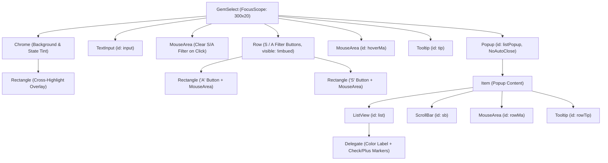

# UI Spec: GemSelect
**File:** `app/qml/components/GemSelect.qml`  **Pack:** `04-view-skills.md`  **Legacy Reference:** `src/Classes/GemSelectControl.lua`  **Status:** Test-Covered

--------------------------------------------------------------------------------

## 1. Purpose & Parity Notes
*   **Role:** Autocomplete gem selection combobox with fuzzy matching, DPS-sorted candidate ordering, support/active gem type filtering toggles, and dual-mode hover comparison tooltips. Used within socket group gem rows and the imbued support selector.
*   **Intentional Deviations from Legacy PoB:** In legacy Lua, highlighting a gem candidate in the dropdown live-previews it directly into the socket group before committing. In QML, no mutation is written to the engine until an explicit commit occurs (via Enter or mouse click), preventing the active build from entering a transient half-configured state during typing.

--------------------------------------------------------------------------------

## 2. Lightweight Wireframe & Layout Box Model
# Default Control Layout (300x20) & Expanded Dropdown (Up to 15 Rows, Height: 244)
```text
+-------------------------------------------------------------+
| [ Lightning Strike                                ] [A] [S] |
+-------------------------------------------------------------+
| +---------------------------------------------------------+ | <- listPopup
| | ^x33FF77Lightning Strike                                | |
| | ^x33FF77Lightning Strike of Arcing                     +| |
| | ^x33FF77Lightning Conduit                               | |
| | ^x33FF77Vaal Lightning Strike                          v| |
| | ^7Added Lightning Damage Support                        | |
| | ^7Faster Attacks Support                                | |
| | ^8<No matches>                                          | |
| +---------------------------------------------------------+ |
+-------------------------------------------------------------+
```

# Responsive / Overflow Rules
*   **Minimum safe dimensions:** 180x20 px (Implicit: 300x20 px; expands to fit container width).
*   **Horizontal scroll policy:** Forbidden. Candidate labels elide right or clip cleanly within the 16 px row height.
*   **Text truncation policy:** Input text scrolls horizontally on cursor movement; dropdown row labels clip with color preserved; right-aligned markers (`+` / `v`) have fixed margin anchors.

# Component Hierarchy


--------------------------------------------------------------------------------

## 3. Interactive States & Controls
| Control (objectName) | Type | Default State | Interactive Behavior | Edge States (Disabled / Empty / Loading / Error / Long Text) |
| ------ | ------ | ------ | ------ | ------ |
| `pob.gemSelect.input` | `TextInput` | Committed gem text | Focus opens dropdown; typing queries bridge candidates; Enter commits | Validator restricts to letters, spaces, apostrophes, colons, and hyphens |
| `pob.gemSelect.filterActive` | `Rectangle` | Inactive (`opacity: 0.5`) | Click filters list to active skill gems (`grants_active_skill`) | Border and opacity illuminate on hover or active filter |
| `pob.gemSelect.filterSupport` | `Rectangle` | Inactive (`opacity: 0.5`) | Click filters list to support gems (`support`) | Border and opacity illuminate on hover or active filter |
| `pob.gemSelect.listPopup` | `QC.Popup` | Hidden (`visible: false`) | Opens below input; displays up to 15 candidate rows; non-modal | Clamped to `Math.min(15, count) * 16 + 4` px |
| `pob.gemSelect.candidateList` | `ListView` | Select index: 0 | Up/Down navigates rows; hover previews stat delta tooltip | Displays `<No matches>` in grey (`^8`) when search yields empty set |
| `pob.gemSelect.rowDelegate` | `Rectangle` | Unselected | Click picks candidate; displays name and DPS marker (`+` or checkmark) | Color indicates gem attribute tier: Strength, Dexterity, Intelligence |

# State Matrix & Binding Hazards
*   *Imperative Property Desynchronization:* `_setText()` writes `input.text` directly, overriding declarative property bindings. Outside updates (e.g. undo/redo or preset change) are re-synchronized via `onTextChanged: if (!input.activeFocus) _setText(text)`.
*   *Focus Loss Race Hazard:* Losing focus while the list is dropped invokes `_exactId(text)`. If the typed text does not match a valid gem name exactly, the text is cleared (`_setText("")`) and `picked("")` is emitted.

--------------------------------------------------------------------------------

## 4. Data & Bridge Contract
*   **Reads (LuaEngine / C++ Models):**
    *   `luaEngine.invoke("pob_skillsGemCandidates", [groupIndex, row, searchBuf, filter])` -> `{ rows: QVariantList, noMatches: bool }`
    *   `luaEngine.invoke("pob_skillsGemTooltip", [groupIndex, row])` -> `{ lines: QVariantList }`
    *   `luaEngine.invoke("pob_skillsGemCandidateTooltip", [groupIndex, row, gemKey])` -> `{ lines: QVariantList }`
*   **Writes / Mutations:**
    *   `root.picked(gemId)` -> emitted on commit (`id` matches `data.gems` identifier, or `""` for empty).
*   **Signals Observed:**
    *   `hoverChanged(bool on)` -> emitted to trigger cross-highlighting on supporting gems in the active group.
*   **Qt6 Bridge Safety:** Convert `r.rows` returned from `pob_skillsGemCandidates` via `QmlBridge.toArray()` to guarantee native JavaScript array length and index access.

--------------------------------------------------------------------------------

## 5. Testable Acceptance Criteria (Qt6::QuickTest)
*   **AC-01 (Initial Render & Zero Warnings):** Rendering `GemSelect` displays the committed gem name in its granted attribute color without QML console warnings.
*   **AC-02 (Fuzzy Autocomplete & Navigation):** Focusing input and typing `"ctf"` opens popup, populates Cold to Fire Support, and pressing Down selects the first candidate.
*   **AC-03 (Primary User Flow - Commit):** Pressing `Enter` on a highlighted candidate closes the popup, updates input text to the gem name, and emits `picked(gemId)`.
*   **AC-04 (Filter Toggles):** Clicking the `"S"` filter box filters candidate rows strictly to support gems; clicking the text input body clears the filter.
*   **AC-05 (Revert on Escape):** Modifying the search buffer and pressing `Escape` closes the popup, restores `_initial` gem name, and forfeits active focus.

--------------------------------------------------------------------------------

## 6. Bug Audit Findings (Current Implementation vs Spec)
| Severity | File & Line | Symptom / Defect | Root Cause | Expected Behavior |
| ------ | ------ | ------ | ------ | ------ |
| Med | `app/qml/components/GemSelect.qml:53` | Candidate list fails to populate if bridge returns non-JS array | `Array.isArray(r.rows)` evaluated without bridge conversion | Use `QmlBridge.toArray(r.rows)` |
| Med | `app/qml/components/GemSelect.qml:137` | Uncaught TypeError inside `_exactId` when candidate has empty name | `rows[i].name.toLowerCase()` called without null guard | Guard with `rows[i] && rows[i].name ? rows[i].name.toLowerCase() : ""` |
| Low | `app/qml/components/GemSelect.qml:303` | Popup dropdown clips outside window at low resolutions | Popup fixed to `y: root.height` without boundary detection | Flip popup above input when bottom screen space is insufficient |
| Low | `app/qml/components/GemSelect.qml:208` | Text cleared prematurely when clicking scrollbar | `onActiveFocusChanged` treats scrollbar click as outside dismiss | Verify focus target before committing empty string |
