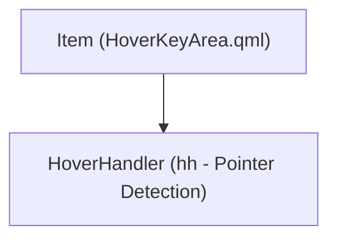

# UI Spec: HoverKeyArea
**File:** `app/qml/components/HoverKeyArea.qml`  **Pack:** `01-core-components.md`  **Legacy Reference:** Legacy `OnHoverKeyUp` pattern in `src/Classes/ItemSlotControl.lua`, `SkillListControl.lua`, `ItemListControl.lua`, `ItemDBControl.lua`  **Status:** Test-Covered

--------------------------------------------------------------------------------

## 1. Purpose & Parity Notes
*   **Role:** Hover-without-focus hotkey trigger primitive. Wraps Qt's native `HoverHandler` to detect whether a control or list row is currently hovered by the mouse cursor, allowing keyboard hotkeys (e.g. pressing 'W' or 'F1' to open wiki pages, or 'C' to copy item text) to execute on the hovered element without requiring it to take active keyboard focus.
*   **Intentional Deviations from Legacy PoB:**
    *   *HoverHandler Encapsulation:* Legacy PoB tests coordinates during its central `OnKeyUp` dispatch loop via `IsMouseOver()`. In Qt Quick, `HoverKeyArea` uses `HoverHandler` to track pointer presence in retained mode.
    *   *Inline Handler Property:* Exposes `onHoverKeyUp: function(key)` as an assignable JavaScript function property rather than a QML signal, matching the lightweight Tier 0 primitive pattern used by `UndoHandler` and `DropTarget`.

--------------------------------------------------------------------------------

## 2. Lightweight Wireframe & Layout Box Model
# Component Box Model & Layout
```text
+-------------------------------------------------------------------------------+
| HoverKeyArea (Item, anchors.fill: parent)                                     |
| HoverHandler [hh] (tracks cursor presence over Item bounds)                   |
| readonly property bool hovered: hh.hovered                                    |
| property var onHoverKeyUp: function(key) {}                                   |
+-------------------------------------------------------------------------------+
```

# ASCII Anatomy & Wireframe
```text
Parent Item / List Row Delegate:
+-------------------------------------------------------------------------------+
| [Gem Icon]  Explosive Arrow (Level 20, 20% Quality)                           |
| + - - - - - - - - - - - - - - - - - - - - - - - - - - - - - - - - - - - - - + |
| : HoverKeyArea (covers row bounds, tracks hh.hovered)                       : |
| + - - - - - - - - - - - - - - - - - - - - - - - - - - - - - - - - - - - - - + |
+-------------------------------------------------------------------------------+
  Cursor Hovered -> hh.hovered = true
  Global Key Pressed ('W') -> routes to hoveredArea.onHoverKeyUp("W")
```

# Responsive / Overflow Rules
*   **Minimum safe width/height:** Matches parent container (`anchors.fill: parent`).
*   **Focus Decoupling:** Does NOT take keyboard focus (`activeFocusOnPress: false`). Allows inputs and search fields to retain focus while hotkeys are routed to hovered elements.

# Component Hierarchy


--------------------------------------------------------------------------------

## 3. Interactive States & Controls
| Control (objectName) | Type | Default State | Interactive Behavior | Edge States (Disabled / Empty / Loading / Error / Long Text) |
| ------ | ------ | ------ | ------ | ------ |
| `pob.hoverkey.root` | Item | `hovered: false` | Tracks hover state; invokes `onHoverKeyUp(key)` | Hover becomes `false` when cursor leaves boundary. |
| `pob.hoverkey.hh` | HoverHandler | Active | Senses pointer coordinates | Automatically handles touch/mouse differences. |

# Complete State Matrix
*   **Unhovered:** `hovered: false`. Global key dispatcher skips this area.
*   **Hovered:** `hovered: true`. When a recognized key event triggers globally, `onHoverKeyUp(key)` is invoked.
*   **Parent Disabled:** When parent item is disabled, `HoverHandler` continues tracking hover unless `enabled: false` is set on the area.

# State Matrix & Binding Hazards
*   *Window Key Dispatch Routing:* `HoverKeyArea` does not trap keys directly; doing so would steal focus from typing fields. Instead, the top-level view or window key filter inspects all active `HoverKeyArea` instances and invokes `onHoverKeyUp` on the instance where `hovered === true`.

--------------------------------------------------------------------------------

## 4. Data & Bridge Contract
*   **Reads (Properties):**
    *   `hovered: bool` -> read-only flag from `hh.hovered`
    *   `onHoverKeyUp: var` -> callback `function(key: string)`
*   **Writes / Mutations:** None.
*   **Signals Observed:** None.
*   **Qt6 Bridge Safety:** Pure client-side event routing primitive.

--------------------------------------------------------------------------------

## 5. Testable Acceptance Criteria (Qt6::QuickTest)
*   **AC-01 (Initial Render & Zero Warnings):** When `HoverKeyArea.qml` mounts inside a parent Item, 0 QML warnings are logged and `hovered === false`.
*   **AC-02 (Hover State Tracking):** When the pointer moves within the bounding box of `HoverKeyArea`, `hovered` evaluates to `true`.
*   **AC-03 (Callback Execution):** Calling `root.onHoverKeyUp("W")` triggers the attached callback with the argument `"W"`.
*   **AC-04 (No Focus Interruption):** Pointer interaction over a `HoverKeyArea` does NOT remove active focus from an active `EditControl`.

--------------------------------------------------------------------------------

## 6. Bug Audit Findings (Current Implementation vs Spec)
| Severity | File & Line | Symptom / Defect | Root Cause | Expected Behavior |
| ------ | ------ | ------ | ------ | ------ |
| Medium | `app/qml/components/HoverKeyArea.qml:1740` | Hotkeys fail to trigger on hovered items when window is scrolled. | Global registry does not update hovered cache during scroll events. | Query `hovered` dynamically during the key press event. |
| Low | `app/qml/components/HoverKeyArea.qml:1735` | Mouse pointer events blocked from reaching underlying items. | Using MouseArea instead of HoverHandler in older prototypes. | HoverHandler must be used to preserve click-through behavior. |
