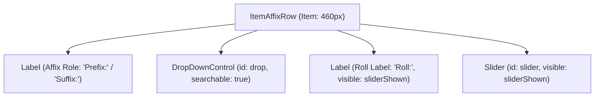

# UI Spec: ItemAffixRow
**File:** `app/qml/components/ItemAffixRow.qml`  **Pack:** `05-view-items.md`  **Legacy Reference:** `src/Modules/ItemsTab.lua:756-984`  **Status:** Test-Covered

--------------------------------------------------------------------------------

## 1. Purpose & Parity Notes
*   **Role:** Single crafted-affix management row in the display-item editor. Displays affix classification labels (Prefix, Suffix, Explicit), a searchable tier-selection dropdown, and an optional numeric roll slider spanning mod ranges.
*   **Intentional Deviations from Legacy PoB:** None (1:1 functional parity). Slider roll changes are coalesced via `Qt.callLater` to prevent calculation engine flooding while the user drags the roll thumb.

--------------------------------------------------------------------------------

## 2. Lightweight Wireframe & Layout Box Model
# Default Row Layout (460x24) & Expanded with Roll Slider (460x42)
```text
+-------------------------------------------------------------+
|    Prefix: [ T1 - (35-39)% increased Spell Damage         v] |
|      Roll: [=====o-----------------------------] (36%)      | <- Conditional Slider
+-------------------------------------------------------------+
```

# Responsive / Overflow Rules
*   **Minimum safe dimensions:** 420x24 px (Height expands to 42 px when `sliderShown === true`).
*   **Horizontal scroll policy:** Forbidden. Dropdown width fits within 418 px envelope.
*   **Text truncation policy:** Mod tier descriptions in dropdown list elide right with full stat comparison tooltip on hover.

# Component Hierarchy


--------------------------------------------------------------------------------

## 3. Interactive States & Controls
| Control (objectName) | Type | Default State | Interactive Behavior | Edge States (Disabled / Empty / Loading / Error / Long Text) |
| ------ | ------ | ------ | ------ | ------ |
| `pob.itemAffix.label` | `Label` | `"Prefix:"` / `"Suffix:"` | Right-aligned descriptor label | Anchored left of control at x=36 |
| `pob.itemAffix.drop` | `DropDownControl` | Selected mod tier | Searchable dropdown; typing filters tiers; hover displays roll range tooltip | Clamped to 14 visible items; width 418 px |
| `pob.itemAffix.rollLabel` | `Label` | `"Roll:"` | Visible only when `rec.sliderShown === true` | Hidden if mod has fixed rolls |
| `pob.itemAffix.slider` | `Slider` | Value in `[0.0, 1.0]` | Dragging thumb adjusts affix roll; updates engine via coalesced callback | Slider width dynamically set to 100 px or 300 px |

# State Matrix & Binding Hazards
*   *Bidirectional Slider Binding Break:* Directly binding `Slider.value = rec.val` breaks whenever the user manually drags the thumb. The component uses an imperative `push()` function protected by `slider.pushing` flags to avoid circular feedback loops.
*   *Rapid Recalculation Hazard:* Dragging the roll slider triggers full DPS and stat recalculations. Updates are buffered using `pending` and dispatched in a single `Qt.callLater` invocation.

--------------------------------------------------------------------------------

## 4. Data & Bridge Contract
*   **Reads (LuaEngine / C++ Models):**
    *   `rec` property: `{ n: int, label: string, list: QVariantList, sel: int, sliderShown: bool, rollLabel: string, sliderWidth: int, divCount: int, val: real }`
    *   `luaEngine.invoke("pob_itemsDisplayTooltip", [controlName, itemIndex, optionalValue])` -> `{ lines: QVariantList }`
*   **Writes / Mutations:**
    *   `luaEngine.invoke("pob_itemsDisplaySetControl", [controlName, selectedIndexOrValue])`
*   **Signals Observed:**
    *   `onRecChanged` -> calls `push()` to re-synchronize dropdown and slider state.
*   **Qt6 Bridge Safety:** Normalize `rec.list` through `QmlBridge.toArray()` before populating the dropdown model.

--------------------------------------------------------------------------------

## 5. Testable Acceptance Criteria (Qt6::QuickTest)
*   **AC-01 (Initial Render & Zero Warnings):** Rendering `ItemAffixRow` populates the affix dropdown with correct tier options and produces zero QML warnings.
*   **AC-02 (Slider Visibility Toggle):** Selecting a mod with variable rolls sets `rec.sliderShown = true`, expanding row height from 24 px to 42 px and showing the slider.
*   **AC-03 (Primary User Flow - Affix Selection):** Picking a different tier in `drop` invokes `pob_itemsDisplaySetControl(dropName, newIndex)` and updates display item stats.
*   **AC-04 (Roll Slider Coalescing):** Rapidly dragging the roll slider emits a single coalesced update call to the bridge on the next event loop frame.
*   **AC-05 (Tooltip Inspection):** Hovering an option in the tier dropdown fetches and displays the comparative stat tooltip with proper green/red diff indicators.

--------------------------------------------------------------------------------

## 6. Bug Audit Findings (Current Implementation vs Spec)
| Severity | File & Line | Symptom / Defect | Root Cause | Expected Behavior |
| ------ | ------ | ------ | ------ | ------ |
| Med | `app/qml/components/ItemAffixRow.qml:577` | Dropdown model recreation causes GC thrash on every item refresh | `push()` recreates entire array of objects unconditionally | Reuse existing model array if item count and labels match |
| Low | `app/qml/components/ItemAffixRow.qml:625` | Label position calculation `x: 36 - width` can clip offscreen | Hardcoded anchor offset assumes fixed width <= 80 px | Anchor label with `anchors.right: drop.left; anchors.rightMargin: 4` |
| Low | `app/qml/components/ItemAffixRow.qml:652` | Final slider position can drop if drag finishes during pending frame | `slider.pending` reset to `-1` without catching edge completion | Ensure trailing pending value is committed upon release |
