# UI Spec: ItemDBPanel
**File:** `app/qml/components/ItemDBPanel.qml`  **Pack:** `05-view-items.md`  **Legacy Reference:** `src/Classes/ItemDBControl.lua`, `src/Modules/ItemsTab.lua:271-294`  **Status:** Test-Covered

--------------------------------------------------------------------------------

## 1. Purpose & Parity Notes
*   **Role:** Comprehensive item database browsing and filtering panel allowing users to search, filter, inspect, and import Unique items and Rare base templates into their active build.
*   **Intentional Deviations from Legacy PoB:** In legacy Lua, the asynchronous `ListBuilder` coroutine relies on continuous immediate-mode `Draw` calls. In QML, background generation is pumped through a job-scoped `Timer` (`stepTimer`) that steps the coroutine in timed slices only when building, avoiding unnecessary idle CPU consumption.

--------------------------------------------------------------------------------

## 2. Lightweight Wireframe & Layout Box Model
# Default Panel Layout (360x360)
```text
+-------------------------------------------------------------+
| Import from: [ Uniques                      v]              |
| [ Slot Filter             v] [ Type Filter                v] |
| [ Sort By: Name           v] [ League: All                v] | <- Unique only
| [ Requirements: All       v] [ Obtainable: All            v] | <- Unique only
| [ Search...                               ] [Search: All  v] |
| +---------------------------------------------------------+ |
| | ^4Abberath's Hooves, Goat's Hoof Boots                  | |
| | ^4Aegis Aurora, Champion Kite Shield                    | |
| | ^4Agnoditha, Primordial Staff                           | |
| |                                                         | |
| +---------------------------------------------------------+ |
+-------------------------------------------------------------+
```

# Responsive / Overflow Rules
*   **Minimum safe dimensions:** 360x300 px (Width fixed to 360 px; height flexes with viewport).
*   **Horizontal scroll policy:** Forbidden. Controls are laid out in fixed 179 px columns.
*   **Text truncation policy:** Filter dropdown options elide right with full-text tooltip; search input scrolls horizontally.

# Component Hierarchy

```mermaid
flowchart TD
    Root["ItemDBPanel (Item: 360px)"] --> ModeLbl["Label ('Import from:')"]
    Root --> ModeDrop["DropDownControl (id: selectDB)"]
    Root --> SlotDrop["DropDownControl (id: slotDrop)"]
    Root --> TypeDrop["DropDownControl (id: typeDrop)"]
    Root --> SortDrop["DropDownControl (id: sortDrop, visible: isUnique)"]
    Root --> LeagueDrop["DropDownControl (id: leagueDrop, visible: isUnique)"]
    Root --> ReqDrop["DropDownControl (id: reqDrop, visible: isUnique)"]
    Root --> ObtainDrop["DropDownControl (id: obtainDrop, visible: isUnique)"]
    Root --> SearchEdit["EditControl (id: search)"]
    Root --> SearchModeDrop["DropDownControl (id: searchModeDrop)"]
    Root --> DbList["ItemListBox (id: dbList)"]
    Root --> StepTimer["Timer (id: stepTimer, interval: 1)"]
    Root --> CalcConn["Connections (target: luaEngine)"]
```


--------------------------------------------------------------------------------

## 3. Interactive States & Controls
| Control (objectName) | Type | Default State | Interactive Behavior | Edge States (Disabled / Empty / Loading / Error / Long Text) |
| ------ | ------ | ------ | ------ | ------ |
| `pob.itemDB.selectDB` | `DropDownControl` | `"Uniques"` (0) | Toggles between Uniques and Rare Templates database views | Re-queries filter schema and resets list offset |
| `pob.itemDB.slotDrop` | `DropDownControl` | `"Any Slot"` | Filters database items by equipment gear slot | Updates available subtype choices |
| `pob.itemDB.typeDrop` | `DropDownControl` | `"Any Type"` | Filters database items by base weapon/armour subtype | Filter list updates dynamically |
| `pob.itemDB.sortDrop` | `DropDownControl` | `"Name"` | Sorts uniques by Name, DPS, Life, or custom stat comparisons | Displays `"Sorting... (N%)"` progress during calculation |
| `pob.itemDB.leagueDrop` | `DropDownControl` | `"All Leagues"` | Filters uniques by league exclusivity | Hidden when Rare Templates selected |
| `pob.itemDB.searchEdit` | `EditControl` | Empty text | Filters item database by keyword search buffer | Focused via `Ctrl+F` shortcut |
| `pob.itemDB.dbList` | `ItemListBox` | Item list | Supports selection, drag to equip, double-click to edit, tooltip compare | Displays `st.text` when empty or filtering |

# State Matrix & Binding Hazards
*   *Coroutine Timer Starvation:* Setting `stepTimer.interval = 1` can saturate the UI event loop on high-refresh displays. Using an adaptive or frame-coalesced step prevents frame drops while keeping list generation fast.
*   *Recalculation Invalidation:* When `luaEngine.onCalcsChanged` fires, existing stat comparisons become stale. The panel must invalidate its sorted cache and restart `stepTimer`.

--------------------------------------------------------------------------------

## 4. Data & Bridge Contract
*   **Reads (LuaEngine / C++ Models):**
    *   `luaEngine.invoke("pob_itemsDBState", [which])` -> `{ building: bool, selectDB: int, search: string, text: string, filters: QVariantMap, rows: QVariantList }`
    *   `luaEngine.invoke("pob_itemsDBStep", [which])` -> `{ running: bool, error: string }`
    *   `luaEngine.invoke("pob_itemsTooltip", [which, key, shift])` -> `{ lines: QVariantList }`
*   **Writes / Mutations:**
    *   `luaEngine.invoke("pob_itemsDBSetFilter", [which, filterName, value])`
    *   `luaEngine.invoke("pob_itemsOpenForEdit", [which, key])` -> `{ ok: bool }`
    *   `luaEngine.invoke("pob_itemsCtrlClick", [which, key, shift])`
*   **Signals Observed:**
    *   `luaEngine.onCalcsChanged` -> calls `refresh()` when panel is visible.
    *   `luaEngine.onModeChanged` -> calls `refresh()` when panel is visible.
*   **Qt6 Bridge Safety:** Normalize `st.rows` and dropdown filter arrays using `QmlBridge.toArray()`.

--------------------------------------------------------------------------------

## 5. Testable Acceptance Criteria (Qt6::QuickTest)
*   **AC-01 (Initial Render & Zero Warnings):** Mounting `ItemDBPanel` renders the Uniques database filter dropdowns and starts `stepTimer` without QML errors.
*   **AC-02 (Database Switching):** Changing `selectDB` to "Rare Templates" hides unique-specific dropdowns (sort, league, req, obtain) and adjusts `listTop` from 104 px to 64 px.
*   **AC-03 (Primary User Flow - Search & Filter):** Typing in `searchEdit` invokes `pob_itemsDBSetFilter("search", text)`, starts `stepTimer`, and populates matching item rows.
*   **AC-04 (Double-Click Edit Flow):** Double-clicking an item in `dbList` invokes `pob_itemsOpenForEdit()`, loads the item into the display pane, and emits `requestEdit()`.
*   **AC-05 (Shortcut Focus Handling):** Calling `focusSearch()` focuses and selects all text in `searchEdit`; calling it while already focused toggles `selectDB`.

--------------------------------------------------------------------------------

## 6. Bug Audit Findings (Current Implementation vs Spec)
| Severity | File & Line | Symptom / Defect | Root Cause | Expected Behavior |
| ------ | ------ | ------ | ------ | ------ |
| Med | `app/qml/components/ItemDBPanel.qml:946` | UI thread stuttering during large item database sorts | `stepTimer` interval set to 1 ms without rate limiting | Use 16 ms timer interval or batch step slices in worker |
| Med | `app/qml/components/ItemDBPanel.qml:939` | Unchecked synchronous refresh on rapid calculation changes | Multiple rapid `onCalcsChanged` triggers parallel queries | Coalesce refreshes using `Qt.callLater` |
| Low | `app/qml/components/ItemDBPanel.qml:1037` | Layout coordinates rely on hardcoded magic offsets | Pixel math (`listTop - 42 - 18`) sensitive to styling edits | Replace with structured `ColumnLayout` or declarative anchors |
| Low | `app/qml/components/ItemDBPanel.qml:931` | `selectDB.currentIndex` out-of-sync if engine returns 0 | Index math assumes 1-based index unconditionally | Check `st.selectDB ? st.selectDB - 1 : 0` |
