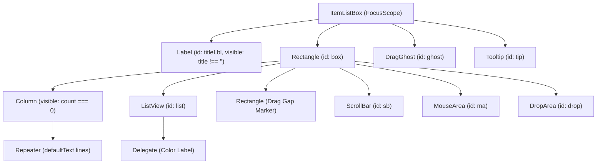

# UI Spec: ItemListBox
**File:** `app/qml/components/ItemListBox.qml`  **Pack:** `05-view-items.md`  **Legacy Reference:** `src/Classes/ListControl.lua`, `ItemListControl.lua`, `ItemDBControl.lua`  **Status:** Test-Covered

--------------------------------------------------------------------------------

## 1. Purpose & Parity Notes
*   **Role:** Unified high-density item list control serving as the visual and interaction engine for the All Items list, Unique Database, Rare Template Database, and Shared Items list. Supports mouse selection, drag-and-drop reordering, cross-list dragging via `DragGhost`, modifier key chords (Ctrl+Click, Shift+Drag), and contextual item tooltips.
*   **Intentional Deviations from Legacy PoB:** None (1:1 functional parity with legacy immediate-mode `ListControl`). The component does not invoke Lua bridge mutations directly; all mutations emit declarative signals (`ctrlClicked`, `doubleClicked`, `moved`, `droppedIn`) to allow host views to coordinate state updates.

--------------------------------------------------------------------------------

## 2. Lightweight Wireframe & Layout Box Model
# Default View Dimensions (360x240, Row Height: 16)
```text
+-------------------------------------------------------------+
| All Items                                         [Delete]  | <- Header Row (20px)
| +---------------------------------------------------------+ |
| | ^4Mageblood, Heavy Belt                                 | |
| | ^4Headhunter, Leather Belt                              | |
| | ^3Mirrored Bow, Spine Bow                               | |
| | ======================================================= | | <- Drop Line
| | ^2Gale Weaver, Cobalt Jewel                             | |
| |                                                         | |
| |                                                         | |
| +---------------------------------------------------------+ |
+-------------------------------------------------------------+
```

# Responsive / Overflow Rules
*   **Minimum safe dimensions:** 240x120 px (Scales fluidly with parent column layout).
*   **Horizontal scroll policy:** Forbidden. Item names clip cleanly at list width minus scrollbar margin.
*   **Text truncation policy:** Item labels clip without wrapping; multi-line `defaultText` renders centered when list count is zero.

# Component Hierarchy


--------------------------------------------------------------------------------

## 3. Interactive States & Controls
| Control (objectName) | Type | Default State | Interactive Behavior | Edge States (Disabled / Empty / Loading / Error / Long Text) |
| ------ | ------ | ------ | ------ | ------ |
| `pob.itemList.box` | `Rectangle` | Border: `theme.border` | Container surface; tints `theme.success` on drag hover, `theme.text` on focus | Bounds content with `clip: true` |
| `pob.itemList.emptyText` | `Column` | Visible when `count === 0` | Displays guidance instructions formatted from `defaultText` | Preserves color codes across line breaks |
| `pob.itemList.list` | `ListView` | Select index: -1 | Visual layout of item rows; driven by `MouseArea` overlay | Non-interactive directly to avoid gesture conflicts |
| `pob.itemList.mouseArea` | `MouseArea` | Active over list | Click selects; Ctrl+Click equips; Double-click edits; Drag past 10px drags | Shift-held modifier passed to signals |
| `pob.itemList.dropArea` | `DropArea` | Accepts `["Item"]` | Validates drag source against `acceptKinds`; updates insertion gap line | Disallows invalid drops |
| `pob.itemList.insertMarker` | `Rectangle` | Hidden (`visible: false`) | Indicates insertion index during active drag | Snaps to 16 px row height boundaries |
| `pob.itemList.scrollBar` | `ScrollBar` | Visible if overflow | Responds to mouse wheel deltas and thumb dragging | Auto-hides when content fits within container |

# State Matrix & Binding Hazards
*   *Drag Threshold Separation:* Drag initiation requires `dx * dx + dy * dy > 100` (10 px threshold) while holding Left Click without Control modifier. This prevents accidental drag triggers on standard selection clicks.
*   *Reorder Index Shift Hazard:* When dropping an item downward within the same list (`dropIndex > fromIndex`), the target index shifts by 1 (`to = dropIndex - 1`). The signal emitter must normalize this offset before dispatching `moved(from, to)`.

--------------------------------------------------------------------------------

## 4. Data & Bridge Contract
*   **Reads (LuaEngine / C++ Models):**
    *   `rows` model property: `QVariantList` of `{ key: var, label: string }`
    *   `tooltipFn(index, tooltip, shiftHeld)` -> host callback to populate `Tooltip` lines.
*   **Writes / Mutations (Signals Emitted):**
    *   `ctrlClicked(int index, bool shift)` -> equip / assign item to slot.
    *   `doubleClicked(int index)` -> open item in display-item editor.
    *   `copyRequested(int index)` -> copy item raw text to clipboard.
    *   `deleteRequested(int index)` -> prompt deletion of custom item.
    *   `moved(int from, int to)` -> reorder custom items within list.
    *   `droppedIn(var payload, int at)` -> import item from external list/database.
*   **Signals Observed:** None (Pure presenter component).
*   **Qt6 Bridge Safety:** Pass `rows` through `QmlBridge.toArray()` to prevent undefined length access.

--------------------------------------------------------------------------------

## 5. Testable Acceptance Criteria (Qt6::QuickTest)
*   **AC-01 (Initial Render & Zero Warnings):** Rendering `ItemListBox` with a populated `rows` model produces 16 px high row delegates with zero QML console warnings.
*   **AC-02 (Keyboard Traversal):** Up/Down arrow keys adjust `selIndex`, clamp within `[0, count - 1]`, and ensure the selected row is visible via `positionViewAtIndex`.
*   **AC-03 (Primary User Flow - Drag Ghost):** Dragging an item beyond 10 px hides the tooltip, instantiates `DragGhost`, and renders insertion line over valid target.
*   **AC-04 (Modifier Chord Signal Dispatch):** Ctrl+Clicking row index 2 emits `ctrlClicked(2, false)`; Ctrl+Shift+Clicking emits `ctrlClicked(2, true)`.
*   **AC-05 (Empty State Display):** With `rows: []` and populated `defaultText`, container displays instructions split across multiple lines in correct colors.

--------------------------------------------------------------------------------

## 6. Bug Audit Findings (Current Implementation vs Spec)
| Severity | File & Line | Symptom / Defect | Root Cause | Expected Behavior |
| ------ | ------ | ------ | ------ | ------ |
| Med | `app/qml/components/ItemListBox.qml:1135` | `count` returns 0 for valid QVariantList models | Raw property `.length` checked without bridge array conversion | Wrap with `QmlBridge.toArray(rows)` |
| Med | `app/qml/components/ItemListBox.qml:1232` | Out-of-bounds error when `rows` updates while view renders | `model: root.count` decoupled from `root.rows` | Bind `ListView.model` directly to `root.rows` |
| Low | `app/qml/components/ItemListBox.qml:1310` | `ghost.start` crashes if item row is removed during mouse press | `pressIndex` accessed without checking `pressIndex < root.rows.length` | Guard access with bounds check |
| Low | `app/qml/components/ItemListBox.qml:1370` | Uncaught exception in `_showTip` if `tooltipFn` is cleared | `tooltipFn` invoked without `try/catch` or null safety | Verify `typeof tooltipFn === 'function'` before invoking |
