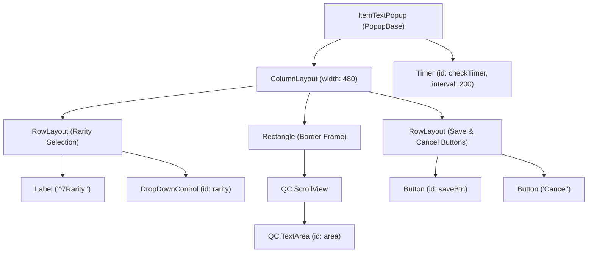

# UI Spec: ItemTextPopup
**File:** `app/qml/components/ItemTextPopup.qml`  **Pack:** `05-view-items.md`  **Legacy Reference:** `src/Modules/ItemsTab.lua:2225-2273` (`ItemsTab:EditDisplayItemText`)  **Status:** Test-Covered

--------------------------------------------------------------------------------

## 1. Purpose & Parity Notes
*   **Role:** Raw item text editor and creator modal enabling users to edit the verbatim text of the currently displayed item ("Edit...") or construct custom items from copied game text ("Create custom..."). Features rarity overrides, monospace multi-line editing, and debounced parsing validation.
*   **Intentional Deviations from Legacy PoB:** In legacy Lua, item text syntax parsing re-validates synchronously every frame inside the immediate-mode draw cycle. In QML, validation is debounced via a 200 ms one-shot timer (`checkTimer`) triggered by `onTextChanged`, eliminating continuous parsing while typing.

--------------------------------------------------------------------------------

## 2. Lightweight Wireframe & Layout Box Model
# Default Modal Layout (504x520, Content Width: 480)
```text
+-------------------------------------------------------------+
|  Edit Item Text / Create Custom Item                    [X] |
+-------------------------------------------------------------+
|  Rarity: [ Rare                                  v]         |
|  +--------------------------------------------------------+ |
|  | Rarity: RARE                                           | |
|  | Gale Weaver                                            | |
|  | Cobalt Jewel                                           | |
|  | --------                                               | |
|  | +15% to Critical Strike Multiplier with Cold Skills    | |
|  | 7% increased maximum Life                              | |
|  | 12% increased Area Damage                               | |
|  |                                                        | |
|  +--------------------------------------------------------+ |
|                    [   Save   ]   [ Cancel ]                |
+-------------------------------------------------------------+
```

# Responsive / Overflow Rules
*   **Minimum safe dimensions:** 504x520 px (Clamped to viewport; host window minimum: 960x640 px).
*   **Horizontal scroll policy:** Allowed inside `QC.TextArea` with `wrapMode: TextEdit.NoWrap`.
*   **Text truncation policy:** Text area uses fixed-width monospace font (`theme.fontFixed`); Save button tooltip renders full item tooltip lines or parse errors.

# Component Hierarchy


--------------------------------------------------------------------------------

## 3. Interactive States & Controls
| Control (objectName) | Type | Default State | Interactive Behavior | Edge States (Disabled / Empty / Loading / Error / Long Text) |
| ------ | ------ | ------ | ------ | ------ |
| `pob.itemText.rarity` | `DropDownControl` | Initial item rarity | Selects rarity override; triggers immediate `_check()` | Width fixed to 100 px; updates parsing context |
| `pob.itemText.area` | `QC.TextArea` | Raw item text | Freeform text entry; keystrokes restart `checkTimer` (200 ms) | Monospace font; horizontal scrolling on overflow |
| `pob.itemText.saveBtn` | `Button` | Enabled if `valid` | Calls `luaEngine.invoke("pob_itemsEditTextSave")` and closes dialog | Disabled when text cannot parse to an item base; hover shows syntax error |
| `pob.itemText.cancelBtn` | `Button` | Enabled | Closes dialog via `reject()`; discards edits | Always enabled |

# State Matrix & Binding Hazards
*   *Validation Debounce Race:* Clicking `Save` immediately after typing can invoke `_save()` before `checkTimer` triggers. The click handler must call `_check()` synchronously if `checkTimer.running == true` to guarantee latest validation state.
*   *Stale Parsing Tooltip:* `saveBtn.tooltipFunc` references `_tipLines`. If parsing fails, `_tipLines` must contain the Lua parser error message lines rather than retaining stale item tooltip data.

--------------------------------------------------------------------------------

## 4. Data & Bridge Contract
*   **Reads (LuaEngine / C++ Models):**
    *   `luaEngine.invoke("pob_itemsEditTextInit", [])` -> `{ title: string, saveLabel: string, rarities: QVariantList, raritySel: int, text: string }`
    *   `luaEngine.invoke("pob_itemsEditTextCheck", [text, rarityIndex1Based])` -> `{ valid: bool, lines: QVariantList }`
*   **Writes / Mutations:**
    *   `luaEngine.invoke("pob_itemsEditTextSave", [text, rarityIndex1Based, alsoAdd])` -> `{ ok: bool }`
*   **Signals Observed:** None (Synchronous modal session).
*   **Qt6 Bridge Safety:** Convert `init.rarities` using `QmlBridge.toArray()` to guarantee safe length access.

--------------------------------------------------------------------------------

## 5. Testable Acceptance Criteria (Qt6::QuickTest)
*   **AC-01 (Initial Render & Zero Warnings):** Opening `ItemTextPopup` focuses `area`, loads raw item text, initializes rarity dropdown, and produces zero QML warnings.
*   **AC-02 (Syntax Validation Debounce):** Modifying text in `area` restarts `checkTimer`; after 200 ms, `pob_itemsEditTextCheck` is invoked and updates `valid`.
*   **AC-03 (Primary User Flow - Save):** Entering valid item text enables `Save`; clicking `Save` invokes `pob_itemsEditTextSave`, accepts modal, and updates display item.
*   **AC-04 (Invalid Text Lockout):** Clearing the text or pasting unparseable text sets `valid = false`, disabling the Save button and rendering parsing error on button hover.
*   **AC-05 (Keyboard & Focus):** Tab navigation transitions focus properly between rarity dropdown and text area; Escape dismisses modal.

--------------------------------------------------------------------------------

## 6. Bug Audit Findings (Current Implementation vs Spec)
| Severity | File & Line | Symptom / Defect | Root Cause | Expected Behavior |
| ------ | ------ | ------ | ------ | ------ |
| Med | `app/qml/components/ItemTextPopup.qml:694` | Clicking Save before timer elapses saves stale or unverified text | `_save()` only checks `valid` property without flushing pending timer | If `checkTimer.running`, call `_check()` synchronously before checking `valid` |
| Low | `app/qml/components/ItemTextPopup.qml:719` | Dropdown width 100 px causes long localization names to elide | Fixed width layout constraint | Expand `rarity` width to 130 px with `elide: Text.ElideRight` |
| Low | `app/qml/components/ItemTextPopup.qml:733` | Monospace text area lacks tab key support | Default `TextArea` traps or loses tab navigation | Set `tabChangesFocus: false` or intercept tab for indent spacing |
