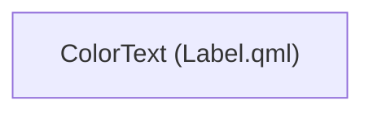

# UI Spec: Label
**File:** `app/qml/components/Label.qml`  **Pack:** `01-core-components.md`  **Legacy Reference:** `src/Classes/LabelControl.lua`  **Status:** Test-Covered

--------------------------------------------------------------------------------

## 1. Purpose & Parity Notes
*   **Role:** The core text label primitive used throughout forms, stat panels, and headers. Wraps `ColorText` to automatically parse and render PoB color-coded strings (`^0`-`^9`, `^xRRGGBB`), while computing exact pixel dimensions via `TextMetrics` to ensure layouts match legacy pixel geometry.
*   **Intentional Deviations from Legacy PoB:**
    *   *Assigning Explicit Dimensions:* In Qt Quick, `implicitWidth` and `implicitHeight` on `Text`-derived items are read-only and derived from font metrics. Label calculates exact dimensions via `textMetrics.width(size, "VAR", label)` and applies them to explicit `width` and `height`, allowing parent `RowLayout` and `ColumnLayout` containers to size accurately without rebind glitches.
    *   *Color Code Parsing:* Delegates string styling to `colorText.toStyledText()`, rendering styled text natively without requiring per-character draw calls.

--------------------------------------------------------------------------------

## 2. Lightweight Wireframe & Layout Box Model
# Component Box Model & Layout
```text
+-------------------------------------------------------------------------------+
| Label (specialization of ColorText, textFormat: Text.StyledText)               |
| font.pixelSize: size (default: theme.fontSize [14-15px])                      |
| font.family: theme.fontVar                                                    |
| defaultColor: theme.text                                                      |
| width: textMetrics.width(root.size, "VAR", root.label)                        |
| height: root.size                                                             |
+-------------------------------------------------------------------------------+
```

# ASCII Anatomy & Wireframe
```text
Rendered Label Output:
+----------------------------------------------------+
|  ^7Main Skill: ^2Explosive Arrow                   | (1)
+----------------------------------------------------+
  |<-------------- textMetrics.width --------------->|
  height: root.size

Annotations:
(1) Styled Text Output: "^7" renders in white (theme.text); "^2" renders in green (theme.success).
    Bounding box matches exact legacy DrawStringWidth measurements.
```

# Responsive / Overflow Rules
*   **Minimum safe width/height:** `0x0px` when `label === ""`; scales directly with string length and font size.
*   **Horizontal scroll policy:** Forbidden. Width fits the measured text.
*   **Text truncation policy:** By default, does not clip or elide. Parent containers can override `elide: Text.ElideRight` and assign an explicit constrained `width`.

# Component Hierarchy


--------------------------------------------------------------------------------

## 3. Interactive States & Controls
| Control (objectName) | Type | Default State | Interactive Behavior | Edge States (Disabled / Empty / Loading / Error / Long Text) |
| ------ | ------ | ------ | ------ | ------ |
| `pob.label.root` | ColorText | `label: ""` | Formats color escapes and sets geometry | Zero dimensions when `label === ""` without layout distortion. |

# Complete State Matrix
*   **Default Text:** `label: "Plain String"`, rendered in `defaultColor` (`theme.text`).
*   **Color-Coded Text:** `label: "^1Warning: ^7Cost exceeds pool"`, parses `^1` (red) and `^7` (white).
*   **Custom Size:** `size: 18`, increases `font.pixelSize` and recalculates `width`/`height`.
*   **Empty:** `label: ""`, `width: 0`, `height: size`.

# State Matrix & Binding Hazards
*   *Implicit vs Explicit Geometry Trap:* Never attempt to bind `implicitWidth` on a `Text`-derived element in Qt Quick; doing so logs runtime errors. Label assigns dimensions directly to `width` and `height`.
*   *Font Family Consistency:* If using monospace figures for tabular alignment, callers must override `font.family: theme.fontFixed` and pass `"FIXED"` to `textMetrics.width`.

--------------------------------------------------------------------------------

## 4. Data & Bridge Contract
*   **Reads (Properties):**
    *   `label: string` -> source string with optional `^` color codes
    *   `size: int` -> font pixel size (defaults to `theme.fontSize`)
*   **Writes / Mutations:** None (Label is purely a display element).
*   **Signals Observed:** None.
*   **Qt6 Bridge Safety:** Robust against malformed caret sequences (e.g. dangling `^` or invalid hex `^x123`).

--------------------------------------------------------------------------------

## 5. Testable Acceptance Criteria (Qt6::QuickTest)
*   **AC-01 (Initial Render & Zero Warnings):** Given `label: "Test Label"`, when `Label.qml` mounts, 0 QML warnings are logged, `height === theme.fontSize`, and `width > 0`.
*   **AC-02 (Color Code Interpretation):** Given `label: "^1Red ^2Green"`, `textFormat` is `Text.StyledText` and rendered text contains styled color tags without visible literal carets.
*   **AC-03 (Text Metric Sizing Parity):** `root.width` exactly matches `textMetrics.width(root.size, "VAR", root.label)`.
*   **AC-04 (Dynamic Label Updates):** When `label` changes from `"A"` to `"A much longer string"`, `width` expands reactively to match the new string's measurement.

--------------------------------------------------------------------------------

## 6. Bug Audit Findings (Current Implementation vs Spec)
| Severity | File & Line | Symptom / Defect | Root Cause | Expected Behavior |
| ------ | ------ | ------ | ------ | ------ |
| Medium | `app/qml/components/Label.qml:1755` | QML runtime warning: "Cannot assign to read-only property implicitWidth". | Attempting to bind `implicitWidth` on `Text` element. | Assign explicit `width: textMetrics.width(...)`. |
| Low | `app/qml/components/Label.qml:1760` | Text baseline shifts slightly off-center inside table row delegates. | Missing vertical centering alignment in delegate layout. | Ensure parent container aligns items via `verticalCenter`. |
