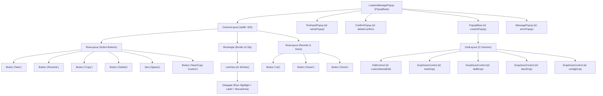

# UI Spec: LoadoutManagePopup
**File:** `app/qml/components/LoadoutManagePopup.qml`  **Pack:** `00-shell-and-theme.md`  **Legacy Reference:** `src/Classes/BuildSetListControl.lua`  **Status:** Test-Covered

--------------------------------------------------------------------------------

## 1. Purpose & Parity Notes
*   **Role:** Modal management dialog allowing the user to view, activate, create, rename, copy, delete, and reorder build loadouts (coordinated presets bundling a Passive Tree Spec, Skill Set, Item Set, and Configuration Set).
*   **Intentional Deviations from Legacy PoB:** None (1:1 functional parity with legacy `BuildSetListControl`). Includes the "New/Copy Custom" sub-dialog providing 4 dropdown selectors to assemble a custom combination of tree, skill, item, and configuration sets.

--------------------------------------------------------------------------------

## 2. Lightweight Wireframe & Layout Box Model
# Default Modal Layout (444x360, Content Width: 420)
```text
+-------------------------------------------------------------+
|  Manage Loadouts                                        [X] |
+-------------------------------------------------------------+
|  [ New ] [ Rename ] [ Copy ] [ Delete ] [New/Copy Custom]   |
|  +--------------------------------------------------------+ |
|  | Default (Current)                                      | |
|  | Endgame Bossing Setup                                  | |
|  | Mapping Speedfarm                                      | |
|  | Delve Deep Tank                                        | |
|  +--------------------------------------------------------+ |
|                     [ Up ]   [ Down ]                       |
|                             [ Done ]                        |
+-------------------------------------------------------------+
```

# Custom Loadout Sub-Popup (348x240)
```text
+---------------------------------------------------+
|  New/Copy Custom Loadout                      [X] |
+---------------------------------------------------+
|  Loadout Name:   [ Level 95 Swap                ] |
|  Tree:           [ Endgame Crit (Spec 2)       v] |
|  Skill Set:      [ 6-Link Lightning Strike     v] |
|  Item Set:       [ Mageblood Setup             v] |
|  Config Set:     [ Pinnacle Bosses             v] |
|                                                   |
|             [  Create  ]    [ Cancel ]            |
+---------------------------------------------------+
```

# Responsive / Overflow Rules
*   **Minimum safe dimensions:** 444x360 px (Fixed dialog envelope; parent viewport min: 960x640 px).
*   **Horizontal scroll policy:** Forbidden. Loadout display strings elide right with tooltip.
*   **Text truncation policy:** Long loadout names in ListView delegates elide right (`Text.ElideRight`). Dropdown options in Custom sub-popup elide with full title tooltip.

# Component Hierarchy


--------------------------------------------------------------------------------

## 3. Interactive States & Controls
| Control (objectName) | Type | Default State | Interactive Behavior | Edge States (Disabled / Empty / Loading / Error / Long Text) |
| ------ | ------ | ------ | ------ | ------ |
| `pob.loadouts.newBtn` | `Button` | Enabled | Opens `namePopup` with title "New Loadout" | Always enabled |
| `pob.loadouts.renameBtn` | `Button` | Enabled if `hasSel` | Opens `namePopup` with current loadout title | Disabled if no loadout is selected |
| `pob.loadouts.copyBtn` | `Button` | Enabled if `hasSel` | Opens `namePopup` with current title for cloning | Disabled if no loadout is selected |
| `pob.loadouts.deleteBtn` | `Button` | Enabled if `canDelete and count > 1` | Opens `deleteConfirm` modal for selected index | Disabled if loadout count <= 1 or engine disallows deletion |
| `pob.loadouts.customBtn` | `Button` | Enabled | Opens `customPopup` modal | Always enabled |
| `pob.loadouts.listView` | `ListView` | Active loadout selected | Single-click selects; double-click activates loadout; `F2` renames; `Delete` removes | Empty list renders empty frame; preserves scroll bounds |
| `pob.loadouts.upBtn` | `Button` | Enabled if `hasSel and selIndex > 0` | Moves selected loadout up by 1 position via bridge | Disabled at index 0 or when no selection |
| `pob.loadouts.downBtn` | `Button` | Enabled if `hasSel and selIndex < count - 1` | Moves selected loadout down by 1 position via bridge | Disabled at bottom index or when no selection |
| `pob.loadouts.doneBtn` | `Button` | Enabled | Closes dialog via `accept()` | Triggers dialog dismissal |
| `pob.loadouts.customCreate` | `Button` | Enabled if `canCreate` | Invokes `pob_loadoutsCustom` and closes sub-popup | Disabled if name is whitespace or collides with existing name |

# State Matrix & Binding Hazards
*   *Duplicate Name Validation Hazard:* `_isDuplicateName(text)` checks both `specNameLookup[text]` and iterates `rows[i].title`. If `specNameLookup` arrives from Lua as an empty QVariantMap, evaluating undefined keys must not throw a script TypeError.
*   *Index Realignment Hazard:* After deleting or reordering loadouts via bridge invoke, `selIndex` must be clamped against `st.rows.length - 1` to prevent out-of-bounds delegate evaluation.

--------------------------------------------------------------------------------

## 4. Data & Bridge Contract
*   **Reads (LuaEngine / C++ Models):**
    *   `luaEngine.invoke("pob_loadoutsGetState", [])` -> `{ ok: bool, rows: QVariantList, canDelete: bool, activeLoadoutIndex0: int, availableSets: { trees: QVariantList, skills: QVariantList, items: QVariantList, configs: QVariantList }, specNameLookup: QVariantMap }`
*   **Writes / Mutations:**
    *   `luaEngine.invoke("pob_loadoutsNew", [name])` -> `{ ok: bool, error: string }`
    *   `luaEngine.invoke("pob_loadoutsCopy", [sourceFullName, newName])` -> `{ ok: bool, error: string }`
    *   `luaEngine.invoke("pob_loadoutsRename", [targetFullName, newName])` -> `{ ok: bool, error: string }`
    *   `luaEngine.invoke("pob_loadoutsDelete", [luaIndex1Based])` -> `{ ok: bool, error: string }`
    *   `luaEngine.invoke("pob_loadoutsReorder", [from1Based, to1Based])` -> `{ ok: bool, error: string }`
    *   `luaEngine.invoke("pob_loadoutsSelect", [fullName])` -> `{ ok: bool, error: string }`
    *   `luaEngine.invoke("pob_loadoutsCustom", [treeId, itemId, skillId, configId, name])` -> `{ ok: bool, error: string }`
*   **Signals Observed:**
    *   Emits `loadoutsChanged()` on any structural change to update the main shell status bar and sidebar selectors.
*   **Qt6 Bridge Safety:** Convert `st.rows`, `st.availableSets.trees`, `skills`, `items`, and `configs` through `QmlBridge.toArray()` to guarantee stable list models.

--------------------------------------------------------------------------------

## 5. Testable Acceptance Criteria (Qt6::QuickTest)
*   **AC-01 (Initial Render & Zero Warnings):** Opening `LoadoutManagePopup` fetches loadout state, selects the active loadout, and emits 0 QML warnings.
*   **AC-02 (No Text Overflow / Clipping):** Loadout titles exceeding 300 px elide with `Text.ElideRight` without clipping action buttons or overflowing delegate rects.
*   **AC-03 (Primary User Flow - Activation):** Double-clicking an inactive loadout invokes `pob_loadoutsSelect`, marks the row with "(Current)", and emits `loadoutsChanged()`.
*   **AC-04 (Reorder Operations):** Selecting index 1 and clicking `Up` invokes `pob_loadoutsReorder()`, moves row to index 0, and updates button enablement (`Up` disabled, `Down` enabled).
*   **AC-05 (Duplicate Name Guard):** Entering an existing loadout title in `namePopup` or `customNameEdit` disables the confirmation button (`confirmEnabled == false`).

--------------------------------------------------------------------------------

## 6. Bug Audit Findings (Current Implementation vs Spec)
| Severity | File & Line | Symptom / Defect | Root Cause | Expected Behavior |
| ------ | ------ | ------ | ------ | ------ |
| Med | `app/qml/components/LoadoutManagePopup.qml:5858` | Raw `Array.isArray(st.rows)` returns false on QVariantList | JS array check on bridge variant | Wrap with `QmlBridge.toArray(st.rows)` |
| Med | `app/qml/components/LoadoutManagePopup.qml:5873` | `_isDuplicateName` throws TypeError if `specNameLookup` is undefined | Missing null check on map property lookup | Verify `Boolean(specNameLookup && specNameLookup[name])` |
| Low | `app/qml/components/LoadoutManagePopup.qml:5998` | Long loadout names overflow delegate bounds | Delegate `Label` missing `elide: Text.ElideRight` | Set `elide: Text.ElideRight` on delegate Label |
| Low | `app/qml/components/LoadoutManagePopup.qml:6146` | Custom popup dropdown labels truncate on deep set hierarchies | Fixed sub-popup width of 320 px | Expand sub-popup `implicitWidth` to 400 px with elided labels |
