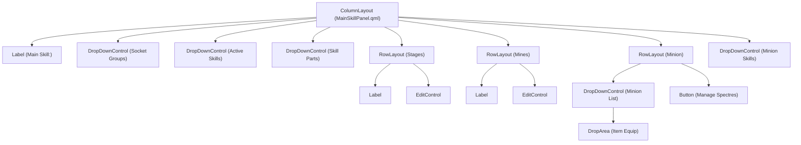

# UI Spec: MainSkillPanel
**File:** `app/qml/components/MainSkillPanel.qml`  **Pack:** `00-shell-and-theme.md`  **Legacy Reference:** `src/Modules/Build.lua:487-575` (`buildMode:Init`), `Build.lua:1511` (`buildMode:RefreshSkillSelectControls`)  **Status:** Test-Covered

--------------------------------------------------------------------------------

## 1. Purpose & Parity Notes
*   **Role:** The main active skill, socket group, and minion configuration stack. Allows the user to select the primary skill group used for calculations, choose active gems within that group, select alternative skill parts/stages/active mines, designate minion types, equip items onto Animate Guardians via drag-and-drop, and open the Spectre Library.
*   **Intentional Deviations from Legacy PoB:**
    *   *Event-driven Visibility:* Legacy re-evaluates `RefreshSkillSelectControls` every frame to toggle visibility of stages, mines, and minion dropdowns. MainSkillPanel updates conditionally on `skillsChanged` and `calcsChanged`, binding visibility to flags provided in `payload`.
    *   *Suffix Parameterization:* Accepts a `suffix` property (default `""` for the sidebar, `"Calcs"` for the Calcs tab) allowing Phase 8 Calcs tab reuse with isolated calculation targets.
    *   *Spectre Dialog Signal:* Replaces the legacy inline modal launcher with the `manageSpectresRequested` signal.

--------------------------------------------------------------------------------

## 2. Lightweight Wireframe & Layout Box Model
# Component Box Model & Layout
```text
+-----------------------------------------------------------------------------------+
| MainSkillPanel (ColumnLayout, spacing: 2px, Layout.fillWidth: true)               |
| +-------------------------------------------------------------------------------+ |
| | Label: "^7Main Skill:" (size: theme.fontSize)                                 | |
| +-------------------------------------------------------------------------------+ |
| | DropDownControl [groupDrop] (Socket Group) (height: 18px, fillWidth: true)    | |
| +-------------------------------------------------------------------------------+ |
| | DropDownControl [skillDrop] (Active Gem) (height: 18px, fillWidth: true)      | |
| +-------------------------------------------------------------------------------+ |
| | DropDownControl [partDrop] (Skill Part) (height: 18px, fillWidth: true)       | |
| +-------------------------------------------------------------------------------+ |
| | RowLayout [Stages] (visible if payload.stages.shown)                          | |
| |   Label ("Stages:") [EditControl stageEdit (60x18px, numeric)]                | |
| +-------------------------------------------------------------------------------+ |
| | RowLayout [Mines] (visible if payload.mines.shown)                            | |
| |   Label ("Active Mines:") [EditControl mineEdit (60x18px, numeric)]           | |
| +-------------------------------------------------------------------------------+ |
| | RowLayout [Minion] (visible if payload.minion.shown)                          | |
| |   DropDownControl [minionDrop] (fillWidth: true) [DropArea minionItemDrop]    | |
| |   Button ("Manage Spectres...", 120x18px)                                     | |
| +-------------------------------------------------------------------------------+ |
| | DropDownControl [minionSkillDrop] (Minion Skill) (height: 16px, fillWidth)    | |
| +-------------------------------------------------------------------------------+ |
+-----------------------------------------------------------------------------------+
```

# ASCII Anatomy & Wireframe
```text
+-------------------------------------------------------------+
| Main Skill:                                                 |
| [ 4L: Explosive Arrow / Ballista Totem                    v]| (1)
| [ Explosive Arrow                                         v]| (2)
| [ Ignite Damage                                           v]| (3)
| Stages: [ 20 ]                                              | (4)
| Active Mines: [ 15 ]                                        | (5)
| [ Raised Spectre: Pale Seraphim          v] [Manage Spectres]| (6)
| [ Pale Seraphim Demon Beam                                v]| (7)
+-------------------------------------------------------------+

Annotations:
(1) Socket Group selector: shows group label, socket colors, and full gem link tooltip.
(2) Active Skill Gem selector: hidden if payload.noSkills is true; disabled if skillsEnabled == false.
(3) Skill Part selector: visible only when skill has multiple modes (e.g., Melee vs Projectile, Hit vs Explosion).
(4) Skill Stages input: visible when payload.stages.shown == true. Numeric input (0-99).
(5) Active Mines input: visible when payload.mines.shown == true. Numeric input (0-99).
(6) Minion selector with item drag-and-drop target, accompanied by "Manage Spectres..." button.
(7) Minion active skill dropdown: visible when selected minion possesses multiple skills.
```

# Responsive / Overflow Rules
*   **Minimum safe width/height:** 260x100px. Width dynamically fills the sidebar column (`Layout.fillWidth: true`).
*   **Horizontal scroll policy:** Forbidden. All dropdowns and inputs span the layout's full width or have fixed compact widths.
*   **Text truncation policy:** Dropdowns elide text on the right (`Text.ElideRight`). Tooltips display full skill group linkages.
*   **Conditional layout collapse:** Rows with `visible: false` automatically collapse in the `ColumnLayout` without reserving dead space.

# Component Hierarchy


--------------------------------------------------------------------------------

## 3. Interactive States & Controls
| Control (objectName) | Type | Default State | Interactive Behavior | Edge States (Disabled / Empty / Loading / Error / Long Text) |
| ------ | ------ | ------ | ------ | ------ |
| `pob.mainskill.group` | DropDownControl | Cur socket group | On selection, calls `luaEngine.setMainSocketGroup(index)` | Tooltip calls `luaEngine.getSocketGroupTooltip` to format rich gem lists. |
| `pob.mainskill.skill` | DropDownControl | Cur active skill | On selection, calls `luaEngine.setMainActiveSkill(index, suffix)` | Hidden if `payload.noSkills === true`; disabled if `payload.skillsEnabled === false`. |
| `pob.mainskill.part` | DropDownControl | Cur part | On selection, calls `luaEngine.setMainSkillPart(index, suffix)` | Visible only when `payload.partsShown === true`. |
| `pob.mainskill.stages` | EditControl | Numeric value | Commits via `luaEngine.setSkillStageCount(count, suffix)` | Visible only when `payload.stages.shown === true`; clamped >= 0. |
| `pob.mainskill.mines` | EditControl | Numeric value | Commits via `luaEngine.setSkillMineCount(count, suffix)` | Visible only when `payload.mines.shown === true`; clamped >= 0. |
| `pob.mainskill.minion` | DropDownControl | Cur minion | Calls `luaEngine.setSkillMinion()` with `{ minionId }` or `{ itemSetId }` | Visible only when `payload.minion.shown === true`. Supports item drag/drop. |
| `pob.mainskill.minionDrop` | DropArea | Inactive | Highlights border green on valid item drag; drops item onto minion equipment set | Active only when `suffix === ""` and `payload.minion.isItemSet === true`. |
| `pob.mainskill.spectres` | Button | "Manage Spectres..." | Emits `manageSpectresRequested()` | Visible only when `payload.minion.libraryShown === true`. |
| `pob.mainskill.minionSkill`| DropDownControl | Cur minion skill | Commits via `luaEngine.setSkillMinionSkill(index + 1, suffix)` | Visible only when `payload.minionSkill.shown === true`. |

# State Matrix & Binding Hazards
*   *Default Property Shadowing Hazard:* Never declare `property var data` on this component. In Qt Quick, `data` is `QtObject`'s default property containing child visual items. Declaring `property var data: ({})` silently overrides child registration, causing the entire layout to reserve height while rendering completely blank without runtime warnings. Use `property var payload`.
*   *Root Layout Structure:* Root MUST be `ColumnLayout` directly. Wrapping an inner `ColumnLayout` inside an outer `Item` with `col.width: root.width` fails to resolve width inside the sidebar's layout, causing 0-width collapse.
*   *Control Mutation Feedback Latch:* During `refresh()`, updating dropdown `currentIndex` and edit fields emits `selected` and `committed` signals. The `_syncing` boolean latch (`if (root._syncing) return;`) prevents circular updates back into the engine.

--------------------------------------------------------------------------------

## 4. Data & Bridge Contract
*   **Reads (LuaEngine / C++ Models):**
    *   `luaEngine.getMainSkillControls(suffix)` -> `{ socketGroups: [...], skills: [...], parts: [...], mainSocketGroup: int, mainActiveSkill: int, partIndex: int, noSkills: bool, skillsEnabled: bool, partsShown: bool, stages: { shown: bool, value: string }, mines: { shown: bool, value: string }, minion: { shown: bool, enabled: bool, isItemSet: bool, libraryShown: bool, selected: any, list: [...] }, minionSkill: { shown: bool, enabled: bool, index: int, list: [...] } }`
    *   `luaEngine.getSocketGroupTooltip(int)` -> `string[]`
    *   `luaEngine.invoke("pob_itemsCanDropOnMinion", [kind, key])` -> `bool`
*   **Writes / Mutations:**
    *   `luaEngine.setMainSocketGroup(int)` -> `void`
    *   `luaEngine.setMainActiveSkill(int, string)` -> `void`
    *   `luaEngine.setMainSkillPart(int, string)` -> `void`
    *   `luaEngine.setSkillStageCount(int, string)` -> `void`
    *   `luaEngine.setSkillMineCount(int, string)` -> `void`
    *   `luaEngine.setSkillMinion(object, string)` -> `void`
    *   `luaEngine.setSkillMinionSkill(int, string)` -> `void`
    *   `luaEngine.invoke("pob_itemsDropOnMinion", [kind, key, itemSetId, shift])` -> `void`
*   **Signals Observed:**
    *   `luaEngine.onSkillsChanged` -> calls `root.refresh()`
    *   `luaEngine.onCalcsChanged` -> calls `root.refresh()`
    *   `luaEngine.onModeChanged` -> calls `root.refresh()`
*   **Qt6 Bridge Safety:** Socket group tooltips returned as raw arrays from Lua must be iterated safely with boundary checks before passing to `Tooltip.addLine()`.

--------------------------------------------------------------------------------

## 5. Testable Acceptance Criteria (Qt6::QuickTest)
*   **AC-01 (Initial Render & Zero Warnings):** Given a character with active skills, when `MainSkillPanel.qml` mounts, 0 QML warnings are emitted, `groupDrop.model.length > 0`, and the panel height adapts to visible sub-controls.
*   **AC-02 (Conditional Controls Visibility):** When switching between a single-hit spell and a multi-stage mine skill, `partDrop.visible`, `stageEdit.visible`, and `mineEdit.visible` reflect the exact flags present in `payload`.
*   **AC-03 (Minion Set Drag-and-Drop Interaction):** Given an Animate Guardian minion set is selected, when an item drag enters `minionDrop`, then `minionItemDrop.containsDrag` becomes `true`, rendering a green border highlight (`theme.success`), and dropping invokes `pob_itemsDropOnMinion`.
*   **AC-04 (Spectre Management Dispatch):** When `payload.minion.libraryShown === true` and the user clicks "Manage Spectres...", then the `manageSpectresRequested()` signal is emitted without altering the current minion selection.
*   **AC-05 (Suffix Decoupling):** When `suffix` is set to `"Calcs"`, all mutating bridge invocations pass `"Calcs"`, leaving the sidebar's main skill selection unmodified.

--------------------------------------------------------------------------------

## 6. Bug Audit Findings (Current Implementation vs Spec)
| Severity | File & Line | Symptom / Defect | Root Cause | Expected Behavior |
| ------ | ------ | ------ | ------ | ------ |
| Critical | `app/qml/components/MainSkillPanel.qml:288` | Panel reserves vertical space in sidebar but renders completely blank with zero error messages. | Declaring `property var data`, which accidentally shadows `QtObject.data` and drops child items. | Rename property to `property var payload`. |
| High | `app/qml/components/MainSkillPanel.qml:280` | Panel collapses to 0px width when placed inside sidebar layout. | Root item was an `Item` containing an inner `ColumnLayout` with unresolved width. | Make `ColumnLayout` the visual root element directly. |
| Medium | `app/qml/components/MainSkillPanel.qml:315` | Updating skill selection in Calcs tab unexpectedly mutates sidebar's main skill. | Hardcoding empty suffix in engine calls rather than passing `root.suffix`. | Pass `root.suffix` to all setter methods (`setMainActiveSkill`, `setSkillPart`, etc.). |
| Low | `app/qml/components/MainSkillPanel.qml:395` | Dropdown index jumps erratically during rapid background recalculations. | Missing synchronization guard during `refresh()`. | Wrap model and index updates in `_syncing = true; ... _syncing = false;`. |
