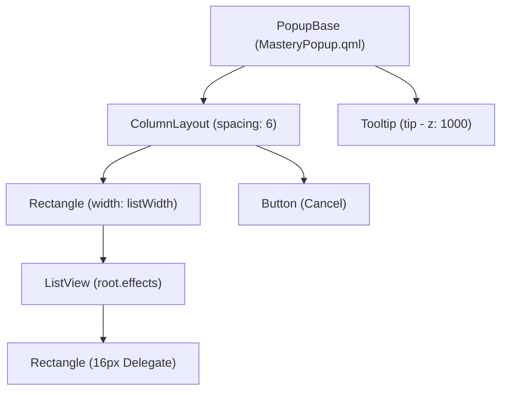

# UI Spec: MasteryPopup
**File:** `app/qml/components/MasteryPopup.qml`  **Pack:** `03-view-tree.md`  **Legacy Reference:** `src/Classes/PassiveMasteryControl.lua` + `TreeTab:OpenMasteryPopup` (TreeTab.lua:1038-1063)  **Status:** Test-Covered

--------------------------------------------------------------------------------

## 1. Purpose & Parity Notes
*   **Role:** Modal selection popup for allocating passive mastery node effects. Displays available, unallocated mastery options for a given mastery cluster. Hovering any option displays the full node tooltip previewing calculation changes and stat differences as if that effect were chosen; clicking an option allocates the node with that effect.
*   **Intentional Deviations from Legacy PoB:**
    *   *Dynamic "Automagical" Width:* Mirrors legacy PoB's calculation of measuring the widest effect text string (`textMetrics.width(16, "VAR", effect.label) + 5px`) plus padding, ensuring the popup expands to accommodate long mastery text descriptions without wrapping.
    *   *Tooltip Stacking Above Modal Dim:* Tooltip is dynamically parented to the popup's content host with `z: 1000` rather than the window content item, ensuring stat preview tooltips render above the modal backdrop dimming layer.

--------------------------------------------------------------------------------

## 2. Lightweight Wireframe & Layout Box Model
# Component Box Model & Layout
```text
+-------------------------------------------------------------------------------+
| MasteryPopup (PopupBase, title: mastery.name, padding: 8px)                   |
| ColumnLayout (spacing: 6px)                                                   |
| +---------------------------------------------------------------------------+ |
| | Rectangle (border: 1px theme.border, width: listWidth, height: N * 16 + 4) | |
| |   ListView [list] (interactive: false, model: root.effects)               | |
| |     Delegate: 16px row, label, hover preview -> _showPreview(idx)         | |
| +---------------------------------------------------------------------------+ |
| | Button: [ Cancel ] (implicitWidth: 90px, height: 20px, AlignHCenter)       | |
| +---------------------------------------------------------------------------+ |
| Tooltip [tip] (z: 1000, dynamically positioned over hovered option)           |
+-------------------------------------------------------------------------------+
```

# ASCII Anatomy & Wireframe
```text
+-------------------------------------------------------------------------------+
|                           Life Mastery Options                                | (1) Title Plate
+-------------------------------------------------------------------------------+
| +---------------------------------------------------------------------------+ |
| |   +50 to maximum Life                                                     | | (2) Mastery Option Rows
| | > 10% increased maximum Life / 10% reduced Life Recovery Rate             | |     (Hovered row triggers
| |   Regenerate 2% of Life per second while on Low Life                      | |      preview tooltip)
| +---------------------------------------------------------------------------+ |
|                                                                               |
|                                [ Cancel ]                                     | (3) Cancel Button
+-------------------------------------------------------------------------------+
  |<---------------------------- listWidth ------------------------------------>|

  \ Hovering Option 2 displays Stat Diff Tooltip:
   +------------------------------------------------------+
   | 10% increased maximum Life                           |
   | 10% reduced Life Recovery Rate                       |
   | ---------------------------------------------------- |
   | Total Life: 4,520 -> 4,745 (+225)                    |
   | Effective Hit Pool: 32,400 -> 34,120 (+1,720)        |
   +------------------------------------------------------+
```

# Responsive / Overflow Rules
*   **Width Policy:** Dynamically calculated: `listWidth = maxTextWidth + 12px`.
*   **Height Policy:** Fixed to exact row count: `effects.length * 16px + 4px`. Does not scroll (`interactive: false`).
*   **Tooltip Clamping:** Tooltip coordinates clamp against window bounds (`win.width`, `win.height`).

# Component Hierarchy


--------------------------------------------------------------------------------

## 3. Interactive States & Controls
| Control (objectName) | Type | Default State | Interactive Behavior | Edge States (Disabled / Empty / Loading / Error / Long Text) |
| ------ | ------ | ------ | ------ | ------ |
| `pob.mastery.root` | PopupBase | Closed | Coordinates mastery effect selection | Bails out safely if effects list is empty. |
| `pob.mastery.row` | Rectangle | `height: 16` | Click allocates mastery; hover previews stats | Displays `theme.hover` background on mouse over. |
| `pob.mastery.cancel` | Button | Enabled | Dismisses dialog without allocating | Leaves passive node in previous state. |

# Complete State Matrix
*   **Opened via `openFor(nodeId, trace)`:** Queries `pob_getMasteryEffects`, computes `listWidth`, opens dialog.
*   **Hover Over Option:** Calls `_showPreview(index, rowItem)`, queries `pob_previewMasteryEffect`, populates and shows `Tooltip`.
*   **Leave Option:** Hides `Tooltip`.
*   **Click Option:** Invokes `pob_selectMasteryEffect`, emits `selectedEffect()`, closes popup.
*   **Cancel / Escape:** Closes popup without modifying node state.

# State Matrix & Binding Hazards
*   *Modal Dimming Tooltip Occlusion:* Parenting tooltips to `Window.contentItem` renders them underneath the modal backdrop dimming rectangle. Setting `tip.parent = root.contentItem.parent` ensures the preview tooltip renders above the dim layer.

--------------------------------------------------------------------------------

## 4. Data & Bridge Contract
*   **Reads (Engine Calls via `openFor` and `_showPreview`):**
    *   `pob_getMasteryEffects(nodeId)` -> `{ name: string, effects: [{ id: int, label: string, selected: bool }] }`
    *   `pob_previewMasteryEffect(nodeId, effectId, tracePath)` -> `{ lines: [{ size, text, sep, center }] }`
*   **Writes / Bridge Methods Invoked:**
    *   `pob_selectMasteryEffect(nodeId, effectId, tracePath)` -> allocates node with selected mastery effect
*   **Signals Emitted:**
    *   `selectedEffect()` -> notifies tree view to re-render passive tree graph
*   **Qt6 Bridge Safety:** If `openFor` receives a nodeId with zero available effects, it returns `false` without opening.

--------------------------------------------------------------------------------

## 5. Testable Acceptance Criteria (Qt6::QuickTest)
*   **AC-01 (Mount & Zero Warnings):** When `MasteryPopup.qml` mounts, 0 QML warnings are logged, and `nodeId === -1`.
*   **AC-02 (Empty Effects Protection):** Given `pob_getMasteryEffects` returns `{ effects: [] }`, calling `openFor(1234)` returns `false` and popup remains closed.
*   **AC-03 (Automagical Width Calculation):** Given longest effect label measures 280px, `listWidth` evaluates to `292px` (280 + 12).
*   **AC-04 (Tooltip Preview on Hover):** When hovering row 0, `tip.visible` becomes `true` and contains lines returned from `pob_previewMasteryEffect`.
*   **AC-05 (Selection Execution):** Clicking an option row invokes `pob_selectMasteryEffect`, emits `selectedEffect()`, and closes the dialog.

--------------------------------------------------------------------------------

## 6. Bug Audit Findings (Current Implementation vs Spec)
| Severity | File & Line | Symptom / Defect | Root Cause | Expected Behavior |
| ------ | ------ | ------ | ------ | ------ |
| High | `app/qml/components/MasteryPopup.qml:2585` | Stat diff tooltip appears dim and unreadable behind dark backdrop. | Tooltip was parented to `Window.contentItem` below the dialog overlay. | Parent tooltip to `root.contentItem.parent` with `z: 1000`. |
| Medium | `app/qml/components/MasteryPopup.qml:2550` | Popup opens with zero items when clicking already exhausted mastery. | Missing length check on `m.effects`. | Return `false` if `!m || !m.effects || m.effects.length === 0`. |
