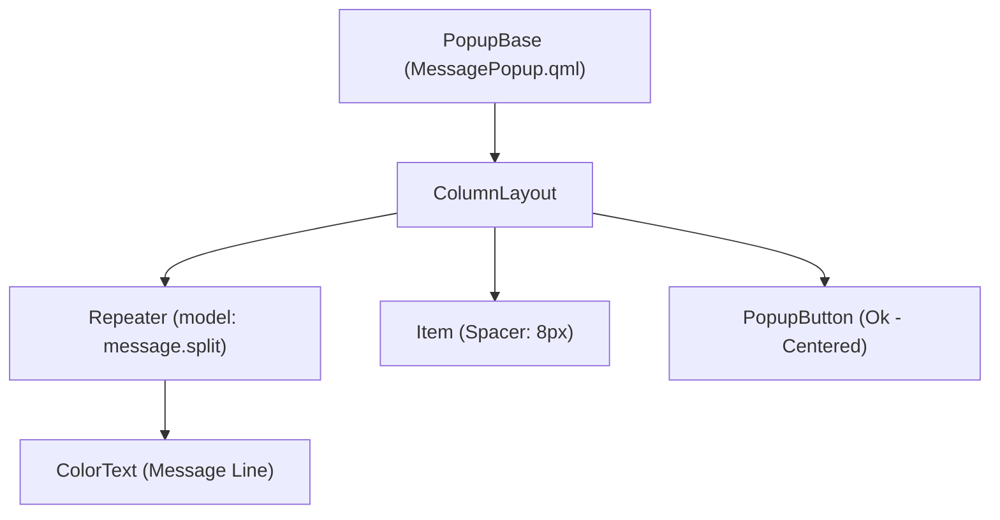

# UI Spec: MessagePopup
**File:** `app/qml/components/MessagePopup.qml`  **Pack:** `01-core-components.md`  **Legacy Reference:** `src/Modules/Main.lua` (`main:OpenMessagePopup`)  **Status:** Test-Covered

--------------------------------------------------------------------------------

## 1. Purpose & Parity Notes
*   **Role:** Canned informational alert modal dialog. Displays single or multi-line error, warning, or status notification text formatted with PoB color codes, accompanied by a single centered `Ok` acknowledgment button.
*   **Intentional Deviations from Legacy PoB:**
    *   *Automatic Dynamic Width:* In legacy PoB, width is computed as `max(DrawStringWidth(msg) + 30, 190)`. MessagePopup binds column width to `Math.max(160, textMetrics.width(theme.fontSize, "VAR", root.message))`, ensuring dialog bounds adapt to multiline content.
    *   *Unified Dismissal:* Either pressing Enter, pressing Escape, or clicking `Ok` dismisses the alert.

--------------------------------------------------------------------------------

## 2. Lightweight Wireframe & Layout Box Model
# Component Box Model & Layout
```text
+-------------------------------------------------------------------------------+
| MessagePopup (specialization of PopupBase, padding: 16px)                     |
| ColumnLayout (spacing: 4px, width: max(160, textMetrics.width(msg)))          |
| +---------------------------------------------------------------------------+ |
| | Repeater (model: root.message.split("\n"))                                | |
| |   ColorText (sourceText: modelData, defaultColor: theme.text)              | |
| +---------------------------------------------------------------------------+ |
| | Item (Layout.preferredHeight: 8px - vertical spacer)                      | |
| +---------------------------------------------------------------------------+ |
| | PopupButton (label: "Ok", Layout.alignment: Qt.AlignHCenter)               | |
| |   onClicked: root.accept()                                                 | |
| +---------------------------------------------------------------------------+ |
+-------------------------------------------------------------------------------+
```

# ASCII Anatomy & Wireframe
```text
+----------------------------------------------------+
|  Failed to load build:                             | (1) Multi-line message
|  ^1Error: XML parsing failed at line 42             |     (ColorText rendered)
|                                                    |
|                      [ Ok ]                        | (2) Centered Dismiss Button
+----------------------------------------------------+
  |<-------------- textMetrics.width --------------->|
```

# Responsive / Overflow Rules
*   **Minimum safe width/height:** 190x100px; expands dynamically to accommodate long message lines.
*   **Multi-Line Separation:** Automatically splits strings on `\n`.
*   **Centered Action:** The single `Ok` button is horizontally centered beneath the text block.

# Component Hierarchy


--------------------------------------------------------------------------------

## 3. Interactive States & Controls
| Control (objectName) | Type | Default State | Interactive Behavior | Edge States (Disabled / Empty / Loading / Error / Long Text) |
| ------ | ------ | ------ | ------ | ------ |
| `pob.message.root` | PopupBase | `message: ""` | Captures modal focus and coordinates dismissal | Cleans up on dismiss. |
| `pob.message.btn_ok` | PopupButton | `label: "Ok"` | Invokes `root.accept()` on click | Closes dialog immediately. |

# Complete State Matrix
*   **Closed:** Inactive.
*   **Opened:** Renders message lines; `Ok` button has initial active focus state.
*   **Enter Pressed:** Dismisses dialog via `root.accept()`.
*   **Escape Pressed:** Dismisses dialog via `root.reject()`.
*   **Ok Clicked:** Dismisses dialog via `root.accept()`.

# State Matrix & Binding Hazards
*   *Multi-Line Width Measurement:* `textMetrics.width` natively returns the maximum line width across a multi-line string with newlines. Binding column width directly to `textMetrics.width` ensures exact envelope sizing across complex error reports.

--------------------------------------------------------------------------------

## 4. Data & Bridge Contract
*   **Reads (Properties):**
    *   `message: string` -> notification string containing optional `\n` linebreaks and PoB `^` color codes
*   **Writes / Signals Emitted:**
    *   `accepted()` -> emitted on Ok click or Enter
    *   `rejected()` -> emitted on Escape
*   **Qt6 Bridge Safety:** Independent informational dialog.

--------------------------------------------------------------------------------

## 5. Testable Acceptance Criteria (Qt6::QuickTest)
*   **AC-01 (Initial Render & Zero Warnings):** Given `message: "Build imported successfully!"`, when mounted, 0 QML warnings are logged and the `Ok` button is rendered.
*   **AC-02 (Color Code Parsing):** Given `message: "^1Critical Error"`, rendered text parses the red color escape code without displaying literal `"^1"`.
*   **AC-03 (Click Dismissal):** Clicking the `Ok` button invokes `root.accept()`, closing the popup.
*   **AC-04 (Keyboard Dismissal):** Pressing Enter or Escape while the popup is open immediately dismisses the dialog.

--------------------------------------------------------------------------------

## 6. Bug Audit Findings (Current Implementation vs Spec)
| Severity | File & Line | Symptom / Defect | Root Cause | Expected Behavior |
| ------ | ------ | ------ | ------ | ------ |
| Low | `app/qml/components/MessagePopup.qml:1795` | Long error messages overflow horizontally on small screens. | Lack of explicit maximum width constraint before line wrapping. | Constrain max width or set `wrapMode: Text.Wrap` when exceeding screen width. |
