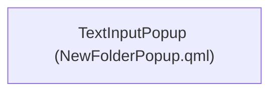

# UI Spec: NewFolderPopup
**File:** `app/qml/components/NewFolderPopup.qml`  **Pack:** `01-core-components.md`  **Legacy Reference:** `src/Modules/Main.lua:1642` (`main:OpenNewFolderPopup`)  **Status:** Test-Covered

--------------------------------------------------------------------------------

## 1. Purpose & Parity Notes
*   **Role:** Canned modal dialog for creating filesystem directories within the build library. Inherits from `TextInputPopup` while enforcing strict cross-platform filename character sanitization to prevent illegal filesystem path errors.
*   **Intentional Deviations from Legacy PoB:**
    *   *Input Filter Pattern Parity:* Legacy PoB filters keystrokes inside an immediate-mode `EditControl` using the pattern `[\/:*?"<>|%c]`. NewFolderPopup binds `confirmEnabled` against the JavaScript regex `text.match(/\S/) !== null && !/[\\/:*?"<>|\x00-\x1f]/.test(text)`.
    *   *Decoupled Directory Creation:* Following legacy architecture (`OpenNewFolderPopup`), the dialog does not call `MakeDir` directly. The caller reads `text` in their `onAccepted` handler and invokes the engine directory creation method, keeping UI and I/O concerns decoupled.

--------------------------------------------------------------------------------

## 2. Lightweight Wireframe & Layout Box Model
# Component Box Model & Layout
```text
+-------------------------------------------------------------------------------+
| NewFolderPopup (specialization of TextInputPopup)                              |
| prompt: "Enter folder name:"                                                  |
| confirmLabel: "Create"                                                        |
| confirmEnabled: text.match(/\S/) !== null && !/[\\/:*?"<>|\x00-\x1f]/.test(text)
| +---------------------------------------------------------------------------+ |
| | [Inherited UI: Prompt Label + TextInput in Chrome + Action Buttons]       | |
| +---------------------------------------------------------------------------+ |
+-------------------------------------------------------------------------------+
```

# ASCII Anatomy & Wireframe
```text
+-------------------------------------------------------------+
|  Enter folder name:                                         | (1) Fixed Prompt String
|  +-------------------------------------------------------+  |
|  | Witch Builds                                          |  | (2) Sanitized Folder Name Input
|  +-------------------------------------------------------+  |
|                                                             |
|                 [ Create ]       [ Cancel ]                 | (3) "Create" Action Button
+-------------------------------------------------------------+
```

# Responsive / Overflow Rules
*   **Geometry:** Inherits 280px width constraint and padding from `TextInputPopup`.
*   **Illegal Character Invalidation:** Typing any illegal character (`\`, `/`, `:`, `*`, `?`, `"`, `<`, `>`, `|`, or ASCII control codes) immediately disables the `Create` button and disables Enter submission.

# Component Hierarchy


--------------------------------------------------------------------------------

## 3. Interactive States & Controls
| Control (objectName) | Type | Default State | Interactive Behavior | Edge States (Disabled / Empty / Loading / Error / Long Text) |
| ------ | ------ | ------ | ------ | ------ |
| `pob.newfolder.root` | TextInputPopup | `confirmLabel: "Create"` | Validates path safety and emits `accepted` | Enter submission locked while text contains illegal characters. |

# Complete State Matrix
*   **Empty:** `text: ""` -> `confirmEnabled: false`.
*   **Legal Folder Name:** `text: "Marauder Builds"` -> `confirmEnabled: true`, Create button active.
*   **Illegal Slash:** `text: "Marauder/Jugg"` -> `confirmEnabled: false`, Create button grayed out.
*   **Illegal Colon/Wildcard:** `text: "Build: 1"` or `text: "Build*"` -> `confirmEnabled: false`.
*   **Leading/Trailing Whitespace:** Validated only if non-whitespace characters exist without illegal tokens.

# State Matrix & Binding Hazards
*   *Windows Reserved Character Collision:* Failing to block characters like `:` or `?` causes unhandled I/O exceptions on Windows builds. The validation regex `!/[\\/:*?"<>|\x00-\x1f]/.test(text)` prevents malformed directory creation attempts before reaching the filesystem bridge.

--------------------------------------------------------------------------------

## 4. Data & Bridge Contract
*   **Reads (Inherited Properties):**
    *   `prompt: string` (fixed to `"Enter folder name:"`)
    *   `confirmLabel: string` (fixed to `"Create"`)
    *   `text: alias` (accesses typed folder name)
*   **Writes / Signals Emitted:**
    *   `accepted()` -> emitted on successful creation confirmation
    *   `rejected()` -> emitted on cancellation
*   **Qt6 Bridge Safety:** Caller passes sanitized `text` to `luaEngine.createFolder(name)` or `QDir::mkdir()`.

--------------------------------------------------------------------------------

## 5. Testable Acceptance Criteria (Qt6::QuickTest)
*   **AC-01 (Initial Configuration):** When `NewFolderPopup.qml` mounts, 0 QML warnings are logged, `prompt === "Enter folder name:"`, and `confirmLabel === "Create"`.
*   **AC-02 (Valid Folder Name Acceptance):** Given `text: "League_3.24"`, `confirmEnabled` evaluates to `true`.
*   **AC-03 (Illegal Character Rejection):** Given `text: "Build/Test"` or `text: "Test:1"`, `confirmEnabled` evaluates to `false`.
*   **AC-04 (Control Character Rejection):** Given text containing null or carriage return bytes (`\x00-\x1f`), `confirmEnabled` evaluates to `false`.
*   **AC-05 (Execution Lifecycle):** Clicking `Create` on a valid name emits `accepted()`, allowing caller to read `root.text`.

--------------------------------------------------------------------------------

## 6. Bug Audit Findings (Current Implementation vs Spec)
| Severity | File & Line | Symptom / Defect | Root Cause | Expected Behavior |
| ------ | ------ | ------ | ------ | ------ |
| High | `app/qml/components/NewFolderPopup.qml:1825` | Application throws unhandled filesystem exception when creating folder with colon ':'. | Regex failed to include colon and backslash escapes. | Use `!/[\\/:*?"<>|\x00-\x1f]/.test(text)`. |
| Low | `app/qml/components/NewFolderPopup.qml:1820` | Confirm button displayed generic "Ok" instead of "Create". | Missing override for `confirmLabel`. | Explicitly set `confirmLabel: "Create"`. |
