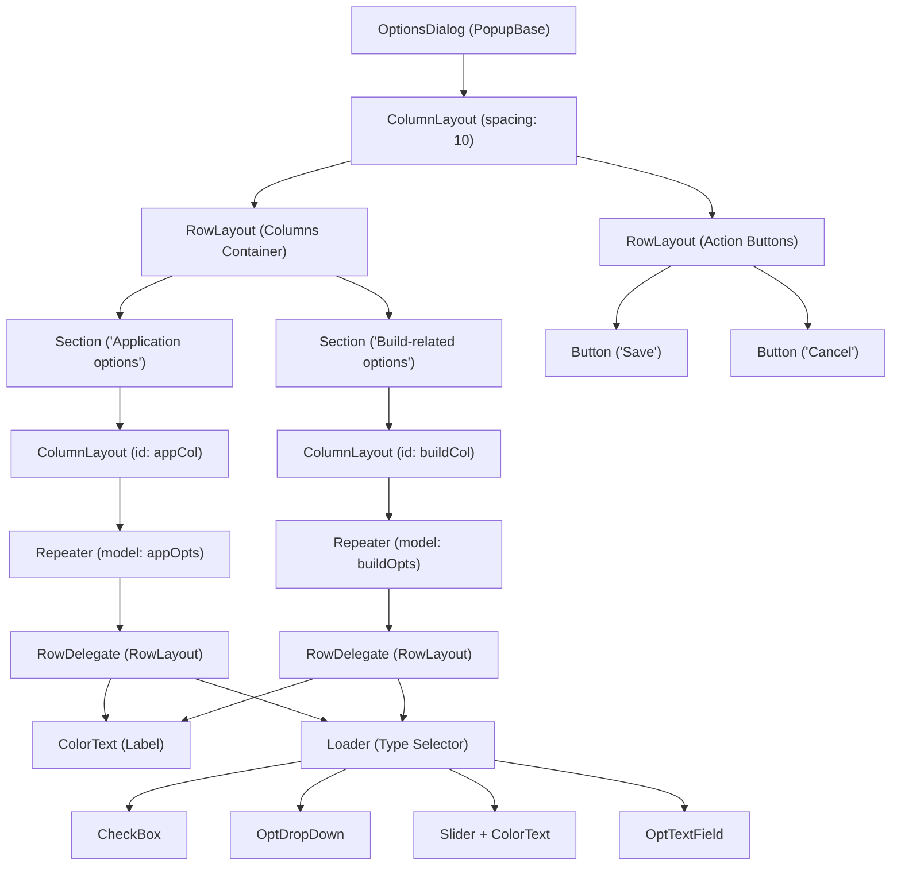

# UI Spec: OptionsDialog
**File:** `app/qml/components/OptionsDialog.qml`  **Pack:** `00-shell-and-theme.md`  **Legacy Reference:** `src/Modules/Main.lua:865-1150` (`main:OpenOptionsPopup`)  **Status:** Test-Covered

--------------------------------------------------------------------------------

## 1. Purpose & Parity Notes
*   **Role:** Comprehensive configuration dialog providing user access to ~28 application-wide and build-specific settings (node power colors, connection proxy, default gem quality, build save path, update channels).
*   **Intentional Deviations from Legacy PoB:** Implements a strict live-preview versus deferred-commit split: non-committal options (colors, node power themes, sliders, checkboxes) live-update the engine immediately and revert on Cancel/Esc; committal options (network proxy, build directory path) buffer into a local draft and commit strictly on clicking Save.

--------------------------------------------------------------------------------

## 2. Lightweight Wireframe & Layout Box Model
# Default Dialog Layout (980x620)
```text
+----------------------------------------------------------------------------------------------------+
|  Options                                                                                       [X] |
+----------------------------------------------------------------------------------------------------+
|  Application options                             | Build-related options                           |
|  +---------------------------------------------+ | +---------------------------------------------+ |
|  |                Show Node Power: [x] Check   | | |          Default Gem Quality: [ 20 ]        | |
|  |           Node Power Theme: [ Heatmap     v]| | |          Default Level:       [ 100 ]       | |
|  |               Proxy Server: [ http://...   ]| | |    Affix Quality Slider: [=====o-----] 20%  | |
|  |            Build Save Path: [ /path/to/pob ]| | |                                             | |
|  +---------------------------------------------+ | +---------------------------------------------+ |
|                                                                                                    |
|                                   [   Save   ]   [  Cancel  ]                                      |
+----------------------------------------------------------------------------------------------------+
```

# Responsive / Overflow Rules
*   **Minimum safe dimensions:** 960x600 px (At 960x640 host resolution, margin padding reduces from 16 px to 8 px).
*   **Horizontal scroll policy:** Forbidden. Column widths are fixed to 460 px each; text inputs clip or scroll horizontally.
*   **Text truncation policy:** Setting labels right-align with `Text.ElideRight`; dropdown items elide with tooltip.

# Component Hierarchy


--------------------------------------------------------------------------------

## 3. Interactive States & Controls
| Control (objectName) | Type | Default State | Interactive Behavior | Edge States (Disabled / Empty / Loading / Error / Long Text) |
| ------ | ------ | ------ | ------ | ------ |
| `pob.options.check` | `CheckBox` | Engine setting value | Clicking toggles boolean; previews live or buffers to draft | Synchronous feedback; tooltip rendered if configured |
| `pob.options.dropdown` | `OptDropDown` | Active engine option | Click opens popup menu; selection triggers change | Long labels elide right; max popup height clamped to 260 px |
| `pob.options.slider` | `Slider` | Numeric float [0.0 - 1.0] | Dragging slider thumb updates numeric percentage label and live engine | Clamped between min/max; formatted to integer percent |
| `pob.options.textField` | `OptTextField` | Current string value | Text input; commits to draft or live previews based on descriptor | Clamped to `maxChars`; non-valid characters ignored for integer types |
| `pob.options.saveBtn` | `Button` | Enabled | Commits `_draft` via `luaEngine.commitOptions()`; closes dialog | Triggers disk persist of `Settings.xml` |
| `pob.options.cancelBtn` | `Button` | Enabled | Reverts live modifications using `_snapshot`; closes dialog | Discards uncommitted `_draft` buffer |

# State Matrix & Binding Hazards
*   *Imperative Property Override Hazard:* `OptDropDown` assigns `dd.currentVal = modelData.val` directly in `MouseArea.onClicked`. This breaks QML declarative property bindings on `currentVal`. Future updates must re-evaluate bindings or use explicit signals.
*   *Revert Snapshot Leak:* If `_snapshot` does not capture the initial value of dynamically loaded options, `_revert()` fails to reset them on Escape. `_load()` must shallow-clone all live-preview values.

--------------------------------------------------------------------------------

## 4. Data & Bridge Contract
*   **Reads (LuaEngine / C++ Models):**
    *   `luaEngine.getOptions()` -> `QVariantList` of descriptors: `[{ key: string, label: string, section: string, type: "check"|"dropdown"|"slider"|"text"|"int"|"color", value: var, options: QVariantList, commit: bool, tooltip: string, maxChars: int }]`
*   **Writes / Mutations:**
    *   `luaEngine.previewOption(key, value)` (instant preview for `commit == false`)
    *   `luaEngine.commitOptions(draftMap)` (batch commit for `commit == true`)
*   **Signals Observed:** None directly (synchronous get/set protocol).
*   **Qt6 Bridge Safety:** Descriptor options array must be sanitized via `QmlBridge.toArray()` before passing to `Repeater` models.

--------------------------------------------------------------------------------

## 5. Testable Acceptance Criteria (Qt6::QuickTest)
*   **AC-01 (Initial Render & Zero Warnings):** Opening `OptionsDialog` populates both Application and Build-related option columns without QML binding errors or null pointer exceptions.
*   **AC-02 (No Text Overflow / Clipping):** Option row labels with widths up to 200 px do not overlap controls at minimum dialog dimensions.
*   **AC-03 (Primary User Flow):** Changing a live preview option (e.g. Node Power CheckBox) immediately invokes `previewOption()`. Clicking `Cancel` invokes `previewOption()` with the snapshot value and closes.
*   **AC-04 (Deferred Commit Flow):** Editing the Build Save Path text modifies `_draft`; it does not invoke `previewOption()`. Clicking `Save` passes `_draft` to `luaEngine.commitOptions()` and closes.
*   **AC-05 (Keyboard & Focus):** Pressing `Return` triggers Save (`accept()`). Pressing `Escape` triggers Revert and dismissal (`reject()`).

--------------------------------------------------------------------------------

## 6. Bug Audit Findings (Current Implementation vs Spec)
| Severity | File & Line | Symptom / Defect | Root Cause | Expected Behavior |
| ------ | ------ | ------ | ------ | ------ |
| Med | `app/qml/components/OptionsDialog.qml:843` | Dialog width (470 * 2 + 16 + 32 = 988 px) overflows 960 px window | Column section widths hardcoded to 470 px | Adjust section width to 445 px (total width <= 940 px) |
| Med | `app/qml/components/OptionsDialog.qml:554` | `Array.isArray()` missing in `_load()` | Raw JS array assumption on `luaEngine.getOptions()` return | Wrap with `QmlBridge.toArray(list)` |
| Low | `app/qml/components/OptionsDialog.qml:645` | Imperative binding break in `OptDropDown` | Direct assignment to `currentVal` destroys QML binding | Emit signal and bind `currentVal` to model expression |
| Low | `app/qml/components/OptionsDialog.qml:783` | Slider delegate does not update if model data changes externally while open | Slider uses `Component.onCompleted` one-shot value assignment | Bind `sl.value` bidirectionally or re-synchronize on model change |
