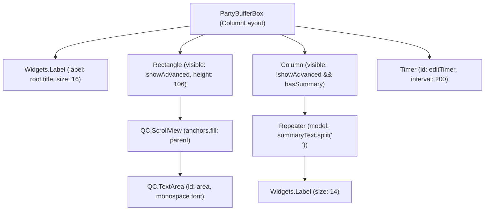

# UI Spec: PartyBufferBox
**File:** `app/qml/components/PartyBufferBox.qml`  **Pack:** `07-view-notes-party.md`  **Legacy Reference:** `src/Modules/PartyTab.lua`  **Status:** Test-Covered

--------------------------------------------------------------------------------

## 1. Purpose & Parity Notes
*   **Role:** Reusable character buff and support configuration panel serving each of PartyTab's 7 data buffers (Auras, Curses, Modifiers, Minions, Flasks, Combat Buffs, Custom). Displays a clean multi-line summary when viewing normally, or a monospace editor with full keyboard navigation and undo/redo support when advanced mode is enabled.
*   **Intentional Deviations from Legacy PoB:** In legacy Lua, editing buffers requires manual save button commits. In QML, text changes are automatically debounced through a 200 ms one-shot timer (`editTimer`), emitting `bufferEdited(bufferKey, text)` without interrupting typing flow.

--------------------------------------------------------------------------------

## 2. Lightweight Wireframe & Layout Box Model
# Default View Mode (Summary Mode: showAdvanced = false)
```text
+-------------------------------------------------------------+
| Aura Buffs:                                                 | <- Title (16px)
|   Determination (Level 21, 50% Aura Effect)                 | <- Summary Lines
|   Grace (Level 20, 40% Aura Effect)                         |
|   Hatred (Level 21, 65% Aura Effect)                        |
+-------------------------------------------------------------+
```

# Advanced Edit Mode (showAdvanced = true, Editor Height: 106px)
```text
+-------------------------------------------------------------+
| Aura Buffs:                                                 |
| +---------------------------------------------------------+ |
| | Determination level=21 quality=20 effect=50             | | <- Monospace Editor
| | Grace level=20 quality=0 effect=40                      | |    (Ctrl+Z/Y)
| | Hatred level=21 quality=23 effect=65                    | |
| +---------------------------------------------------------+ |
+-------------------------------------------------------------+
```

# Responsive / Overflow Rules
*   **Minimum safe dimensions:** 280x40 px (Width expands to fill parent column layout; editor height default: 106 px).
*   **Horizontal scroll policy:** Allowed inside editor with `wrapMode: TextEdit.NoWrap`.
*   **Text truncation policy:** Summary mode labels elide right; editor scrolls horizontally on long text strings.

# Component Hierarchy


--------------------------------------------------------------------------------

## 3. Interactive States & Controls
| Control (objectName) | Type | Default State | Interactive Behavior | Edge States (Disabled / Empty / Loading / Error / Long Text) |
| ------ | ------ | ------ | ------ | ------ |
| `pob.partyBuffer.title` | `Label` | Section title string | Non-interactive header | Displays buffer descriptor |
| `pob.partyBuffer.editor` | `QC.TextArea` | Buffer text | Text entry; keystrokes restart `editTimer` (200 ms); Ctrl+Z/Y shortcuts | Monospace font (`theme.fontFixed`); horizontal scrolling |
| `pob.partyBuffer.summary` | `Column` | Multi-line text | Displays parsed summary lines of active party buffs | Hidden when `showAdvanced === true` or empty |

# State Matrix & Binding Hazards
*   *Active Focus Typing Guard:* `setBufferText()` does not mutate `area.text` while `area.activeFocus == true`. This prevents external calculations or XML serialization echoes from disturbing user typing or resetting caret position.
*   *Sync Flag Protection:* Text programmatic synchronization sets `_syncing = true` during assignment to prevent the debounce timer from emitting duplicate `bufferEdited` mutations.

--------------------------------------------------------------------------------

## 4. Data & Bridge Contract
*   **Reads (LuaEngine / C++ Models):**
    *   `title`: `string`
    *   `bufferKey`: `string` (e.g., `"auras"`, `"curses"`)
    *   `showAdvanced`: `bool`
    *   `hasSummary`: `bool`
    *   `summaryText`: `string`
*   **Writes / Mutations (Signals Emitted):**
    *   `bufferEdited(string key, string text)` -> emitted after 200 ms debounce to update character calculation environment.
*   **Signals Observed:** None (Host view coordinates buffer models).
*   **Qt6 Bridge Safety:** Verify `summaryText` is cast to a string before splitting across newlines.

--------------------------------------------------------------------------------

## 5. Testable Acceptance Criteria (Qt6::QuickTest)
*   **AC-01 (Initial Render & Zero Warnings):** Rendering `PartyBufferBox` with summary text displays title and parsed summary lines with zero QML console warnings.
*   **AC-02 (Advanced Mode Toggle):** Setting `showAdvanced = true` hides summary labels and displays the monospace text editor.
*   **AC-03 (Debounced Keystroke Emission):** Typing in `area` restarts `editTimer`; after 200 ms, `bufferEdited(bufferKey, text)` is emitted.
*   **AC-04 (Undo / Redo Keyboard Shortcuts):** Pressing `Ctrl+Z` inside the editor undoes the last text edit; `Ctrl+Y` redoes the edit.
*   **AC-05 (External Sync Caret Safety):** Invoking `setBufferText()` while the editor has active focus does not overwrite the text buffer.

--------------------------------------------------------------------------------

## 6. Bug Audit Findings (Current Implementation vs Spec)
| Severity | File & Line | Symptom / Defect | Root Cause | Expected Behavior |
| ------ | ------ | ------ | ------ | ------ |
| Med | `app/qml/components/PartyBufferBox.qml:593` | Typing changes lost if focus leaves editor before 200 ms elapses | Focus loss does not flush pending `editTimer` | Add `onActiveFocusChanged: if (!activeFocus && editTimer.running) { editTimer.stop(); root.bufferEdited(root.bufferKey, area.text) }` |
| Low | `app/qml/components/PartyBufferBox.qml:665` | Empty summary renders a 1 px gap in layout | Column spacing applies to empty split array | Guard `Repeater.model` with `root.summaryText.trim().length > 0 ? root.summaryText.split("\n") : []` |
| Low | `app/qml/components/PartyBufferBox.qml:627` | Editor background border does not illuminate on focus | Border color binds directly to `theme.text` instead of `theme.accent` | Use `area.activeFocus ? theme.accent : theme.border` |
