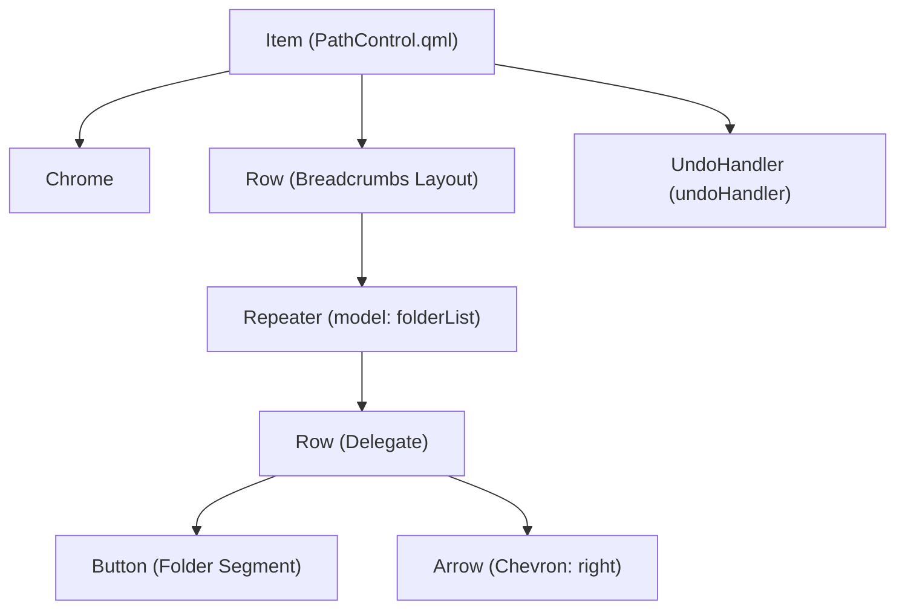

# UI Spec: PathControl
**File:** `app/qml/components/PathControl.qml`  **Pack:** `01-core-components.md`  **Legacy Reference:** `src/Classes/PathControl.lua`  **Status:** Test-Covered

--------------------------------------------------------------------------------

## 1. Purpose & Parity Notes
*   **Role:** Folder breadcrumb navigation bar (`Base > Folder1 > Folder2 > ...`) used in build list views. Enables users to navigate hierarchical build directories, click any ancestor folder segment to jump directly to it, and navigate back/forward through directory history via an integrated `UndoHandler`.
*   **Intentional Deviations from Legacy PoB:**
    *   *Component Composition:* Legacy PoB manually calculates string hitboxes and draws breadcrumbs via character offsets. PathControl constructs the breadcrumb path dynamically using a `Row` layout of `Button` components separated by `Arrow` chevron glyphs (`direction: "right"`).
    *   *Undo History Encapsulation:* Uses `UndoHandler.qml` internally to record subpath transitions, exposing `undoPath()`, `redoPath()`, `canUndo()`, and `canRedo()` helper methods.
    *   *Deferred Drag-and-Drop Highlight:* Legacy PoB features a green drag-over tint when dragging builds onto a breadcrumb segment (`otherDragSource`). This interaction is deferred pending Tier 4 build list drag integration.

--------------------------------------------------------------------------------

## 2. Lightweight Wireframe & Layout Box Model
# Component Box Model & Layout
```text
+-------------------------------------------------------------------------------+
| PathControl (implicitHeight: 24px, implicitWidth: 200px)                      |
| Chrome (anchors.fill: parent, surface fill)                                   |
| Row (anchors.fill: parent, margins: left/right 4px, spacing: 10px)            |
|   Repeater [folderList] (model: [{label, path}, ...])                         |
|     Row (spacing: 6px, verticalCenter)                                        |
|       Button (label: modelData.label, height: 20px, dynamic width)            |
|       Arrow (visible: index < count - 1, direction: "right", size: 8x8px)     |
| UndoHandler [undoHandler] (manages subPath undo/redo state history)           |
+-------------------------------------------------------------------------------+
```

# ASCII Anatomy & Wireframe
```text
+-------------------------------------------------------------------------------+
|  [ Builds ]  >  [ Witch ]  >  [ Necromancer ]                                 |
+-------------------------------------------------------------------------------+
   |<-- (1) -->| (2)|<-- (1) -->| (2)|<----- (1) ----->|

Annotations:
(1) Folder Segment Buttons: height is parent.height - 4px (20px). Sized dynamically to label width.
    Clicking a button sets subPath to that segment's cumulative path.
(2) Chevron Separator: Arrow component with direction: "right", 8x8px. Visible for all but the last item.
```

# Responsive / Overflow Rules
*   **Minimum safe width/height:** 160x24px. Expands to accommodate deep folder hierarchies.
*   **Horizontal layout:** Breadcrumbs layout horizontally via `Row`. Long paths extend to the right; callers should host PathControl within a horizontal flickable or clip container if paths exceed window bounds.
*   **Base Folder Fallback:** If `basePath` is empty, extracts or defaults `baseName` to `"Base"`.

# Component Hierarchy


--------------------------------------------------------------------------------

## 3. Interactive States & Controls
| Control (objectName) | Type | Default State | Interactive Behavior | Edge States (Disabled / Empty / Loading / Error / Long Text) |
| ------ | ------ | ------ | ------ | ------ |
| `pob.path.root` | Item | `subPath: ""` | Coordinates path updates and undo state | Shows base folder button when `subPath` is empty. |
| `pob.path.segment` | Button | Enabled | Sets `subPath` on click; invokes `onChange(newPath)` | Hover/pressed feedback on individual segments. |
| `pob.path.chevron` | Arrow | `direction: "right"` | Visual separator between path segments | Hidden for the rightmost (leaf) path segment. |
| `pob.path.undo` | UndoHandler | Empty history | Records subpath history; enables undo/redo | History resets on initial completion. |

# Complete State Matrix
*   **Root Directory:** `subPath: ""` -> Displays single `[ Base ]` button; no chevron arrows visible.
*   **Nested Directory:** `subPath: "Witch/Necromancer/"` -> Displays `[ Base ] > [ Witch ] > [ Necromancer ]`.
*   **Leaf Segment Active:** Rightmost segment is clickable (allows refreshing current directory).
*   **Undo Action:** Calling `undoPath()` restores previous `subPath` without creating a duplicate undo entry.

# State Matrix & Binding Hazards
*   *Trailing Slash Consistency:* Subpaths in PoB must consistently maintain trailing slashes (e.g. `"Folder1/Folder2/"`). `folderList` normalization splits on `/` and appends `/` to each segment's cumulative path to ensure exact directory matching in backend file lookups.
*   *Undo Loop Prevention:* When restoring state via `undoHandler`, the subpath must be updated with `noUndo: true` (`_setSubPath(state, true)`), preventing restored states from re-appending to the undo ring.

--------------------------------------------------------------------------------

## 4. Data & Bridge Contract
*   **Reads (Properties):**
    *   `basePath: string` -> root filesystem directory (e.g. `"builds/"`)
    *   `subPath: string` -> active relative subdirectory (e.g. `"Witch/LeagueStart/"`)
    *   `onChange: var` -> callback `function(newSubPath)`
*   **Writes / Methods Exposed:**
    *   `setSubPath(newSubPath: string)` -> pushes subpath and adds undo record
    *   `canUndo()` -> returns `bool`
    *   `canRedo()` -> returns `bool`
    *   `undoPath()` -> steps backward in directory history
    *   `redoPath()` -> steps forward in directory history
*   **Signals Observed:** None.
*   **Qt6 Bridge Safety:** Pure client-side navigation component; invokes `onChange` cleanly with string path payloads.

--------------------------------------------------------------------------------

## 5. Testable Acceptance Criteria (Qt6::QuickTest)
*   **AC-01 (Initial Render & Zero Warnings):** Given `basePath: "builds/"` and `subPath: ""`, when `PathControl.qml` mounts, 0 QML warnings are logged, `folderList.length === 1`, and 0 chevrons are visible.
*   **AC-02 (Breadcrumb Generation):** Given `subPath: "Poison/BladeVortex/"`, `folderList` produces 3 segments: `["builds", "Poison", "BladeVortex"]`, and exactly 2 chevrons are rendered.
*   **AC-03 (Ancestor Segment Navigation):** When the user clicks the `"Poison"` button, `onChange` is invoked with `"Poison/"`, and `subPath` updates to `"Poison/"`.
*   **AC-04 (Undo/Redo Navigation Ring):** Given navigation from `""` -> `"A/"` -> `"A/B/"`, calling `undoPath()` updates `subPath` to `"A/"`, and calling `redoPath()` returns it to `"A/B/"`.

--------------------------------------------------------------------------------

## 6. Bug Audit Findings (Current Implementation vs Spec)
| Severity | File & Line | Symptom / Defect | Root Cause | Expected Behavior |
| ------ | ------ | ------ | ------ | ------ |
| Medium | `app/qml/components/PathControl.qml:1880` | Navigating directories creates duplicate undo entries on external path updates. | Calling `addUndoState()` unconditionally without checking if path changed. | Guard with `if (newSubPath === root.subPath) return;`. |
| Low | `app/qml/components/PathControl.qml:1850` | Empty segment buttons appear if path contains double slashes. | `subPath.split("/")` leaving empty strings. | Filter empty segments: `filter(function (p) { return p.length > 0; })`. |
