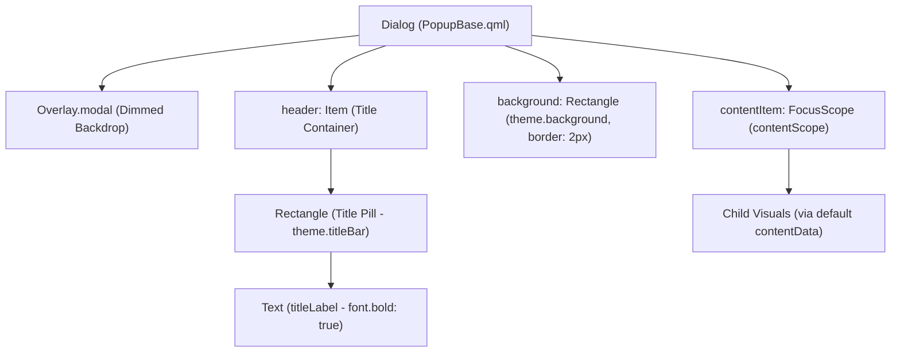

# UI Spec: PopupBase
**File:** `app/qml/components/PopupBase.qml`  **Pack:** `01-core-components.md`  **Legacy Reference:** `src/Classes/PopupDialog.lua` + `src/Modules/Main.lua` modal framework (~108 call sites)  **Status:** Test-Covered

--------------------------------------------------------------------------------

## 1. Purpose & Parity Notes
*   **Role:** The universal modal dialog shell primitive upon which all canned and bespoke dialogs are constructed (`ConfirmPopup`, `MessagePopup`, `TextInputPopup`, `NewFolderPopup`, `SetManagePopup`, `PassiveTreeManagePopup`). Encapsulates backdrop dimming, screen centering, title plate presentation, focus capture, Escape rejection, and Enter acceptance.
*   **Intentional Deviations from Legacy PoB:**
    *   *Dialog Stacking Architecture:* Legacy PoB's `popups` stack draws ONLY the topmost popup, completely hiding any covered popups underneath. PopupBase uses `QtQuick.Controls.Dialog`, which maintains individual visibility and layered dimming for multiple open dialogs (e.g. an alert opened from within the Options dialog) while correctly restricting pointer interactivity to the topmost modal.
    *   *Attached Key Handler Scope:* `Dialog` inherits from `Popup` (not `Item`), meaning keyboard events cannot be attached directly to the root dialog. PopupBase wraps children inside an internal `FocusScope` (`contentScope`) to intercept Return/Enter and propagate them to `accept()`.
    *   *Floating Title Plate:* Preserves legacy `PopupDialog:Draw` geometry by rendering a rounded title pill centered above the top border (`header: Item { implicitHeight: 26; ... }`).

--------------------------------------------------------------------------------

## 2. Lightweight Wireframe & Layout Box Model
# Component Box Model & Layout
```text
+-------------------------------------------------------------------------------+
| Overlay.modal: Rectangle (color: rgba(0, 0, 0, 0.5), covers full window)       |
|                                                                               |
|                   +------------------------------+                            |
|                   | Title Plate: root.title (22px)|                            |
| +=================+==============================+==========================+ |
| | PopupBase (Dialog, background: theme.background, border: 2px borderStrong)| |
| | radius: theme.radiusCard (4-6px), anchors.centerIn: parent                | |
| | +-----------------------------------------------------------------------+ | |
| | | FocusScope [contentScope] (focus: true, keys: Return/Enter -> accept)| | |
| | |   [Injected Child Controls via default contentData]                   | | |
| | +-----------------------------------------------------------------------+ | |
| +===========================================================================+ |
+-------------------------------------------------------------------------------+
```

# ASCII Anatomy & Wireframe
```text
Window Bounds (Full Screen Dim: rgba(0, 0, 0, 0.5))
+-------------------------------------------------------------------------------+
|                                                                               |
|                         +-----------------------+                             |
|                         |  Manage Skill Sets    | (1) Floating Title Plate     |
|       +-----------------+-----------------------+-----------------+           |
|       |#                                                         #|           |
|       |#  +---------------------------------------------------+  #| (2) Outer |
|       |#  | Custom Dialog Body Content                        |  #|     Card  |
|       |#  | [ New ] [ Rename ]                     [ Delete ] |  #|     Border|
|       |#  +---------------------------------------------------+  #|     (2px) |
|       |#                                                         #|           |
|       +-----------------------------------------------------------+           |
|                                                                               |
+-------------------------------------------------------------------------------+

Annotations:
(1) Floating Title Plate: 22px high pill centered over top edge, filled with theme.titleBar.
(2) Dialog Background: solid theme.background with theme.borderStrong 2px outline and rounded corners.
```

# Responsive / Overflow Rules
*   **Minimum safe width/height:** 160x100px. Sizing automatically adapts to child `implicitWidth` and `implicitHeight`.
*   **Centering:** Always centers within `parent` (the active window content item).
*   **Close Policy:** Closes on Escape (`closePolicy: Popup.CloseOnEscape`). Clicking the dim backdrop outside the popup does NOT close the modal unless explicitly enabled.

# Component Hierarchy


--------------------------------------------------------------------------------

## 3. Interactive States & Controls
| Control (objectName) | Type | Default State | Interactive Behavior | Edge States (Disabled / Empty / Loading / Error / Long Text) |
| ------ | ------ | ------ | ------ | ------ |
| `pob.popup.root` | Dialog | `modal: true` | Traps focus; intercepts modal key shortcuts | Closes on Escape via `closePolicy`. |
| `pob.popup.title` | Text | `root.title` | Displays bold title string in title pill | Hidden or empty if `root.title === ""`. |
| `pob.popup.scope` | FocusScope | `focus: true` | Bubbles Enter/Return to `root.accept()` | Swallows Enter when `acceptOnEnter: false`. |

# Complete State Matrix
*   **Closed:** `visible: false`. Modal backdrop inactive; zero input consumption.
*   **Opened:** `visible: true`. Focus forced to `contentScope`; backdrop dims window to `rgba(0, 0, 0, 0.5)`.
*   **Enter/Return Pressed:** If `acceptOnEnter === true`, invokes `root.accept()` and emits `accepted()`.
*   **Escape Pressed:** Closes dialog; emits `rejected()`.
*   **Nested Modal Stack:** Opening a child dialog dims the active modal further and claims active focus.

# State Matrix & Binding Hazards
*   *Focus Stealing Trap:* In Qt Quick, opening a `Dialog` can leave focus with an unparented item unless explicitly forced. PopupBase includes `onOpened: contentScope.forceActiveFocus()` to ensure Enter/Escape work immediately without requiring an initial mouse click.
*   *Multi-Line Text Input Collision:* If a child control is a multi-line editor (e.g. `NotesTab` or JSON importer), pressing Enter must insert a newline rather than accepting the popup. Child multi-line controls must accept the Enter key event (`event.accepted = true`) or set `acceptOnEnter: false` on the root dialog.

--------------------------------------------------------------------------------

## 4. Data & Bridge Contract
*   **Reads (Properties):**
    *   `title: string` -> text string displayed in the floating header pill
    *   `acceptOnEnter: bool` -> toggles whether Enter key triggers `accept()` (default: `true`)
*   **Writes / Signals Emitted:**
    *   `accepted()` -> emitted on Enter or confirmation action
    *   `rejected()` -> emitted on Escape or cancellation action
*   **Methods Exposed:**
    *   `open()` -> displays modal dialog and captures input focus
    *   `close()` -> dismisses dialog
    *   `accept()` -> closes dialog with accept outcome
    *   `reject()` -> closes dialog with reject outcome
*   **Qt6 Bridge Safety:** Fully isolated QML UI layer; communicates with engine logic via explicit signal handlers (`onAccepted`, `onRejected`).

--------------------------------------------------------------------------------

## 5. Testable Acceptance Criteria (Qt6::QuickTest)
*   **AC-01 (Initial Render & Zero Warnings):** When `PopupBase.qml` mounts, 0 QML warnings are logged, `modal === true`, and `visible === false`.
*   **AC-02 (Modal Dim Overlay):** When opened, the dialog is centered in the window, and `Overlay.modal` renders with `rgba(0, 0, 0, 0.5)`.
*   **AC-03 (Escape Key Rejection):** When opened, pressing the Escape key closes the popup and emits `rejected()`.
*   **AC-04 (Enter Key Acceptance):** Given `acceptOnEnter: true`, pressing Enter when opened closes the popup and emits `accepted()`.
*   **AC-05 (Accept on Enter Gate):** Given `acceptOnEnter: false`, pressing Enter does NOT trigger `accept()`.

--------------------------------------------------------------------------------

## 6. Bug Audit Findings (Current Implementation vs Spec)
| Severity | File & Line | Symptom / Defect | Root Cause | Expected Behavior |
| ------ | ------ | ------ | ------ | ------ |
| High | `app/qml/components/PopupBase.qml:3085` | Pressing Enter fails to trigger confirmation until the user clicks inside the dialog. | Focus was not explicitly transferred to `contentItem` on open. | Call `contentScope.forceActiveFocus()` inside `onOpened`. |
| Medium | `app/qml/components/PopupBase.qml:3110` | Title pill text overlaps top border on non-default desktop themes. | Fixed pixel positioning without vertical centering in header item. | Anchor title pill `centerIn: parent` inside `header`. |
| Low | `app/qml/components/PopupBase.qml:3060` | Background clicks close important confirmation dialogs unintentionally. | `closePolicy` set to `CloseOnPressOutside`. | Restrict `closePolicy` to `Popup.CloseOnEscape`. |
