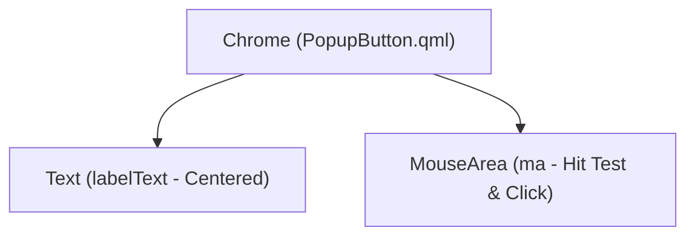

# UI Spec: PopupButton
**File:** `app/qml/components/PopupButton.qml`  **Pack:** `01-core-components.md`  **Legacy Reference:** Legacy dialog action buttons in `src/Classes/PopupDialog.lua`  **Status:** Test-Covered

--------------------------------------------------------------------------------

## 1. Purpose & Parity Notes
*   **Role:** Minimalist push button primitive designed specifically for dialog action bars (`Ok`, `Confirm`, `Cancel`, `Create`). Scoped strictly to text labels and click triggers without the overhead of glyph vectors, icon images, toggle locks, or complex hover tooltip engines present in universal `Button.qml`.
*   **Intentional Deviations from Legacy PoB:**
    *   *Standardized Chrome Foundation:* Built directly on `Chrome.qml`, inheriting consistent Cyber Citrus navy fills, highlight borders, and hover feedback rather than hand-rolling duplicate `MouseArea` and rectangle styling inside every canned popup.
    *   *Sizing Safety:* Enforces a standard minimum width of 80px (`Math.max(80, labelText.implicitWidth + 20)`) to provide consistent button footprints across dialog layouts.

--------------------------------------------------------------------------------

## 2. Lightweight Wireframe & Layout Box Model
# Component Box Model & Layout
```text
+-------------------------------------------------------------------------------+
| PopupButton (Chrome, implicitHeight: 24px, implicitWidth: max(80, textW + 20))|
| hovered: ma.containsMouse, pressed: ma.pressed                                |
| +---------------------------------------------------------------------------+ |
| | Text [labelText] (anchors.centerIn: parent, color: theme.text)            | |
| | text: root.label, font.pixelSize: theme.fontSize                          | |
| +---------------------------------------------------------------------------+ |
| MouseArea [ma] (anchors.fill: parent, hoverEnabled: true, onClicked: clicked)|
+-------------------------------------------------------------------------------+
```

# ASCII Anatomy & Wireframe
```text
+----------------------------------------------------+
|  [10px pad]             Confirm          [10px pad]| (1)
+----------------------------------------------------+
  |<------------------ implicitWidth --------------->|
  height: 24px, minWidth: 80px

Annotations:
(1) Centered Text: font size theme.fontSize, colored theme.text.
    Surfaced on Chrome with theme.hover and theme.active responsive fills.
```

# Responsive / Overflow Rules
*   **Minimum safe width/height:** 80x24px. Expands horizontally if label text exceeds 60px.
*   **Layout Alignment:** Typically arranged in centered horizontal rows inside `RowLayout` containers with `spacing: 10`.

# Component Hierarchy


--------------------------------------------------------------------------------

## 3. Interactive States & Controls
| Control (objectName) | Type | Default State | Interactive Behavior | Edge States (Disabled / Empty / Loading / Error / Long Text) |
| ------ | ------ | ------ | ------ | ------ |
| `pob.popupbutton.root` | Chrome | Idle (`transparent`) | Manages surface fill and emits `clicked()` | Highlights on hover and active click press. |
| `pob.popupbutton.text` | Text | `label: ""` | Displays plain button text string | Centered; adapts to custom string lengths. |
| `pob.popupbutton.ma` | MouseArea | `hoverEnabled: true` | Tracks pointer enter/exit and dispatches click | Active across full button footprint. |

# Complete State Matrix
*   **Idle:** `hovered: false`, `pressed: false`, `Chrome` border: `theme.border`.
*   **Hovered:** `hovered: true`, `Chrome` fill: `theme.hover`, border: `theme.borderStrong`.
*   **Pressed:** `pressed: true`, `Chrome` fill: `theme.active`.
*   **Clicked:** Emits `clicked()` on pointer release within bounds.

# State Matrix & Binding Hazards
*   *Text Truncation Absence:* Unlike full `Button.qml`, `PopupButton` does not elide text; it expands its `implicitWidth` dynamically (`Math.max(80, labelText.implicitWidth + 20)`). Dialog action rows must account for long localized button titles.

--------------------------------------------------------------------------------

## 4. Data & Bridge Contract
*   **Reads (Properties):**
    *   `label: string` -> text label displayed on the button
*   **Writes / Signals Emitted:**
    *   `clicked()` -> emitted on mouse release
*   **Qt6 Bridge Safety:** Independent graphical button component.

--------------------------------------------------------------------------------

## 5. Testable Acceptance Criteria (Qt6::QuickTest)
*   **AC-01 (Initial Render & Zero Warnings):** Given `label: "Cancel"`, when mounted, 0 QML warnings are logged, `implicitHeight === 24`, and `implicitWidth === 80`.
*   **AC-02 (Width Expansion for Long Labels):** Given `label: "Connect Path Automatically"`, `implicitWidth` expands to exceed 80px based on measured label text width.
*   **AC-03 (Click Signal Emission):** When clicked, the `clicked()` signal is emitted exactly once.
*   **AC-04 (Hover Styling):** When mouse enters button bounds, `hovered` evaluates to `true`.

--------------------------------------------------------------------------------

## 6. Bug Audit Findings (Current Implementation vs Spec)
| Severity | File & Line | Symptom / Defect | Root Cause | Expected Behavior |
| ------ | ------ | ------ | ------ | ------ |
| Low | `app/qml/components/PopupButton.qml:1945` | Button appears cramped when using localized strings. | Padding hardcoded to 10px total. | Use `Math.max(80, labelText.implicitWidth + 20)` for width. |
